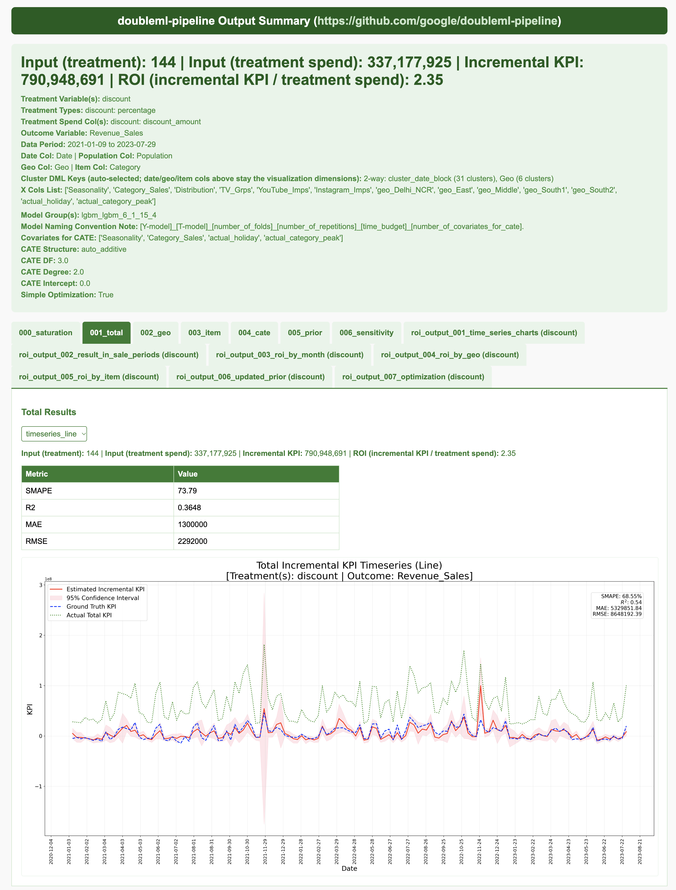
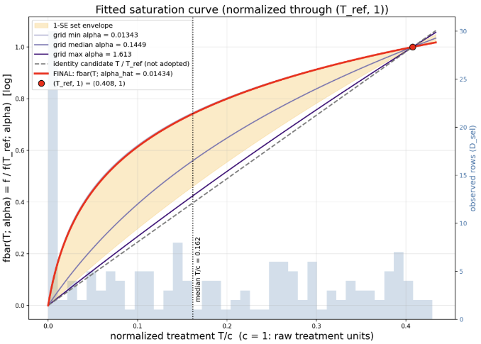
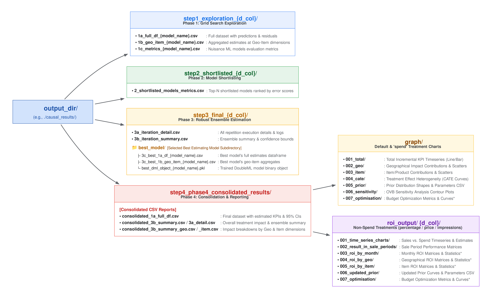
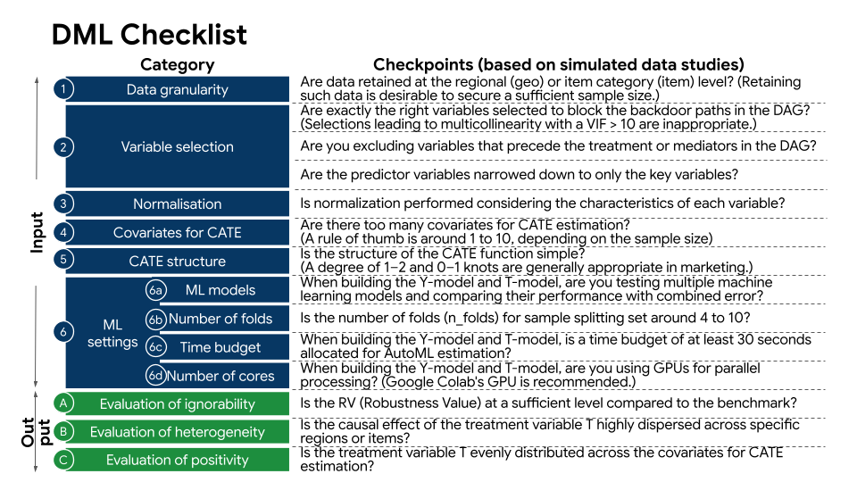

# doubleml-pipeline

[](https://pypi.org/project/doubleml-pipeline/)
[](https://www.python.org/downloads/)
[](LICENSE)

**Measure what your marketing actually caused — not what merely happened
alongside it.**

`doubleml-pipeline` estimates the incremental sales and ROI of promotions,
discounts, prices and media spend from the panel data you already have
(date × region × product). It uses Double Machine Learning (DML) to remove the
influence of confounders such as seasonality and holidays, and AutoML (FLAML)
to pick the nuisance models for you. You decide *what* to measure; the pipeline
runs model selection, cross-fitting, repetitions, confidence bounds,
sensitivity checks and reporting.

*Built by Google's APAC Marketing Effectiveness Taskforce. `doubleml-pipeline`
refers to and builds upon the underlying `DoubleML` Python package published by
[doubleml.org](https://docs.doubleml.org).*



*   📦 `pip install doubleml-pipeline`
*   🚀 [Quick start](#quick-start) — a dozen lines of code
*   📘 New to causal inference? Read
    [Double Machine Learning in 10 minutes](docs/concepts.md)
*   📓 [Example notebooks](#documentation) on realistic simulated marketing
    data — open them in Colab with one click
*   📚 [Documentation](#documentation) — user guide, Saturation DML, advanced
    internals, API reference, FAQ

> [!IMPORTANT]
> **Caveat on File Generation:** For verification purposes, `doubleml_pipeline`
> currently writes CSV files and charts for every step of the process.

## Table of contents

*   [Is it for me?](#is-it-for-me)
*   [What makes it different](#what-makes-it-different)
*   [Installation](#installation)
*   [Quick start](#quick-start)
*   [What you need to decide](#what-you-need-to-decide)
*   [How to read the results](#how-to-read-the-results)
*   [How it works](#how-it-works)
*   [Features](#features)
*   [Documentation](#documentation)
*   [Community](#community) · [License](#license) · [Citation](#citation)

--------------------------------------------------------------------------------

## Is it for me?

Use `doubleml-pipeline` when you want to answer questions such as:

*   *How much extra revenue did last quarter's discounts generate, and at what
    ROI?*
*   *Does TV spend still pay off, or has it saturated?*
*   *Where (regions, products) and when (months) does a promotion work best?*
*   *How should the budget be reallocated across regions and periods?*

**What it needs:** observational **panel data** — one row per period × region ×
product with the outcome, the treatment and the variables that drive both — and
a treatment that actually varies across rows.

**What it is not:** a replacement for an A/B test when you can run one. It also
cannot correct for drivers you did not measure; instead, its sensitivity
analysis tells you how strong such an unmeasured confounder would have to be to
overturn the result.

### Why Double Machine Learning?

Estimates from observational data suffer from confounding: seasonality,
holidays or competitor activity move both the treatment and the outcome, so a
naive comparison credits the treatment with their effect. DML removes what the
confounders can explain from both the outcome and the treatment with flexible
ML models, and estimates the effect from what is left. Two guarantees make this
trustworthy — *Neyman orthogonality* (small errors in the ML predictions do not
bias the effect) and *cross-fitting* (every row is predicted by a model that
never saw it) — and `doubleml-pipeline` adds the automation around it: model
selection, repetitions, confidence bounds and diagnostics. The
[10-minute introduction](docs/concepts.md) explains the idea without formulas.

--------------------------------------------------------------------------------

## What makes it different

Most DML libraries give you the estimator; you bring the learners, the tuning,
the repetitions, the diagnostics and the reporting. `doubleml-pipeline` wraps
all of those steps into one call and adds a capability built for marketing
data: a saturation-aware treatment model.

### An end-to-end, automated pipeline

`run_full_pipeline` takes your data frame and your choice of Y / T / X and runs
every step that is usually hand-written notebook code:

| Step | What the pipeline does | You set |
| :--- | :--- | :--- |
| Hyperparameter search | FLAML tunes every candidate learner once per treatment and side, within a time budget | `ml_models_y`, `ml_models_t`, `time_budget` |
| Candidate grid | every learner × fold setting is fitted in parallel and ranked by a combined error of the Y- and T-models | `n_folds_list`, `n_jobs` |
| Shortlist and repetitions | the best `top_n` candidates are re-estimated `n_reps` times into a weighted ensemble with an empirical 2.5–97.5% band | `top_n`, `n_reps` |
| Inference | 2-way Cluster DML whose keys are chosen automatically from item, geo and a date block | `geo_col`, `item_col`, `date_col` |
| Business units | scaled inputs are descaled exactly, so incremental KPI and ROI come back in real-world units | `CausalDataScaler` |
| Diagnostics | ground-truth comparison on simulated data and OVB sensitivity analysis with robustness values and benchmark covariates | `run_sensitivity`, `ground_truth_existence` |
| Outputs | CSVs for every phase, charts, a self-contained HTML report and `metadata.json` | `output_dir` |

Details: [How it works](#how-it-works) and
[Advanced configuration & internals](docs/advanced.md).

### Saturation DML (optional Phase 0)

Media spend has diminishing returns, and a linear treatment effect misprices
the next dollar. Phase 0 estimates a response curve `f(T; alpha)` (`tanh`,
`exp`, `log` or `power`) *before* the DML phases, decides with a
one-standard-error test whether the curve beats a straight line, and hands the
transformed treatment to Phases 1–4 — so the effect, the CATE and the ROI all
account for saturation. On top of it sits a saturation-aware budget optimizer:
a one-pass KKT allocation across regions, products and periods under a fixed
budget or an ROI target, with six identification diagnostics that tell you when
the data cannot pin the curve down. Enabling it is a one-key change
(`saturation_config={"saturation": {"family": "tanh"}}`).
[Read more →](docs/saturation.md)



--------------------------------------------------------------------------------

## Installation

Before running the pipeline, ensure you have:

*   **Python 3.10** or later.

You can install the library directly from PyPI:

```bash
pip install doubleml-pipeline
```

Alternatively, to install from source:

```bash
git clone https://github.com/google/doubleml-pipeline.git
cd doubleml-pipeline
pip install .
```

--------------------------------------------------------------------------------

## Quick start

### Basic example

Here is how to initialize and run the causal pipeline in a standard Python
environment. The orchestrator is shown with its **required** parameters only —
plus `treatment_types`, `treatment_spend_cols` and `sales_col`, which a
non-`spend` treatment such as a discount rate needs for its ROI.

> [!TIP]
> **Ready-to-Use Simulation Datasets:** Don't have a dataset on hand? We have
> prepared realistic marketing simulation datasets and end-to-end sample
> notebooks in the [`examples/`](examples/) directory. Feel free to use them to
> explore the pipeline and test its features right away!

```python
# Note: Module name uses underscores (_) instead of hyphens (-)
from doubleml_pipeline.preprocessing.scalers import CausalDataScaler
from doubleml_pipeline.workflow import CausalWorkflowOrchestrator
import pandas as pd

# 1. Load your dataset
df = pd.read_csv("path/to/your/marketing_data.csv")

# 2. Initialize the scaler with explicit scaling strategies per column
scaler = CausalDataScaler(
    standardize_cols=["holiday_index", "seasonality_factor"],
    population_standardize_cols=["competitor_spend"],
    population_median_normalize_cols=["sales_revenue", "tv_spend"],
    min_max_cols=["store_count"],
    median_normalize_cols=["discount_rate"],
    population_col="geo_population",
)

# 3. Initialize the orchestrator (required parameters only)
orchestrator = CausalWorkflowOrchestrator(
    y_col="sales_revenue",
    d_cols=["discount_rate"],
    x_cols_list=[
        ["holiday_index", "seasonality_factor", "competitor_spend"],
    ],
    ml_models_y=["lgbm", "xgboost"],
    ml_models_t=["lgbm", "xgboost"],
    n_folds_list=[5],
    output_dir="./causal_results",
    # A discount rate is a "percentage" treatment: declare its type, the
    # column holding its monetary cost (for ROI) and the sales column.
    treatment_types={"discount_rate": "percentage"},
    treatment_spend_cols={"discount_rate": "discount_cost"},
    sales_col="sales_revenue",
)

# 4. Execute the full 4-phase pipeline
#    (Grid Search -> Shortlist -> Ensemble -> Consolidation)
orchestrator.run_full_pipeline(
    df=df,
    scaler=scaler,
    top_n=3,
    n_reps=10,
)
```

The orchestrator will execute the models in parallel, select the best
estimators, run repetitions to calculate robust confidence bounds, and write all
dataframes, charts and the HTML report to the specified `./causal_results`
directory.

### Saturation DML example

To model diminishing returns of the treatment (for example, deeper discounts
adding less and less incremental sales), add a `saturation_config` with a
`saturation` block to the same parameters. This enables **Phase 0**, which
estimates the saturation curve `f(T; alpha)` of the treatment before the DML
phases; see [Saturation DML](docs/saturation.md) for every key and its default.

```python
from doubleml_pipeline.workflow import CausalWorkflowOrchestrator

orchestrator = CausalWorkflowOrchestrator(
    y_col="sales_revenue",
    d_cols=["discount_rate"],
    x_cols_list=[
        ["holiday_index", "seasonality_factor", "competitor_spend"],
    ],
    ml_models_y=["lgbm", "xgboost"],
    ml_models_t=["lgbm", "xgboost"],
    n_folds_list=[5],
    output_dir="./causal_results_saturation",
    treatment_types={"discount_rate": "percentage"},
    treatment_spend_cols={"discount_rate": "discount_cost"},
    sales_col="sales_revenue",
    # "tanh" (default) | "exp" | "log" | "power"
    saturation_config={"saturation": {"family": "tanh"}},
)
```

Run it with the same `run_full_pipeline(...)` call as above. Two things to keep
in mind:

*   A saturated treatment must be left unscaled or use a **divisive**
    normalization — `median_normalize_cols` (as `discount_rate` above) or
    `population_median_normalize_cols`. `standardize`,
    `population_standardize` and `min_max` shift the treatment and are rejected
    by Phase 0 with a `ValueError`.
*   The saturation-aware budget optimizer (`optimize=True`) exists for
    `treatment_types = "spend"` only. For a `percentage` treatment such as
    `discount_rate`, Phases 0–3 still use the saturation curve, but Phase 4
    runs the simple optimizer: the orchestrator forces
    `simple_optimization=True` at construction and says so with a warning.

--------------------------------------------------------------------------------

## What you need to decide

The pipeline automates model selection, cross-fitting and reporting. Three
choices remain yours, and they decide whether the estimate has a causal
meaning:

| Role | Parameter | Plain meaning | Example |
| :--- | :--- | :--- | :--- |
| Outcome **Y** | `y_col` | the KPI you want to move | `sales_revenue` |
| Treatment **T** | `d_cols` | the lever you control | `discount_rate` |
| Confounders **X** | `x_cols_list` | variables that drive *both* T and Y | `holiday_index`, `seasonality_factor`, `competitor_spend` |

Your data should have one row per `date × geo × item` (geo and item are
optional but recommended — they feed the cluster-robust inference and the
breakdown charts):

| date | geo | item | sales_revenue | discount_rate | discount_cost | holiday_index | seasonality_factor | competitor_spend | geo_population |
| :--- | :--- | :--- | ---: | ---: | ---: | ---: | ---: | ---: | ---: |
| 2024-01-07 | tokyo | shampoo | 12,430 | 0.10 | 1,243 | 0 | 0.92 | 8,100 | 13,960,000 |
| 2024-01-07 | osaka | shampoo | 7,210 | 0.00 | 0 | 0 | 0.95 | 5,400 | 8,840,000 |
| 2024-01-14 | tokyo | shampoo | 14,980 | 0.15 | 2,247 | 1 | 1.08 | 8,300 | 13,960,000 |

> [!WARNING]
> Do **not** put variables that are *caused by* the treatment (store traffic
> after a promotion, search volume driven by a campaign) into `x_cols_list`:
> they absorb part of the effect you want to measure. Include the variables
> that influence both the treatment decision and the outcome, keep the list
> short, and check multicollinearity (VIF). The [User Guide](docs/guide.md)
> walks through this with a worked example.

Everything else — panel dimensions (`date_col`, `geo_col`, `item_col`), CATE
covariates, sensitivity analysis, treatment types, optimization — has a default
and is documented in the [API Reference](docs/api_reference.md).

--------------------------------------------------------------------------------

## How to read the results

Every run writes to `output_dir`:

*   **The HTML report** `<treatment>_<outcome>[_<family>].html` (for example
    `discount_rate_sales_revenue.html`; several treatments are joined with `-`,
    and `_<family>` is appended only when saturation is enabled) — one
    self-contained file with every chart and the summary tables.
*   **CSV files** for every phase, documented in the
    [Output CSV Schema](docs/output_csv_schema.md). The consolidated results live
    in `step4_consolidated_results/`.
*   `metadata.json` with the run configuration.

Three numbers answer most questions:

1.  **Incremental KPI** — how much of the outcome the treatment caused, with
    the empirical 2.5–97.5% band from the `n_reps` repetitions
    (`step4_consolidated_results/graph/001_total/`; per region and product in
    `002_geo/` and `003_item/`).
2.  **ROI vs. threshold** — incremental KPI ÷ spend, compared with
    `opt_threshold_roi` (default `1.0`). Below the line, the money is better
    spent elsewhere.
3.  **Robustness value (RV)** — how strong an *unmeasured* confounder would
    have to be to explain the effect away (`graph/006_sensitivity/`, with
    `run_sensitivity=True`). Compare it with the benchmark covariate: if the RV
    is smaller, treat the result with caution.

The screenshot at the top of this page shows the first of them: the
`001_total` tab with the incremental KPI, the ROI and the time series of the
estimated effect against the known ground truth of a simulated dataset.

Then look at *where* and *when* the effect is largest — the CATE charts in
`graph/004_cate/` and, for `percentage` / `impressions` / `price` treatments,
the ROI breakdowns under `roi_output/<treatment>/` — and run the validation
checks (ignorability, heterogeneity, positivity) described in the
[User Guide](docs/guide.md) before acting on the numbers.

### Analyzing results with AI agents

The repository bundles a lightweight Agent Skill
([`skills/causal-insights`](skills/causal-insights/SKILL.md)) that teaches AI
agents how to read any completed `output_dir` with exact metric definitions
([`metric_formulas.md`](skills/causal-insights/references/metric_formulas.md)),
causal interpretation rules, diagnostics checks, and mandatory
**Fact / Inference / Hypothesis** tagging. No extra dependencies beyond Python,
`numpy`, and `pandas` are required.

Install from GitHub with the Agent Skills CLI:

```bash
npx skills add google/doubleml-pipeline
```

Then ask your agent, for example:
*"Analyze `./causal_results` and summarize which treatments paid back, where and
when they worked best, whether the estimates pass diagnostics, and how budget
should shift."*

--------------------------------------------------------------------------------

## How it works

```text
Phase 0 (optional)  Saturation: estimate the diminishing-returns curve f(T; alpha)
                    and hand fbar(T) to the next phases      -> docs/saturation.md
Phase 1             Grid search: fit the Y- and T-models for every candidate
                    learner x fold setting, in parallel
Phase 2             Shortlist: rank the candidates by combined error, keep top_n
Phase 3             Repetitions: re-estimate the shortlist n_reps times and build
                    a weighted ensemble with empirical 2.5-97.5% bounds
Phase 4             Consolidate & report: CATE, incremental KPI, ROI, sensitivity
                    analysis, budget optimization, charts, HTML report
```

When the pipeline runs, it saves all intermediate evaluation metrics, candidate
model repetitions, consolidated datasets, and visualization plots within the
specified `output_dir` (e.g., `./causal_results/`) as shown below:



The cross-fitting folds and the standard errors use a **2-way Cluster DML**
whose keys are chosen automatically from `item_col`, `geo_col` and a date block
derived from `date_col`; the hyperparameters of the nuisance models are searched
once per treatment and learner (`hparam_policy="global"`). Both are described in
[Advanced configuration & internals](docs/advanced.md).

--------------------------------------------------------------------------------

## Features

*   **AutoML nuisance models** — FLAML searches and tunes the learners you list
    (`"lgbm"`, `"xgboost"`, `"rf"`, …) within `time_budget` seconds, once per
    treatment and learner.
*   **Model selection with repetitions** — candidates are ranked by a combined
    error of the Y- and T-models, the best `top_n` are re-estimated `n_reps`
    times, and the effect is reported with empirical confidence bounds.
*   **Heterogeneous effects (CATE)** — B-spline bases over the covariates you
    choose (`covariates_for_cate_list`) show how the effect varies by season,
    region or product.
*   **Sensitivity analysis (OVB)** — robustness values and benchmark covariates
    (Cinelli & Hazlett 2020) quantify how strong an unmeasured confounder would
    have to be; details in
    [Advanced configuration & internals](docs/advanced.md#sensitivity-analysis-details).
*   **Saturation DML (optional)** — Phase 0 estimates diminishing returns
    `f(T; alpha)` (`tanh`, `exp`, `log` or `power`) and the DML phases run on
    the transformed treatment. See [Saturation DML](docs/saturation.md).
*   **Budget optimization** — a simple ROI-threshold optimizer or, for `spend`
    treatments with saturation, a one-pass KKT allocation under a fixed budget
    or an ROI target. See
    [Saturation-aware optimization](docs/saturation.md#saturation-aware-optimization).
*   **Safe business-unit scaling** — population- and median-based normalization
    with exact descaling, so KPI and ROI come back in real-world units.
*   **Priors for Bayesian MMM** — fitted Normal / LogNormal / Beta parameters of
    the treatment contribution (%) and ROI, ready to use as prior knowledge
    (mind that CATE varies with conditions such as seasonality, and that MMM
    estimates an ATE while DML reports a CATE).
*   **Reports** — CSVs ([schema](docs/output_csv_schema.md)), publication-ready
    charts and a self-contained HTML report.
*   **Agent Skills** —
    [`skills/causal-insights`](skills/causal-insights/SKILL.md) equips AI agents
    with pipeline-accurate metric formulas, causal trust checks and a structured
    report template over any `output_dir`.

--------------------------------------------------------------------------------

## Documentation

| Document | Read it when |
| :--- | :--- |
| [Double Machine Learning in 10 minutes](docs/concepts.md) | you are new to causal inference or want the vocabulary (Y / T / X, CATE, cross-fitting) mapped to the parameters |
| [User Guide](docs/guide.md) | you are preparing data, choosing variables and normalization, setting up CATE and the ML options, or validating a result — a chapter per step of the workflow, with a worked case study and a checklist |
| [Saturation DML](docs/saturation.md) | your treatment has diminishing returns (media spend) or you want the saturation-aware budget optimizer |
| [Advanced configuration & internals](docs/advanced.md) | treatment types and ROI charts, optimization modes, Cluster DML keys, hyperparameter policy, parallelism, sensitivity formulas |
| [FAQ](docs/faq.md) | something errors, warns, or takes longer than expected |
| [API Reference](docs/api_reference.md) | you need every parameter, default and return value |
| [Output CSV Schema](docs/output_csv_schema.md) | you are reading the CSV outputs programmatically |
| [Slides](docs/slides.md) | you want the original slide deck of the User Guide (one image per slide) for a presentation |
| Example notebooks: [`IN_skincare`](examples/IN_skincare/doubleml-pipeline_sample_notebook_IN.ipynb) [](https://colab.research.google.com/github/google/doubleml-pipeline/blob/main/examples/IN_skincare/doubleml-pipeline_sample_notebook_IN.ipynb), [`JP_retailer`](examples/JP_retailer/doubleml-pipeline_sample_notebook_JP.ipynb) [](https://colab.research.google.com/github/google/doubleml-pipeline/blob/main/examples/JP_retailer/doubleml-pipeline_sample_notebook_JP.ipynb) | you want an end-to-end run — loading realistic simulated panel data, engineering lagged features, scaling, running the pipeline and plotting the results (a single discount-rate treatment in `IN_skincare`; multi-treatment, lagged flyer spend and a custom CATE formula in `JP_retailer`) |

[](docs/guide.md#10-checklist)

--------------------------------------------------------------------------------

## Community

We welcome contributions!

*   **Reporting Issues**: If you encounter bugs or want to request features,
    please open an issue in the GitHub repository issue tracker.
*   **Submitting Changes**: Please see [CONTRIBUTING.md](CONTRIBUTING.md) for our guidelines on
    submitting pull requests.

## License

Apache License 2.0 — see [LICENSE](LICENSE).

## Citation

If you use `doubleml-pipeline` in your work, please cite the repository
(GitHub offers the same reference under *Cite this repository*, generated from
[CITATION.cff](CITATION.cff)):

```text
@software{doubleml_pipeline,
  title   = {doubleml-pipeline: automated causal inference with Double Machine
             Learning and AutoML},
  author  = {{Google LLC}},
  year    = {2026},
  version = {0.2.2},
  url     = {https://github.com/google/doubleml-pipeline}
}
```

--------------------------------------------------------------------------------

## Acknowledgments & Dataset Credits

We gratefully acknowledge our partners for their collaboration on the simulation
datasets included under [`examples/`](examples/):

*   **[`examples/IN_skincare/`](examples/IN_skincare/)**: Simulation data and
    example materials provided in collaboration with **Analytic Edge**.
*   **[`examples/JP_retailer/`](examples/JP_retailer/)**: Simulation data
    designed and provided by **Hakuhodo Inc.**, informed by real-world Japanese
    marketing dynamics.

--------------------------------------------------------------------------------

## References

1.  **Debiased Machine Learning method** Victor Chernozhukov, Denis Chetverikov,
    Mert Demirer, Esther Duflo, Christian Hansen, Whitney Newey, James Robins.
    *Double/debiased machine learning for treatment and structural parameters*.
    [arXiv:1608.00060](https://arxiv.org/abs/1608.00060)

2.  **Hyperparameter Tuning for Causal Inference with Double Machine Learning: A
    Simulation Study** Martin Spindler, et al.
    [arXiv:2402.04674](https://arxiv.org/abs/2402.04674)

3.  **Debiased Machine Learning of Conditional Average Treatment Effects and
    Other Causal Functions** Vira Semenova, Victor Chernozhukov.
    [arXiv:1702.06240](https://arxiv.org/abs/1702.06240)

4.  **Multiway Cluster Robust Double/Debiased Machine Learning** Harold D.
    Chiang, Kengo Kato, Yukitoshi Matsushita, Takuya Ishihara.
    [arXiv:1909.03489](https://arxiv.org/abs/1909.03489)
