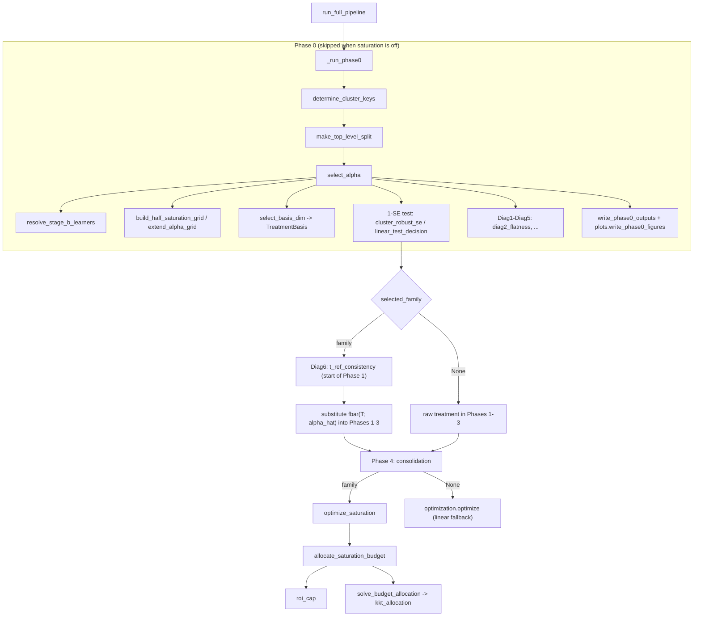

# `doubleml-pipeline` API Reference

This document outlines the core public classes and functions available in the
`doubleml-pipeline` package.

--------------------------------------------------------------------------------

## Module: `doubleml_pipeline.workflow`

### Class: `CausalWorkflowOrchestrator`

The central manager for orchestrating the DoubleML execution pipeline, handling
parallelization, model selection, and visual reporting.

#### `__init__(self, y_col, d_cols, x_cols_list, ml_models_y, ml_models_t, n_folds_list, output_dir, n_jobs=-1, covariates_for_cate_list=None, cate_structure_list=None, time_budget=15, date_col=None, geo_col=None, item_col=None, geo_name_col=None, item_name_col=None, run_sensitivity=False, sensitivity_scope=None, ground_truth_existence=False, ground_truth_effect_column=None, treatment_types=None, treatment_spend_cols=None, sales_col=None, peak_months=None, optimize=False, simple_optimization=None, opt_periods=None, opt_threshold_roi=1.0, opt_other_cost_variables=None, generate_html=True, opt_geos=None, opt_items=None, saturation_config=None, hparam_policy="global", generate_agent=True)`

**Parameters:**

-   `y_col` *(str)*: The outcome variable column name. Example: `'sales'`.
-   `d_cols` *(List[str])*: List of treatment variable column names. Example: `['discount_rate', 'tv_spend']`.
-   `x_cols_list` *(List[List[str]])*: List of confounding variables
    corresponding to each treatment variable. Example:
    `[['seasonality', 'competitor_price'], ['seasonality', 'macro_indicator']]`.
-   `ml_models_y` *(List[str])* / `ml_models_t` *(List[str])*: Candidate models
    for AutoML. Example: `['lgbm', 'xgboost', 'rf']`.
-   `n_folds_list` *(List[int])*: Candidate fold numbers for cross-fitting.
    Example: `[5, 10]`.
-   `output_dir` *(str)*: Path to the directory where results and artifacts will
    be saved. Example: `'./results/causal_output/'`.
-   `n_jobs` *(int, default=-1)*: Number of parallel jobs. `-1` uses all
    available CPU cores. Example: `-1` or `4`.
-   `covariates_for_cate_list` *(Optional[List[List[str]]])*: Variables to
    estimate Conditional Average Treatment Effects (CATE). Example:
    `[['geo_region'], ['store_type']]`.
-   `cate_structure_list` *(Optional[List[Any]])*: Specifies the CATE functional
    form. Example: `['auto_additive', 'auto_additive']`.
-   `time_budget` *(int, default=15)*: Time limit in seconds for FLAML AutoML
    tuning per model. Example: `30`.
-   `date_col` *(Optional[str])*: Date column name. Example: `'date'`.
-   `geo_col` *(Optional[str])*: Geography column name. Example: `'region_id'`.
-   `item_col` *(Optional[str])*: Item column name. Example: `'product_id'`.
-   `geo_name_col` *(Optional[str])*: Column containing geographical names (used
    for descriptive aggregation). Example: `'region_name'`.
-   `item_name_col` *(Optional[str])*: Column containing item names (used for
    descriptive aggregation). Example: `'product_name'`.
-   `run_sensitivity` *(bool, default=False)*: Whether to execute robust
    sensitivity bounds analysis. Example: `True`.
-   `sensitivity_scope` *(Optional[List[str]], default=['total'])*: Scope for
    sensitivity bounds analysis. Options include `'total'`, `'geo'`, or
    `'item'`. Example: `['total', 'item']`.
-   `ground_truth_existence` *(bool, default=False)*: Set to `True` if ground
    truth treatment effects are available for evaluation. Example: `False`.
-   `ground_truth_effect_column` *(Optional[List[str]], default=[])*: Column
    names containing ground truth effects for each treatment variable. Example:
    `['true_effect_discount', 'true_effect_tv']`.
-   `treatment_types` *(Optional[Dict[str, str]], default=None)*: Treatment type
    classification. Default type is `"spend"`. Note: Phase 4 ROI charts are
    generated only for `"percentage"`, `"impressions"`, or `"price"` (requires
    `treatment_spend_cols`). For `"spend"`, they are skipped as they are
    redundant with Phase 5 optimization. Example:
    `{'discount_rate': 'percentage', 'tv_spend': 'spend'}`.
-   `treatment_spend_cols` *(Optional[Dict[str, str]], default=None)*: Maps
    treatment variables to their monetary spend columns. Automatically maps to
    the treatment itself if type is `"spend"`. Example:
    `{'discount_rate': 'discount_cost'}`.
-   `sales_col` *(Optional[str], default=None)*: Outcome sales column, used for
    calculating ROI and optimization. Example: `'total_sales'`.
-   `peak_months` *(Optional[List[int]], default=None)*: List of peak months
    (1-12) to highlight in ROI charts. Defaults to `[3, 7, 11, 12]` if not
    specified. Example: `[11, 12]`.
-   `optimize` *(bool, default=False)*: Whether to run the optimization phase
    (Phase 5). Example: `True`.
-   `simple_optimization` *(Optional[bool], default=None)*: Selects the
    optimizer. See the table below. `None` means **derive it**: `False` when a
    saturation family is configured (i.e. the `saturation` block is present,
    with `family` defaulting to `'tanh'`), `True` otherwise — so
    turning saturation on only means adding the block. An explicit
    `True`/`False` always wins for `spend` treatments. **Non-`spend` treatment
    types (`percentage` / `impressions` / `price`) always force `True`** (with
    a warning when the derived or explicit value was `False`): the
    saturation-aware optimizer is only implemented for `treatment_type='spend'`.
    Even with `False`, a treatment for which Phase 0 selects the linear model
    (`selected_family=None`) automatically uses the existing optimizer with a
    warning; the value itself is not rewritten. The value in force is
    written to `metadata.json["simple_optimization"]` and shown in the HTML
    header (`Simple Optimization: True/False`). Example: `False`.
-   `opt_periods` *(Optional[tuple[Any, Any]], default=None)*: Tuple of start
    and end periods for optimization. Example: `('2023-01-01', '2023-12-31')`.
-   `opt_threshold_roi` *(float, default=1.0)*: ROI
    threshold `r >= 0` (`workflow.DEFAULT_THRESHOLD_ROI = 1.0`). Defaults to
    `1.0` across every optimizer mode (`simple_optimization=True`,
    `simple_optimization=False` with `budget_mode='fixed'` or `'roi_target'`,
    and the linear fallback). A negative value raises
    `ValueError` at initialization. Applied per row (instance) in both
    optimizers: in the saturation-aware optimizer it is the per-unit constraint
    `ROI_t(T_t) >= r`, enforced as the cap `T_t <= T_t^r` (see
    `optimize_saturation`); in the simple optimizer it cuts rows inside
    `opt_periods` whose row-level `ROI < r` (see `optimize`). Pass `0.0` in
    `fixed` or simple mode for no ROI floor. Example: `1.5`.
-   `opt_geos` *(Optional[List[Any]], default=None)* / `opt_items`
    *(Optional[List[Any]], default=None)*: The geos / items whose
    rows are allocation units of the saturation-aware optimizer; `None` = all
    rows (when the column is set). Giving a value without the corresponding
    `geo_col` / `item_col` raises `ValueError`. Rows outside the scope keep
    their actual values in the `optimized_*` columns. Example: `['tokyo']`.
-   `opt_other_cost_variables` *(Optional[List[str]], default=None)*: Other cost
    variables to include in optimization. Example: `['fixed_marketing_cost']`.
-   `generate_html` *(bool, default=True)*: Whether to emit the interactive HTML
    report. Example: `False`. The report is written to
    `<output_dir>/<treatment>_<outcome>_<family>.html`, where `<treatment>` is
    every treatment column joined with `-` and `<family>` is the *configured*
    family (`'tanh'` when the `saturation` block omits `family`); the
    `_<family>` segment is omitted when saturation is off (no block, or
    `family: None`). Example: `tv_spend-digital_spend_sales_tanh.html`. The
    report gains a `000_saturation` tab with the Phase 0 figures and decision
    when saturation is on.
-   `hparam_policy` *(str, default=`"global"`)*: How the nuisance
    hyperparameters of Phases 1–3 are chosen.
    `"global"`: one FLAML search per (treatment, learner) at the start of
    Phase 1 — on the sample Phases 1–3 are fitted on, target `Y` for the
    Y-side learners and the PLR treatment `D` (`f̄(T; α̂)` when Phase 0 adopted
    a family, `T` otherwise) for the T-side learners, `time_budget` seconds,
    `eval_method="auto"`, `early_stop=True`, seed 1 — whose winner is then
    fitted with fixed hyperparameters (`models.fixed_hparam_regressor.FixedHparamRegressor`)
    in every cross-fitting fold of every Phase 1 / Phase 3 run; the results are
    written to `step1_exploration_<d_col>/hparams_<d_col>_<learner>.json`.
    `"per_fold"`: the previous behaviour, a FLAML search inside every fold.
    Any other value raises `ValueError`. The policy does not change the DML
    estimation (cross-fitting, CATE, repetitions, median aggregation), the
    combined-error ranking or any Phase 4 output; it has no effect on Phase 0.
    Example: `"per_fold"`.
-   `generate_agent` *(bool, default=True)*: Whether to write an ADK agent that
    analyzes the results to `<output_dir>/agents/causal_ml_insight_agent/`
    (see [`doubleml_pipeline.agent`](#module-doubleml_pipelineagent)).
    Run it with `adk web <output_dir>/agents`. Example: `False`.

> [!NOTE]
> Compute-time behaviour that applies under **both** policies: Phase 1
> results are reused as repetition 0 of Phase 3; Phase 3 runs all
> `(candidate, repetition)` jobs as one parallel job list whose workers return
> only the aggregated items; the scaler and the CATE basis are built once per
> treatment; each parallel section uses `W = min(tasks, cores)` workers with
> `h = cores // W` learner threads (a positive `n_jobs` replaces `cores`),
> FLAML gets `early_stop=True`; and the sensitivity analysis fits the
> benchmark's short model once per treatment with group-specific benchmark
> points (columns `benchmark_rho`, `benchmark_scope`). The parallel sections
> use joblib's `loky` process backend; where loky cannot spawn worker
> processes (e.g. an embedded interpreter with `sys.executable is None`) the
> environment variable `DOUBLEML_JOBLIB_BACKEND=multiprocessing` selects the
> fork-based pool, with `h` applied through `OMP_NUM_THREADS` & co. instead of
> `inner_max_num_threads`.

**Optimization modes:**

"Configured family" below means the `saturation` block is present (family
defaulting to `'tanh'`); `None` means no block or an explicit `family: None`.
"Phase 0 result" is the per-treatment `selected_family` returned by the
1-SE linear test.

| `optimize` | `simple_optimization` | Configured family | Phase 0 result | `treatment_type` | Behaviour |
| :--- | :--- | :--- | :--- | :--- | :--- |
| `False` | any | any | any | any | No optimization phase. |
| `True` | `True` | any | any | any | Existing simple optimizer (`opt_threshold_roi` applied per row). |
| `True` | `False` | set | family | `spend`, one treatment | **Saturation-aware optimizer** (one KKT pass with the ROI cap, see `optimize_saturation`). |
| `True` | `False` | set | `None` | `spend` | **Linear fallback**: warns *"saturation was not identified; falling back to linear optimization"* and runs the existing optimizer. |
| `True` | `False` | set | any | `spend`, several treatments | Warns and **falls back to the existing optimizer** (saturation-aware optimization for several treatments is future work). |
| `True` | *(forced to `True`)* | any | any | `percentage` / `impressions` / `price` | `simple_optimization` is **forced to `True` at construction** (warning when it was `False`) and the existing optimizer runs; the saturation-aware optimizer needs a cost model `spend = g(treatment)` that is not specified yet. |
| `True` | `False` | `None` | — | `spend` | **Raises `ValueError`** at construction. |

For `spend` treatments `simple_optimization=False` is never
overridden to `True` when `saturation_config` is given (earlier versions did
that with a warning), and `budget_mode='roi_target'` together with
`opt_threshold_roi=0` raises `ValueError` at construction (the default
`opt_threshold_roi=1.0` satisfies `roi_target` out of the box).

> [!IMPORTANT]
> The last row is a **behaviour change**. Previously this combination emitted a
> warning and silently fell back to `simple_optimization=True`. Under the linear
> PLR the budget allocation problem is a *linear program*, so its optimum is a
> corner solution that dumps the entire budget on one time point — a silently
> meaningless answer. It now fails loudly instead.

> [!NOTE]
> The non-spend fallback row exists because the saturation allocator budgets the
> treatment column directly, i.e. it assumes `g(T) = T`. For a discount rate or
> an impression count that constraint is not denominated in money, so a cost
> model `spend = g(treatment)` is required before saturation-aware optimization
> is meaningful. Phases 0–3 still run with saturation for these treatments; only
> the Phase 4 optimizer falls back.

**Saturation DML parameters:**

Every saturation setting lives in **one** dictionary, `saturation_config`.
Omit it and the previous behaviour is reproduced exactly.

-   `saturation_config` *(Optional[Dict[str, Any]], default=None)*: The single
    entry point for Saturation DML. Recognized top-level blocks are `saturation`,
    `alpha_selection`, `final_fit` and `optimization`. **The presence of the
    `saturation` block enables Phase 0.** Inside the block `family` defaults to
    `'tanh'`, and every other key has a sensible default, listed in the
    tables below. Example: `{'saturation': {'family': 'exp'}}`.

> [!IMPORTANT]
> `saturation_config` is **strictly validated**. An unrecognized block, key, or
> `saturation.grid` / `alpha_selection.learners` key raises `ValueError`, and a
> block that is not a dict raises `TypeError`. This is deliberate: because the
> *presence* of the `saturation` block is what enables Phase 0 and `family`
> silently defaults to `'tanh'`, a typo such as `saturaton` would
> otherwise skip Phase 0 and hand back an ordinary linear run, and `familly`
> would quietly run the default family instead of the intended one.

> [!WARNING]
> **Breaking change.** The `saturation=`, `alpha_selection=`, `final_fit=` and
> `budget_increment=` keyword arguments have been **removed**. Move them into
> `saturation_config` (note that `budget_increment` belongs under the
> `optimization` block). They previously coexisted with `saturation_config`
> but were merged block-wise rather than deeply, so passing both silently
> discarded the whole corresponding block — and an empty `saturation={}` would
> beat a fully-populated `saturation_config`, quietly disabling Phase 0.

##### Complete key reference

`saturation`:

| Key | Type | Default | Meaning |
| :--- | :--- | :--- | :--- |
| `family` | `str` | `'tanh'` if the block is present | `'tanh'` \| `'exp'` \| `'log'` \| `'power'`. If the `saturation` block is present and `family` is omitted, the family defaults to `'tanh'`. An omitted block, or an explicit `family: None`, keeps `family=None` (linear run). |
| `grid.mode` | `str` | `'auto'` | `'auto'` uses a half-saturation grid `T_1/2 in [c_min*q50(T>0), c_max*q95(T>0)]`, log-spaced, for tanh/exp/log. `'power'` always uses a linear alpha grid. `'manual'` uses `min`/`max`/`scale`. A legacy config with `min`/`max` and no `mode` is treated as `'manual'`. |
| `grid.c_min` / `grid.c_max` | `float` | `0.25` / `4.0` | Auto-grid range multipliers. |
| `grid.max_extensions` | `int` | `2` | Maximum number of x4 extensions when the argmin sits on an auto-grid edge. |
| `grid.min` | `float` | family lower bound | Smallest alpha searched (`manual` only). |
| `grid.max` | `float` | family upper bound | Largest alpha searched (`manual` only). |
| `grid.num` | `int` | `25` | Number of grid points. |
| `grid.scale` | `str` | `'log'` | `'log'` or `'linear'` spacing (`manual` only). |
| `basis_dim_T` | `int` \| `'auto'` | `'auto'` | B-spline dimension `J` of the T-basis (clamped knots, Greville linear precision). `'auto'` picks the smallest `J` in `basis_dim_range` with a relative RMS approximation error below `basis_tol` for every grid alpha. |
| `basis_tol` | `float` | `1e-3` | Tolerance for `'auto'`. |
| `basis_dim_range` | `[int, int]` | `[6, 20]` | Search range for `'auto'`. |
| `ridge` | `float` | `1e-4` | Ridge penalty in the closed-form solve (absolute). |
| `t_ref_quantile` | `float` | `0.95` | Quantile of `T > 0` (computed once on the full fitting data, before the `D_sel`/`D_inf` split) that defines the reference point `T_ref`. Every candidate is normalized to `fbar(T; alpha) = f(T; alpha) / f(T_ref; alpha)` so all curves pass through `(T_ref, 1)` and the identity candidate is `fbar_T = T / T_ref`. Always on; cannot be disabled. |

Family default bounds (manual mode): `'power'` -> `(0.05, 0.95)`; `'exp'`,
`'log'` and `'tanh'` -> `(0.05, 5.0)`.

> [!NOTE]
> The grid variable of the `'log'` family is the knee point
> `T_knee = alpha` (not a half-saturation point, which is undefined for an
> unbounded curve). `half_saturation_T` in the outputs therefore means
> `T_1/2` for tanh/exp and `T_knee` for log.

`alpha_selection`:

| Key | Type | Default | Meaning |
| :--- | :--- | :--- | :--- |
| `sel_fraction` | `float` | `0.20` | Fraction of clusters put into `D_sel` (Stage A). |
| `n_seeds` | `int` | `10` | Number of repeated cross-fitting partitions. |
| `k_folds` | `int` | `5` | Folds per seed (cluster-level). |
| `refine` | `str` | `'brent'` | `'brent'` for continuous refinement, `'none'` for grid argmin only. No other search method is supported. |
| `linear_test_k` | `float` | `1.0` | Saturation is adopted iff `d_bar < -k*se`, where `d_bar` is the mean paired loss difference against the **identity candidate** `fbar_T = T / T_ref` and `se` is the **cluster-robust `se_obs`** of the per-observation differences `d_i` (clusters = the adopted key with fewer clusters; `G/(G-1)` correction). There is no across-seed se and no selector. Otherwise `selected_family=None`. |
| `fallback_half_saturation_T` | `Optional[float]` | `None` | A fixed half-saturation point in units of `T` (`T_knee` for `log`, `alpha` itself for `power`; on the Phase 0 scale `T / c`, i.e. comparable to `half_saturation_T` / `T_ref` in the JSON). Used downstream **when Diag1 or Diag2 fires** (the family is then kept, `fallback_half_saturation_T_used = true`); otherwise the 1-SE decision stands. Must be `> 0`. |
| `flatness_ratio` | `float` | `10.0` | Diag2 threshold: fires when `T_1/2^max / T_1/2^min` over the 1-SE set `A_1SE` exceeds it (`T_knee` for `log`; `power` uses the fixed rule `alpha^max - alpha^min > 0.4`). Must be `> 1`. |
| `t_ref_tolerance` | `float` | `1e-9` | Diag6 tolerance: relative error between the `T_ref` recomputed at the start of Phase 1 and the Phase 0 `T_ref`; the run stops with `TRefMismatchError` when it is reached. Must be `> 0`. |
| `learners` | `dict` | fixed XGBoost | Keys: `learner_selection` (default `False`; `True` runs the legacy FLAML search), `y_model` / `t_model` (`class`, `params`, `early_stopping_rounds`), `small_sample_threshold` (`2000`), `small_sample_model` (`'ridge_cv'`). If XGBoost >= 2.0 is unavailable, a warning is emitted and scikit-learn stand-ins are used. |
| `output_dir` | `str` | `'step0_saturation'` | Phase 0 output directory under `output_dir`. |
| `time_budget` | `int` | scaled from `time_budget` | Only used with `learners.learner_selection=True`. FLAML seconds per Stage B nuisance fit. If omitted, the orchestrator's `time_budget` is scaled by `len(D_sel) / len(D)` (floored at 5s, never raised), because Stage B only ever sees `D_sel`. Set it explicitly to pin a value. |

> [!NOTE]
> **Linear fallback.** If Phase 0 returns `selected_family=None`, then
> Phases 1–3 use the raw treatment, and Phase 4 runs the existing optimization
> with a warning. This happens even with `optimize=True` and
> `simple_optimization=False`, and the config value is not rewritten.

`final_fit`:

| Key | Type | Default | Meaning |
| :--- | :--- | :--- | :--- |
| `data` | `str` | `'d_inf'` | `'d_inf'` (inference split only) or `'full_sample'`. |

`optimization` (saturation-aware optimizer only):

| Key | Type | Default | Meaning |
| :--- | :--- | :--- | :--- |
| `budget_mode` | `str` | `'fixed'` | `'fixed'`: the budget `K = (1 + budget_increment) x actual total of the target units` is allocated in one KKT pass. `'roi_target'`: no budget; every unit with `theta_t > 0` receives `min(T_bar_t, T_t^r)` (requires `opt_threshold_roi > 0`; `budget_increment` / `budget_reallocate` are ignored with an INFO line when explicitly passed). |
| `budget_increment` | `float` | `0.0` | `fixed` only. `>= -1`. |
| `budget_reallocate` | `bool` | `True` | `fixed` only. `True` (default): `K' = K`, one solve with the effective caps `min(T_bar_t, T_t^r)` -- the spend of negative-ROI units and the amount removed by the ROI cap are redistributed. `False`: `K' = K_+` (negative-ROI spend removed), one solve with the caps `T_bar_t`, then `T_t* = min(T_t^(1), T_t^r)` without redistribution (`unspent_budget`). |

##### Example 1: minimal

Turning saturation on only means **adding the `saturation` block**. An
empty block selects the default `'tanh'` family, every other key falls back to
the defaults above, and `simple_optimization` is derived as `False` because a
family is configured. Phase 0 may still return `selected_family=None` for a
treatment whose data do not support saturation; that treatment then takes the
linear path, including the Phase 4 fallback.

```python
orch = CausalWorkflowOrchestrator(
    y_col='sales',
    d_cols=['tv_spend'],
    x_cols_list=[['seasonality', 'competitor_price']],
    ml_models_y=['lgbm', 'rf'],
    ml_models_t=['lgbm', 'rf'],
    n_folds_list=[5],
    output_dir='./results/',
    date_col='date',
    geo_col='region_id',
    item_col='product_id',
    sales_col='sales',
    optimize=True,
    # The block's presence enables Phase 0; `family` defaults to 'tanh'.
    # Use {'saturation': {'family': 'exp'}} to pick another family.
    saturation_config={'saturation': {}},
)

# The treatment MUST use a divisive normalization (see the IMPORTANT block
# below); a shifting one (standardize / population_standardize / min_max)
# raises ValueError at the start of Phase 0.
scaler = scalers.CausalDataScaler(
    median_normalize_cols=['tv_spend'],
    standardize_cols=['seasonality', 'competitor_price', 'sales'],
)
orch.run_full_pipeline(df=df, scaler=scaler)
```

##### Example 2: every key set explicitly

Values shown are the defaults, so this behaves identically to Example 1 apart
from `budget_increment`. (`time_budget` only matters with
`learners.learner_selection=True`.)

```python
orch = CausalWorkflowOrchestrator(
    y_col='sales',
    d_cols=['tv_spend'],
    x_cols_list=[['seasonality', 'competitor_price']],
    ml_models_y=['lgbm', 'rf'],
    ml_models_t=['lgbm', 'rf'],
    n_folds_list=[5],
    output_dir='./results/',
    date_col='date',
    geo_col='region_id',
    item_col='product_id',
    sales_col='sales',
    time_budget=30,
    optimize=True,
    saturation_config={
        'saturation': {
            'family': 'tanh',           # default; 'tanh' | 'exp' | 'log' | 'power'
            'grid': {
                # Default: a half-saturation grid. T_1/2 is log-spaced
                # over [c_min * q50(T>0), c_max * q95(T>0)] and converted to
                # alpha per family, so it is dimensionless by construction.
                # When the argmin sits on an edge, the grid is extended by x4,
                # at most `max_extensions` times. `power` always uses a
                # linear alpha grid on [0.1, 0.95].
                'mode': 'auto',
                'c_min': 0.25,
                'c_max': 4.0,
                'max_extensions': 2,
                'num': 25,
                # Manual override (the legacy grid, alpha units):
                #   {'mode': 'manual', 'min': 0.05, 'max': 5.0, 'num': 25,
                #    'scale': 'log'}
                # A legacy grid with min/max but no `mode` is treated as manual.
            },
            'basis_dim_T': 'auto',      # or a fixed int J
            'basis_tol': 1e-3,          # max relative RMS error
            'basis_dim_range': [6, 20], # J search range for 'auto'
            'ridge': 1e-4,              # default (absolute)
            # T_ref = q95(T > 0) on the full fitting data; every
            # candidate is normalized so that fbar(T_ref; alpha) = 1 and the
            # identity candidate is fbar_T = T / T_ref.
            't_ref_quantile': 0.95,     # default
        },
        'alpha_selection': {
            'sel_fraction': 0.20,       # default
            'n_seeds': 10,              # default
            'k_folds': 5,               # default
            'refine': 'brent',          # default; 'brent' | 'none'
            'linear_test_k': 1.0,       # adopt iff d_bar < -k * se
                                        #   (se = cluster-robust se_obs)
            'fallback_half_saturation_T': None,  # used when Diag1/Diag2 fires
            'flatness_ratio': 10.0,     # Diag2 threshold
            't_ref_tolerance': 1.0e-9,  # Diag6 tolerance
            'learners': {               # fixed learners, no AutoML
                'learner_selection': False,
                'small_sample_threshold': 2000,
                'small_sample_model': 'ridge_cv',
                # 'y_model' / 't_model': {'class': ..., 'params': {...},
                #                         'early_stopping_rounds': 30}
            },
            'output_dir': 'step0_saturation',
            # Only used with learners.learner_selection=True. Omit it to get
            # the orchestrator's time_budget scaled down by len(D_sel) / len(D).
            # 'time_budget': 30,
        },
        'final_fit': {'data': 'd_inf'},  # default
        # The saturation-aware optimizer's own settings live under
        # `optimization`, not `saturation`.
        'optimization': {
            'budget_mode': 'fixed',      # 'fixed' | 'roi_target'
            'budget_increment': 0.10,    # +10% budget (fixed only)
            'budget_reallocate': False,  # fixed only
        },
    },
    # Optional scope of the allocation units (None = all).
    opt_geos=None,
    opt_items=None,
)
```

##### Example 3: the `saturation_config` as a shared constant

Same as Example 2, but moved out into a constant so several runs can share
it. This one uses `exp` with an explicit manual grid.

```python
SATURATION_CONFIG = {
    'saturation': {
        'family': 'exp',
        'grid': {
            'mode': 'manual', 'min': 0.05, 'max': 5.0, 'num': 25,
            'scale': 'log',
        },
        'basis_dim_T': 'auto',
        'basis_tol': 1e-3,
        'basis_dim_range': [6, 20],
        'ridge': 1e-4,
    },
    'alpha_selection': {
        'sel_fraction': 0.20,
        'n_seeds': 10,
        'k_folds': 5,
        'refine': 'brent',
        'linear_test_k': 1.0,
        'fallback_half_saturation_T': None,
        'flatness_ratio': 10.0,
        't_ref_tolerance': 1.0e-9,
        'learners': {'learner_selection': False},
        'output_dir': 'step0_saturation',
    },
    'final_fit': {'data': 'd_inf'},
    'optimization': {'budget_mode': 'fixed', 'budget_increment': 0.10,
                     'budget_reallocate': False},
}

orch = CausalWorkflowOrchestrator(
    y_col='sales',
    d_cols=['tv_spend'],
    x_cols_list=[['seasonality', 'competitor_price']],
    ml_models_y=['lgbm', 'rf'],
    ml_models_t=['lgbm', 'rf'],
    n_folds_list=[5],
    output_dir='./results/',
    date_col='date',
    geo_col='region_id',
    item_col='product_id',
    sales_col='sales',
    time_budget=30,
    optimize=True,
    saturation_config=SATURATION_CONFIG,
)
```

The caller's dict is never mutated, so `SATURATION_CONFIG` can safely be a
module-level constant shared across runs.

> [!IMPORTANT]
> A saturated treatment **must** use a *divisive* normalization:
> `median_normalize_cols` or `population_median_normalize_cols`. Configuring it
> for `standardize`, `population_standardize` or `min_max` raises a `ValueError`
> at the start of Phase 0. Those three *shift* the treatment, which sends
> roughly half the rows negative (silently clipped to `0` by `f`) and destroys
> `f(0) = 0`, the identity the Phase 4 theta recovery depends on. Covariates and
> the outcome are unconstrained — only the treatment column is.

> [!NOTE]
> Alpha is estimated against the **normalized** treatment `T/c`, not raw spend.
> The default `auto` grid is dimensionless on its own: it is laid out
> in the half-saturation point `T_1/2`, relative to the observed quantiles
> `q50` / `q95` of `T > 0`. So it adapts to spend in yen, dollars or millions
> *and* to where the data actually sit, with no bounds to tune. If the argmin
> lands on a grid edge, the grid is extended by a factor of 4 in `T_1/2` (at
> most `max_extensions` times), and every extension is reported. The `manual`
> grid (default bounds `(0.05, 5.0)`) is also scale-free, because
> median-type normalization pins `median(T/c) = 1` by construction: at
> `0.05`, `1 - exp(-alpha)` is 97.5% linear; at `5.0` it is 99.3% saturated.
> Phase 4 budgets in raw units, so alpha is mapped back internally via
> `saturation.rescale_alpha_to_raw`. Under `population_median_normalize` the
> divisor varies by row, which gives a per-row `alpha_i = alpha / (c * p_i)`
> for `exp`. This is still a **one-parameter** model: only the mapping is
> heterogeneous, not the search.

> [!TIP]
> With the default fixed learners, Stage B costs
> `2 * n_seeds * k_folds` ML fits, which is `2*10*5 = 100` at the defaults.
> With `learners.learner_selection=True` the legacy FLAML search adds
> `n_models_y + n_models_t` (so `2 + 2 + 100 = 104` with 2 candidates each).
> None of these multiplies the cost: the alpha grid size, the grid
> extensions, the identity candidate, the intercept-only curve or
> `basis_dim_T`. The treatment side is a single
> *multi-output* regression over the J basis functions, and every alpha is
> evaluated in closed form from the same per-seed nuisances. `n_seeds` is the
> cheapest knob (it only smooths the averaged curve; the
> standard error does not depend on it); `k_folds` is not, because it is the
> cross-fitting guarantee. With
> `learner_selection=True` the FLAML `time_budget` is also scaled by the
> *realized* `len(D_sel) / len(D)`. That ratio is close to `sel_fraction`, but
> the split is cluster-level, so it rarely lands exactly there.

> [!CAUTION]
> `fallback_half_saturation_T` is a *fallback*: it is
> applied only when Diag1 (basis approximation error) or Diag2 (1-SE
> flatness) fires. In that case the estimated alpha is replaced by the alpha
> of the given half-saturation point, the configured family is **kept**
> (`selected_family = family`) even if the 1-SE test would have picked
> linear, and `fallback_half_saturation_T_used = true` is recorded; the
> test's `decision`, `d_bar` and `se` are still reported. When neither
> diagnostic fires the value is ignored and the 1-SE decision stands.

> [!NOTE]
> **Phase 0 / Stage B display.** The console shows exactly eight items,
> in order: 1) `Stage B: Number of ML trainings =
> <treatments> x 2 nuisance models x <S> x <K> = <total>`; 2) a
> `[Phase 0 Progress] elapsed … | done/total ML trainings completed | ETA …`
> line once per minute; per treatment 3) learners, 4) grid, 5) Diag1,
> 6) alpha estimate, 7) Diag2 (+ Diag3 / Diag4 when fired, Diag5 for an
> adopted tanh / exp) and the 1-SE decision line (which states `FALLBACK TO
> LINEAR DML` when `selected_family = None`); 8) the completion message.
> Diag6 prints only when it fails (`[ERROR] Diag6 …`, then
> `TRefMismatchError`) at the start of Phase 1. All other Stage B messages go
> to `summary_alpha_selection.json` (`messages`).

#### `run_full_pipeline(self, df, scaler, top_n=5, n_reps=20, process_log='lightweight')`

Executes the full pipeline: **Phase 0 (Saturation-Aware Setup, only when the
`saturation` block is present)** -> Grid Search -> Shortlisting ->
Ensemble -> Consolidation. When saturation is off (no block, or
`family: None`), Phase 0 is skipped and Phases 1-4 behave exactly as before.

When Phase 0 runs:

-   Phase 0 decides `selected_family` per treatment with the 1-SE linear
    test.
-   A treatment with `selected_family=None` keeps the raw treatment in
    Phases 1-3. With `optimize=True`, Phase 4 then takes the linear fallback
    and warns.
-   The Phase 0 output files are written to `<output_dir>/step0_saturation/`
    with a prefix that states what each file belongs to: `summary_*` (the
    result: `summary_alpha_selection.json` / `.csv`, `summary_alpha_grid.csv`,
    `summary_rloss_curves.csv`, `summary_alpha_profile_<treatment>.png`,
    `summary_phase0_diagnostics.json`), `diag1_*` … `diag6_*` (one or more
    files per identification diagnostic; `diag6_t_ref_consistency.csv` is written
    at the start of Phase 1) and `others_*` (grid construction, split / fold
    bookkeeping, per-seed visualizations). With several treatments the
    per-treatment files go to one sub-directory per treatment instead. See
    [`evaluation.saturation_evaluation`](#module-doubleml_pipelineevaluationsaturation_evaluation)
    and [`utils.io`](#module-doubleml_pipelineutilsio) (the file-name constants).
-   `metadata.json` gains `saturation_selected_family`, `saturation_phase0` and
    `phase4_optimization`, and the HTML report gains a `000_saturation` tab.
    `summary_alpha_selection.json` also records the divisor `c` of the
    normalized treatment `T / c` (`normalization`, `divisor_constant`,
    `divisor_population_col`, `divisor_formula`, `divisor_description`), and
    the Phase 0 log states the Stage B training count as a formula and the
    meaning of `T / c` in words.
-   With the default `final_fit.data = "d_inf"`, Phases 1–3 are fitted on
    `D_inf` and the held-out `D_sel` rows are **scored** with the fitted
    models (`DoubleMLPipeline.run(df_score=...)`), so every per-row output and
    every `step4_consolidated_results/` table, chart and optimization covers
    **all** input rows; the consolidated CSV marks them in
    `estimation_sample` (`D_inf` / `D_sel`). Only the DoubleML fit, the
    shortlist and the sensitivity analysis are restricted to the fitted rows.

In **every** run (with or without a `saturation` block) the Cluster DML keys
of the cross-fitting folds and the cluster-robust standard errors are chosen
by the cluster-key determination rule
(`alpha_selection.determine_cluster_keys`): the
two of `item_col`, `geo_col` and a derived date block with the most clusters.
The choice is logged (Phase 0 header, or the start of Phase 1 in a normal
run), written to `metadata.json["cluster_dml"]` (see
`ClusterKeyPlan.to_metadata`) and shown in the HTML report header;
`date_col` / `item_col` / `geo_col` keep their visualization role regardless.

The input `df` is **never mutated**; Phase 0 works on copies throughout.

After the run, `orch.best_model_data[<treatment>]` holds the Phase 3 result of
each treatment (`model_name`, `model_obj`, `df_1a`, `df_1b`, `metrics_1c`,
`cate_coef_dict`). `model_obj` is the fitted `DoubleMLPLR` that is also
exported as `best_dml_object_<model>.pkl`, so in-process callers can use the
estimator directly instead of unpickling that file (unpickling a file from
disk can execute arbitrary code).

**Parameters:**

-   `df` *(pd.DataFrame)*: The raw input dataset. Its index must be **unique**
    (any order or dtype is fine): rows are matched by index label across
    phases. Example: `pd.read_csv('data.csv')`.
-   `scaler` *(CausalDataScaler)*: Initialized scaler object. Example: `CausalDataScaler(standardize_cols=['spend'])`.
-   `top_n` *(int, default=5)*: Number of top models to select for the final
    ensemble. Example: `3`.
-   `n_reps` *(int, default=20)*: Number of repetitions for the robust ensemble
    step. Example: `10`.
-   `process_log` *(str, default='lightweight')*: Log level. If `'lightweight'`,
    the process will skip generating `1a_full_df_<model>.csv` in
    `step1_exploration` to save disk space. Another value is `'full'`. Example:
    `'full'`.

**Raises:**

-   `ValueError`: If `df.index` has duplicated labels (raised before any
    phase runs, in both saturation and non-saturation runs). Fix with
    `df = df.reset_index(drop=True)`.

#### `format_cate_equation(self, coef_dict)`

Transforms CATE regression coefficients into a readable algebraic equation text
string. **Parameters:**

-   `coef_dict` *(Dict[str, float])*: Regression coefficients dictionary. Example: `{'Intercept': 1.5, 'region_NA': 0.2}`.
    **Returns:**

-   `str`: Formatted algebraic equation string.

#### `extract_priors(self, df_1a_consolidated, treatment_base_name, prior_type='roi', distribution_type='Normal')`

Generates shape parameters (mu, sigma, alpha, beta) for probabilistic prior
matching, useful for Bayesian Media Mix Modeling. **Parameters:**

-   `df_1a_consolidated` *(pd.DataFrame)*: Consolidated pipeline results. Example: `df_1a`.
-   `treatment_base_name` *(str)*: Treatment base name (excluding lag suffixes). Example: `'tv_spend'`.
-   `prior_type` *(str, default='roi')*: Prior type to extract. Either `'roi'`
    or `'contribution'`. Example: `'roi'`.
-   `distribution_type` *(str, default='Normal')*: Distribution to fit. Options:
    `'Normal'`, `'LogNormal'`, `'Beta'`. Example: `'Normal'`. **Returns:**

-   `Dict[str, float]`: Dictionary of fitted distribution parameters.

### Class: `TRefMismatchError`

`RuntimeError` raised at the start of Phase 1 when Diag6 fails: the `T_ref`
recomputed from the treatment column Phase 1 receives differs from the Phase 0
`T_ref` by a relative error of at least `alpha_selection.t_ref_tolerance`
(a unit or hand-over bug). `diag6_t_ref_consistency.csv` is written before
the error is raised.

--------------------------------------------------------------------------------

## Module: `doubleml_pipeline.agent`

Turns the results of a pipeline run into a local
[ADK](https://google.github.io/adk-docs/) agent that explains the causal
estimates. The agent's tools only read the pipeline outputs and do all the
arithmetic deterministically, so the LLM interprets DoubleML estimates instead
of computing effects itself.

### Function: `generate_agent`

#### `generate_agent(results_dirs, *, output_dir=None, run_names=None, skills_dir=None, model='gemini-3.8-flash', agent_name='causal_ml_insight_agent')`

Writes `__init__.py`, `agent.py`, `.env.example` and a copy of the skills to
`<output_dir>/agents/<agent_name>/`. Regenerating overwrites these files. The
agent refers to the runs by relative paths, so they can be moved together.

**Parameters:**

-   `results_dirs` *(str | os.PathLike | Sequence)*: `output_dir` of a
    completed pipeline run, or several of them (for example one per channel).
    Treatment names must be unique across runs. Example:
    `['results/Spend_TV', 'results/Spend_Flyer']`.
-   `output_dir` *(Optional[str | os.PathLike], default=None)*: Where to write
    the agent. Defaults to the run's directory; required for several runs.
-   `run_names` *(Optional[Sequence[str]], default=None)*: Run names used in
    answers. Default to the directory names.
-   `skills_dir` *(Optional[str | os.PathLike], default=None)*: Directory whose
    subdirectories with a `SKILL.md` are copied into the agent. Defaults to the
    skills bundled in `doubleml_pipeline/skills/`. Example: `'./my_skills'`.
-   `model` *(str, default='gemini-3.8-flash')*: Gemini model of the agent.
-   `agent_name` *(str, default='causal_ml_insight_agent')*: Agent and folder
    name; must be a valid Python identifier.

**Returns:**

-   `pathlib.Path`: The generated agent directory.

### Class: `CausalResultsReader`

#### `__init__(self, results)`

Reads `metadata.json` from `results` (the `output_dir` of a completed run, or a
mapping from run name to `output_dir` for several runs) and exposes the analysis
tools below. Tools route each treatment to the run that estimated it, and report
runs side by side without adding effects across them. Each tool returns a JSON-serializable dict
whose `status` is `"ok"`, `"unavailable"` (the run did not produce the required
output) or `"invalid_argument"`.

#### `tools(self)`

Returns the bound tool methods, ready to pass to `google.adk.Agent(tools=...)`.

#### `snapshot(self)`

Returns a JSON-serializable dict of precomputed outputs across all
`CausalResultsReader` tools (used by `generate_html_report` to power the
serverless in-browser `AI Assistant (Gemini)` tab in `report.html`).

Tool                                                                  | Answers
--------------------------------------------------------------------- | -------
`get_analysis_overview()`                                             | Outcome, treatments, period, segment dimensions and available analyses.
`get_treatment_effects()`                                             | Incremental KPI with 95% interval, effect per unit, ROI on spend and outcome share per treatment.
`get_segment_effects(dimension, treatment=None, sort_by='incremental_kpi', top_n=10)` | Highest and lowest geo or item segments, the spread of the effect, and whether segment-specific effects are modeled at all.
`get_effect_trend(treatment=None, granularity='month')`               | Effect per week, month, quarter, year or calendar month, and the variables through which it can change.
`get_effect_heterogeneity(treatment=None, bins=4)`                    | Per-unit effect (CATE) across quantile bins of each CATE covariate, with a significance test.
`get_robustness_checks(treatment=None)`                               | Stability across repetitions and sensitivity to unobserved confounding.

### Constant: `INSTRUCTION`

The default system instruction of the generated agent. It limits the agent to
questions that the causal estimates can answer and requires every number to
come from a tool result.

--------------------------------------------------------------------------------

## Module: `doubleml_pipeline.preprocessing.scalers`

### Class: `CausalDataScaler`

Manages data scaling operations safely, preserving original units for reverse
transformation to ensure accurate business impact metrics (KPI, ROI).

#### `__init__(self, standardize_cols=None, population_standardize_cols=None, population_median_normalize_cols=None, min_max_cols=None, median_normalize_cols=None, population_col='population')`

Initializes specific scaling strategies. Issues a `UserWarning` if
`population_col` is erroneously passed into `population_median_normalize_cols`
to prevent singularity bugs. **Parameters:**

-   `standardize_cols` *(Optional[List[str]])*: Columns to apply standard
    scaling. Example: `['temperature']`.
-   `population_standardize_cols` *(Optional[List[str]])*: Columns to apply
    population standardization. Example: `['competitor_sales']`.
-   `population_median_normalize_cols` *(Optional[List[str]])*: Columns to apply
    population median normalization. Example: `['tv_spend', 'search_spend']`.
-   `min_max_cols` *(Optional[List[str]])*: Columns to apply Min-Max scaling.
    Example: `['temperature']`.
-   `median_normalize_cols` *(Optional[List[str]])*: Columns to apply median
    normalization (no population adjustment). Each value is divided by the
    median of the column's non-zero values (`x / median(x[x != 0])`), falling
    back to the overall median and then to `1.0` if the median is NaN or 0.
    This is a pure rescaling (no centering): zeros stay zero and non-negative
    data stays non-negative, making it suitable for treatment variables used
    with saturation transforms. The inverse transformation multiplies by the
    same median. Example: `['price_discount', 'tv_grp']`.
-   `population_col` *(str, default='population')*: Column specifying the
    population for normalization. Example: `'population'`.

#### `fit_transform(self, x: pd.DataFrame, y: Optional[Any] = None) -> pd.DataFrame`

Fits the scaling parameters and returns a normalized copy of the DataFrame
(`self.fit(x, y).transform(x, y)`). Preserves a hidden raw population column
for accurate descaling.

**Parameters:**

-   `x` *(pd.DataFrame)*: The dataframe to fit and transform.
-   `y` *(Optional[Any], default=None)*: Optional target variable; unused,
    kept for scikit-learn compatibility.

#### `inverse_transform_column(self, df_norm: pd.DataFrame, target_col: str, param_source_col: Optional[str] = None, is_difference: bool = False) -> pd.Series`

Reverts a scaled column (e.g., predicted Incremental KPI) back to its original
magnitude based on fitted parameters. Gracefully acts as a pass-through for
unscaled columns.

**Parameters:**

-   `df_norm` *(pd.DataFrame)*: The normalized dataframe.
-   `target_col` *(str)*: The column to inverse transform.
-   `param_source_col` *(Optional[str], default=None)*: The column whose
    fitted parameters are used; defaults to `target_col`.
-   `is_difference` *(bool, default=False)*: `True` when the column is a
    difference between two values, in which case only the scale is applied
    and the mean / minimum shift is not.

--------------------------------------------------------------------------------

## Module: `doubleml_pipeline.preprocessing.features`

Vectorized, high-performance generation of lagged variables. Utilizes
`pd.Series.reindex` with exact date matching on `date_col`, preventing
alignment errors on discontinuous dates; the period length is inferred as
the median positive step between consecutive dates.

### Function: `create_lagged_features`

#### `create_lagged_features(df, columns, periods, date_col, unit_col=None, na_fill=False)`

Creates lagged features for specified columns in the dataframe. Each lag `p`
adds a column `<col>_l<p>` holding the value observed exactly `p` periods
earlier (NaN when that date is absent).

**Parameters:**

-   `df` *(pd.DataFrame)*: The input dataframe. Example: `raw_df`.
-   `columns` *(List[str])*: List of column names to create lags for. Example: `['tv_spend']`.
-   `periods` *(Union[int, List[int]])*: Number of lags (an int `n`
    generates `_l1` … `_ln`) or the explicit lag indices to generate.
    Example: `3` or `[1, 7, 14]`.
-   `date_col` *(str)*: Column specifying the date/time for exact chronological
    lagging (required). Example: `'date'`.
-   `unit_col` *(Optional[Union[str, List[str]]], default=None)*: Optional
    column(s) to group by before shifting (essential for Geo/Panel data).
    Example: `'geo_id'`.
-   `na_fill` *(bool, default=False)*: If True, fills the resulting NaN values
    with 0. Example: `True`.

**Returns:**

-   `pd.DataFrame`: A new dataframe with the lagged columns added.

**Raises:**

-   `ValueError`: If `date_col` is empty or not a column of `df`.
-   `KeyError`: If one of `columns` is not a column of `df`.

### Function: `create_amount_from_pct`

#### `create_amount_from_pct(df, sales_col, d_col, output_col) -> pd.DataFrame`

Converts a percentage discount / rate treatment into a monetary amount
column, `output_col = sales_col * d_col / (1 - d_col)`, with `d_col` clipped
to at most `0.999` to avoid a division by zero. Useful to build the
`treatment_spend_cols` column of a `"percentage"` treatment.

**Parameters:**

-   `df` *(pd.DataFrame)*: The input dataframe.
-   `sales_col` *(str)*: Column holding the sales amounts.
-   `d_col` *(str)*: Column holding the percentage discount / rate.
-   `output_col` *(str)*: Name of the amount column to add.

**Returns:**

-   `pd.DataFrame`: A copy of `df` with `output_col` added. Raises
    `ValueError` if `sales_col` or `d_col` is missing.

--------------------------------------------------------------------------------

## Module: `doubleml_pipeline.evaluation.runner`

### Class: `DoubleMLPipeline`

Wraps the `doubleml` library logic, integrating FLAML estimators and `patsy`
spline basis generation for CATE estimation.

#### `__init__(self, y_col, d_col, x_cols, ml_y_model, ml_t_model, n_folds=5, n_rep=1, time_budget=15, cate_structure='auto_additive', covariates_for_cate=None, ground_truth_col=None, cluster_cols=None, random_state=None, n_jobs=None, early_stop=True, hparams_y=None, hparams_t=None)`

Initializes the DoubleML PLR pipeline. **Parameters:**

-   `y_col` *(str)*: Outcome variable. Example: `'sales'`.
-   `d_col` *(str)*: Treatment variable (`fbar(T; alpha_hat)` or `T`).
    Example: `'discount_rate'`.
-   `x_cols` *(List[str])*: Confounding variables. Example: `['seasonality', 'competitor_price']`.
-   `ml_y_model` *(str)*: Candidate ML model for Y nuisance estimation. Example: `'lgbm'`.
-   `ml_t_model` *(str)*: Candidate ML model for T nuisance estimation. Example: `'xgboost'`.
-   `n_folds` *(int, default=5)*: Number of cross-fitting folds. Example: `5`.
-   `n_rep` *(int, default=1)*: DoubleML repetitions inside one run; the
    orchestrator repeats whole runs itself, so this stays `1`. Example: `1`.
-   `time_budget` *(int, default=15)*: FLAML search budget in seconds of the
    `per_fold` searches. Example: `15`.
-   `cate_structure` *(Union[str, Dict[str, Any]], default='auto_additive')*:
    CATE functional form specifications. Example: `'auto_additive'`.
-   `covariates_for_cate` *(Optional[List[str]], default=None)*: Covariates used
    for CATE estimation. Example: `['geo_region']`.
-   `ground_truth_col` *(Optional[str], default=None)*: Column name for ground
    truth treatment effect. Example: `'true_effect'`.
-   `cluster_cols` *(Optional[List[str]], default=None)*: Column names used for
    cluster robust inference. Example: `['geo_region']`.
-   `random_state` *(Optional[int], default=None)*: Seed of the run (sample
    splitting, FLAML, fixed fits). Example: `1`.
-   `n_jobs` *(Optional[int], default=None)*: Threads per learner fit (`h`
    of the parallel plan), passed to FLAML and to `FixedHparamRegressor`;
    `None` leaves the library defaults. Example: `4`.
-   `early_stop` *(Optional[bool], default=True)*: FLAML `early_stop` of the
    `per_fold` searches; `None` = do not pass it. Example: `True`.
-   `hparams_y` / `hparams_t` *(Optional[HparamSearchResult], default=None)*:
    The global search results of the Y-side / T-side learner
    (`hparam_policy="global"`). When both are given the nuisance learners
    are `FixedHparamRegressor` instances with the searched hyperparameters
    and no FLAML search runs inside the folds. Giving only one raises
    `ValueError`, as does a result searched on another target column.

#### `run(self, df_orig: pd.DataFrame, scaler: CausalDataScaler, rep_id: int = 1, df_score: Optional[pd.DataFrame] = None, row_order: Optional[pd.Index] = None, prepared: Optional[PreparedInputs] = None) -> Dict[str, Any]`

Executes a single DoubleML Partial Linear Regression (PLR) pipeline run.
**Returns:** A dictionary containing the model name, result dataframe (`df_1a`),
execution metrics (`metrics_1c`), the DoubleML model object, and CATE
coefficients.

**Parameters:**

-   `df_orig` *(pd.DataFrame)*: The rows the DML model is **fitted** on
    (Phase 0's `D_inf` when a saturation split is active, otherwise the whole
    sample).
-   `scaler` *(CausalDataScaler)*: The pipeline scaler; fitted here on
    `df_orig` unless `prepared` carries the already scaled frames.
-   `rep_id` *(int, default=1)*: Repetition id (seed / model-name suffix).
-   `df_score` *(Optional[pd.DataFrame], default=None)*: Extra rows (Phase 0's
    `D_sel`) that take **no part in the fit** but are *scored* with the fitted
    model: the CATE `theta(X)` and its confidence band are evaluated on them
    with the fitted basis (`build_cate_basis_pair`), `Y_pred` / `T_pred` are
    the mean of the stored fold models (none of which saw these rows) and the
    incremental KPI is derived exactly as for the fitted rows. They are
    appended to `df_1a` with `estimation_sample = "D_sel"` (fitted rows carry
    `"D_inf"`), so every downstream table and chart covers all data points.
    Nothing is added when `None`, and the `estimation_sample` column is then
    absent.
-   `row_order` *(Optional[pd.Index], default=None)*: Row order of the returned
    `df_1a` (the original order of the full sample). The orchestrator
    aggregates repetitions positionally, so all repetitions must return the
    same order.
-   `prepared` *(Optional[PreparedInputs], default=None)*: The scaled frames
    and the CATE basis of this treatment, computed once per treatment by
    `prepare_run_inputs` (`scaler` must be the instance fitted there) and
    shared by every Phase 1 task and Phase 3 repetition. When `None` they
    are computed here.

When `df_score` is given, `metrics_1c` additionally carries
`number_of_fitted_rows` and `number_of_scored_rows`.

### Constants

-   `ESTIMATION_SAMPLE_COL = 'estimation_sample'`: name of the column that
    marks fitted vs scored rows.
-   `FITTED_SAMPLE_LABEL = 'D_inf'`, `SCORED_SAMPLE_LABEL = 'D_sel'`: its two
    values.

### Function: `build_cate_basis`

#### `build_cate_basis(df_norm, df_orig, covariates_for_cate, cate_type='auto_additive', cate_df=3, cate_degree=2, cate_intercept=False) -> pd.DataFrame`

The single construction of the CATE basis
`p(X) = (1, B_1(X^(1)), ..., B_q(X^(q)))` from `covariates_for_cate` /
`cate_structure`. `DoubleMLPipeline` (Phases 1-3) and Phase 0 (through the
`basis_builder` passed to `select_alpha`) both call it. This way the
`theta(X)` available when alpha is selected is the same one the final model
can express. `DoubleMLPipeline._build_cate_basis` delegates to it.

**Parameters:**

-   `df_norm` *(pd.DataFrame)*: Normalized frame the basis is evaluated on.
-   `df_orig` *(pd.DataFrame)*: Raw frame (used to detect binary covariates).
-   `covariates_for_cate` *(Optional[List[str]])*: CATE covariates. Empty or
    `None` gives an intercept-only basis.
-   `cate_type` *(str, default='auto_additive')*: `'auto_additive'` or a patsy
    formula.
-   `cate_df` / `cate_degree` / `cate_intercept`: B-spline `df`, degree and
    `include_intercept` for `'auto_additive'`.

**Returns:** the `(n, d)` design matrix as a DataFrame indexed like `df_norm`.

### Function: `build_cate_basis_pair`

#### `build_cate_basis_pair(df_norm, df_orig, df_norm_score, covariates_for_cate, cate_type='auto_additive', cate_df=3, cate_degree=2, cate_intercept=False) -> Tuple[pd.DataFrame, Optional[pd.DataFrame]]`

Builds `p(X)` on the fitting rows exactly as `build_cate_basis` does and
evaluates the **same** design on the extra rows to score. The design matrix of
`df_norm_score` is produced with patsy's `build_design_matrices` from the
fitted `design_info`, so the B-spline knots (and the column order DoubleML's
`confint(basis=...)` insists on) are those of the fitting rows. Numeric
covariates of the extra rows are clipped to the fitted range before
evaluation, so a scored row never extrapolates the spline.

**Parameters:** as for `build_cate_basis`, plus

-   `df_norm_score` *(Optional[pd.DataFrame])*: Normalized frame of the rows
    to score, or `None`.

**Returns:** `(basis_fit, basis_score)`; `basis_score` is `None` when no
scoring frame was given.

--------------------------------------------------------------------------------

## Module: `doubleml_pipeline.evaluation.selection`

### Function: `shortlist_top_models`

#### `shortlist_top_models(df_metrics, top_n=5, y_rmse_col='nuisance_models_rmse_Y_model_evaluated_by_AutoML', t_rmse_col='nuisance_models_rmse_T_model_evaluated_by_AutoML')`

Shortlists top N performing estimator combinations using combined normalized
RMSE.

**Parameters:**

-   `df_metrics` *(pd.DataFrame)*: DataFrame containing evaluation metrics of
    models. Example: `df_metrics`.
-   `top_n` *(int, default=5)*: Number of top models to select for the final
    ensemble. Example: `3`.
-   `y_rmse_col` *(str)*: Column name for the outcome model RMSE. Example: `'nuisance_models_rmse_Y_model_evaluated_by_AutoML'`.
-   `t_rmse_col` *(str)*: Column name for the treatment model RMSE. Example: `'nuisance_models_rmse_T_model_evaluated_by_AutoML'`.

**Returns:**

-   `pd.DataFrame`: Sorted DataFrame with a `shortlisted` indicator column.

--------------------------------------------------------------------------------

## Module: `doubleml_pipeline.evaluation.sensitivity`

The sensitivity analysis: this module holds the OVB bias bound
and the robustness value used by `plots.plot_sensitivity_contour` and written
to `sensitivity_metrics.csv` (notation: $D$, $n$, $t^*_\alpha$, $\sigma^2$,
$\nu^2$, $\mathrm{cf}_y$, $\mathrm{cf}_d$, $\rho_U$, $f_q$, $RV$). The scale of
the bias bound is always the residual-based $\sqrt{\sigma^2\nu^2}$; the
cluster-robust $\widehat{se}$ enters the sampling-error term only.

### Constants

-   `T_STAR_ALPHA = 1.96`: $t^*_\alpha$, the two-sided critical value.
-   `TREATMENT_VARIABLE_FBAR = "f_bar(T)"`, `TREATMENT_VARIABLE_T = "T"`:
    values of the `treatment_variable` column.
-   `SCALE_SOURCE_ELEMENTS`, `SCALE_SOURCE_RESIDUALS`,
    `SCALE_SOURCE_RESIDUALS_GROUP`: where $\sigma^2$, $\nu^2$ came from.
-   `BENCHMARK_SCOPE_GROUP = "group"`,
    `BENCHMARK_SCOPE_WHOLE_SAMPLE = "whole_sample"`: values of the
    `benchmark_scope` column.

### Function: `robustness_value`

#### `robustness_value(theta, se, scale, t_star=T_STAR_ALPHA) -> (rv, f_q)`

$m=|\hat\theta|-t^*_\alpha\widehat{se}$; if $m\le0$ both values are 0,
otherwise $f_q=m/\texttt{scale}$ and $RV=\tfrac12(\sqrt{f_q^4+4f_q^2}-f_q^2)$,
the solution of $\texttt{scale}\sqrt{RV^2/(1-RV)}=m$ (the RV lies on the zero
contour). Example: `robustness_value(3.0, 1.0, 31.62)` → `(0.0324, 0.0329)`.

### Function: `bias_bound`

#### `bias_bound(cf_y, cf_d, scale, rho=1.0)`

$B(\mathrm{cf}_y,\mathrm{cf}_d)=\rho_U\cdot\texttt{scale}\cdot\sqrt{\mathrm{cf}_y\mathrm{cf}_d/(1-\mathrm{cf}_d)}$,
broadcast over array inputs.

### Function: `sigma2_nu2`

#### `sigma2_nu2(dml_model, i_treat=0) -> (sigma2, nu2)`

Reads `sigma2` / `nu2` from `dml_model.sensitivity_elements` (shape
`(1, n_rep, n_coefs)`; median over repetitions). A component is `None` when
unavailable.

### Function: `residuals`

#### `residuals(dml_model, i_treat=0) -> (u, v)`

Out-of-fold residuals $u=Y-\hat\ell$, $v=D-\hat m$ from `dml_model.predictions`
and `dml_model.nuisance_targets` (shape `(n_obs, n_rep)` each).

### Function: `residual_scale`

#### `residual_scale(u, v, theta, mask=None) -> (scale, sigma2, nu2)`

$\sigma^2=\mathrm{mean}[(u-\theta v)^2]$, $\nu^2=1/\mathrm{mean}[v^2]$ over the
rows selected by `mask` (all rows when `None`; median over repetitions) and
$\texttt{scale}=\sqrt{\sigma^2\nu^2}$.

### Function: `sensitivity_stats`

#### `sensitivity_stats(dml_model, override_theta=None, override_se=None, override_n_obs=None, group_mask=None) -> SensitivityStats`

Collects $\hat\theta$, $\widehat{se}$, $n$, $\sigma^2$, $\nu^2$, `scale`,
$f_q$ and $RV$ for one contour. The ATE row takes $\sigma^2$, $\nu^2$ from
`sensitivity_elements` (recomputed with `residuals` / `residual_scale` when
unavailable). A GATE row passes the group's $\hat\theta_g$, $\widehat{se}_g$
and `group_mask`; its $\sigma^2_g$, $\nu^2_g$ are the group's own residual
moments. `SensitivityStats.as_record()` returns the `theta`, `se`,
`robustness_value`, `n_obs`, `f_q`, `sigma2`, `nu2`, `scale` fields of
`sensitivity_metrics.csv`.

### Class: `SensitivityStats`

Frozen dataclass returned by `sensitivity_stats`: `theta`, `se`, `n_obs`,
`t_stat` (`theta / se`), `f_q`, `robustness_value`, `sigma2`, `nu2`, `scale`
and `scale_source` (`"sensitivity_elements"`, `"residuals"` or
`"residuals_group"`). `as_record()` returns the `sensitivity_metrics.csv`
fields listed above.

### Class: `BenchmarkStats`

Frozen dataclass holding the group-specific benchmark point of one scope:
`cf_d` ($\mathrm{cf}_{d,g}$), `cf_y` ($\mathrm{cf}_{y,g}$), `rho`
($\rho_{U,g}$, clipped to $[-1, 1]$), `delta_theta`
($\hat\theta^s_g-\hat\theta_g$), the long / short moments `sigma2_long`,
`nu2_long`, `sigma2_short`, `nu2_short`, `n_obs` and `scope` (`"group"` or
`"whole_sample"`). `as_record()` returns the `benchmark_cf_d`,
`benchmark_cf_y`, `benchmark_rho` and `benchmark_scope` fields of
`sensitivity_metrics.csv`.

### Function: `fit_short_model`

#### `fit_short_model(dml_model, benchmark_covariates) -> Any`

Fits the **short** model (without the benchmark covariate $Z$) once per
treatment: the fitted long `DoubleMLPLR` is deep-copied — keeping its sample
splitting, learners and seed — and refitted with $Z$ removed from `x_cols`
(what `DoubleML.sensitivity_benchmark` does internally, done once instead of
once per contour). Returns the fitted short model. Raises `ValueError` if
$Z$ is not a covariate of the long model or no covariate would remain.

### Function: `group_benchmark`

#### `group_benchmark(u_long, v_long, u_short, v_short, theta_long, theta_short, mask=None) -> BenchmarkStats`

The group benchmark $(\mathrm{cf}_{d,g}, \mathrm{cf}_{y,g}, \rho_{U,g})$ of
one scope: the group moments $\sigma^2_g=\mathrm{mean}_g[(u-\hat\theta_g v)^2]$,
$\nu^2_g=1/\mathrm{mean}_g[v^2]$ of the long residuals (`u_long`, `v_long`,
shape `(n_obs, n_rep)`, with `theta_long`) and of the short residuals
(`u_short`, `v_short`, with `theta_short`) over the rows in `mask` (all rows
when `None`), passed to `benchmark_from_moments`. The `scope` of the result
is `"group"` when `mask` selects a proper subset, `"whole_sample"` otherwise.

### Function: `benchmark_from_moments`

#### `benchmark_from_moments(sigma2_long, nu2_long, sigma2_short, nu2_short, delta_theta) -> Tuple[float, float, float]`

`(cf_d, cf_y, rho)` from long / short moments, with the algebra of DoubleML's
`gain_statistics`:
$\mathrm{cf}_y=\mathrm{clip}((\sigma^{s2}-\sigma^2)/\sigma^2,0,1)$,
$\mathrm{cf}_d=\mathrm{clip}((\nu^2-\nu^{s2})/\nu^{s2},0,1)$ and
$\rho=\mathrm{sign}(\Delta\theta)\,\mathrm{clip}(|\Delta\theta|/\sqrt{(\sigma^{s2}-\sigma^2)(\nu^2-\nu^{s2})},0,1)$
with $\Delta\theta$ = `delta_theta` (`sign(delta_theta)` when the
denominator is `0`). For the whole sample the values coincide with
`DoubleMLPLR.sensitivity_benchmark`.

### Function: `perform_gate_and_sensitivity_analysis`

#### `perform_gate_and_sensitivity_analysis(dml_model, df_orig, gate_cols, benchmark_covariates=None)`

Performs GATE (Group Average Treatment Effect) and robust sensitivity bounds
checks.

**Parameters:**

-   `dml_model` *(doubleml.DoubleMLPLR)*: Fitted DoubleML PLR model.
-   `df_orig` *(pd.DataFrame)*: Raw original input dataset.
-   `gate_cols` *(List[str])*: Column names to define groups for GATE
    estimation.
-   `benchmark_covariates` *(Optional[List[str]], default=None)*: Covariates to
    use as benchmark for sensitivity analysis.

**Returns:**

-   `Dict[str, Any]`: Dictionary containing the GATE summary, sensitivity
    elements, benchmark results, and groups dataframe.

--------------------------------------------------------------------------------

## Module: `doubleml_pipeline.evaluation.metrics`

### Function: `calculate_smape`

#### `calculate_smape(y_true, y_pred)`

Calculates the Symmetric Mean Absolute Percentage Error (SMAPE) between true and
predicted values.

**Parameters:**

-   `y_true` *(pd.Series)*: True values.
-   `y_pred` *(pd.Series)*: Predicted values.

**Returns:**

-   `float`: The SMAPE percentage.

### Function: `calculate_ground_truth_metrics`

#### `calculate_ground_truth_metrics(y_true, y_pred, total_input)`

Calculates accuracy metrics against ground truth data, including SMAPE,
R-squared, MAE, and RMSE.

**Parameters:**

-   `y_true` *(pd.Series)*: Ground truth values.
-   `y_pred` *(pd.Series)*: Predicted values.
-   `total_input` *(float)*: Total treatment input for ROI calculation.

**Returns:**

-   `Dict[str, float]`: Dictionary containing `true_total_roi`, `SMAPE`,
    `R_squared`, `MAE`, and `RMSE`.

### Function: `evaluate_nuisance_residuals`

#### `evaluate_nuisance_residuals(residuals, treatment, covariates=None)`

Evaluates the properties of nuisance residuals, including variance ratio,
skewness, and normality.

**Parameters:**

-   `residuals` *(pd.Series)*: Nuisance model residuals.
-   `treatment` *(pd.Series)*: Treatment variable values.
-   `covariates` *(Optional[pd.DataFrame], default=None)*: Confounding variables
    to check correlation.

**Returns:**

-   `Dict[str, float]`: Dictionary containing residual properties
    (`residual_mean`, `residual_skewness`, `variance_ratio`,
    `normaltest_pvalue`, `max_correlation`).

### Function: `aggregate_geo_item_metrics`

#### `aggregate_geo_item_metrics(df, model_name, d_col, y_col, geo_col=None, item_col=None, geo_name_col=None, item_name_col=None, gt_col=None)`

Aggregates estimated KPIs and ROI metrics across specified geographical and item
dimensions.

**Parameters:**

-   `df` *(pd.DataFrame)*: Results DataFrame.
-   `model_name` *(str)*: Model name.
-   `d_col` *(str)*: Treatment column.
-   `y_col` *(str)*: Outcome column.
-   `geo_col` / `item_col` *(Optional[str])*: Grouping dimension columns.
-   `geo_name_col` / `item_name_col` *(Optional[str])*: Descriptive name columns
    for dimensions.
-   `gt_col` *(Optional[str])*: Ground truth KPI column.

**Returns:**

-   `pd.DataFrame`: Aggregated metrics DataFrame.

### Function: `compute_nuisance_combined_error`

#### `compute_nuisance_combined_error(df_metrics, y_rmse_col, t_rmse_col) -> pd.DataFrame`

Adds the min-max normalized `norm_Y_rmse` / `norm_T_rmse` columns
(`(rmse - min + eps) / (max - min + eps)`, `eps = 1e-9`) and the composite
`combined_error = norm_T_rmse * (norm_T_rmse + norm_Y_rmse)` to a metrics
frame, in place. The normalization spans the rows of the frame, so the same
model gets a different `combined_error` in Phase 2 (across the candidate
architectures) and in Phase 3 (across the repetitions of one winning model);
this is expected.

**Parameters:**

-   `df_metrics` *(pd.DataFrame)*: Frame containing the two RMSE columns.
-   `y_rmse_col` / `t_rmse_col` *(str)*: Names of the Y / T nuisance RMSE
    columns.

**Returns:**

-   `pd.DataFrame`: The same frame with the three columns added.

--------------------------------------------------------------------------------

## Module: `doubleml_pipeline.visualization.plots`

A suite of publication-ready visualization tools generating Matplotlib
artifacts. Handles dynamic layout scaling based on data density (e.g.,
automatically thinning x-axis labels on multi-year daily data to prevent
overlapping).

### Function: `plot_incremental_kpi_line`

#### `plot_incremental_kpi_line(df, date_col, kpi_col, lower_col, upper_col, out_path, title, gt_col=None, actual_y_col=None)`

Plots a line chart showing estimated incremental KPI over time with 95%
confidence intervals. Automatically overlays ground truth and actual total KPIs
if provided.

**Parameters:**

-   `df` *(pd.DataFrame)*: Input DataFrame.
-   `date_col` *(str)*: Date column name.
-   `kpi_col` *(str)*: Estimated incremental KPI column name.
-   `lower_col` *(str)*: Confidence interval lower bound column name.
-   `upper_col` *(str)*: Confidence interval upper bound column name.
-   `out_path` *(str)*: Path to save the generated plot image.
-   `title` *(str)*: Plot title.
-   `gt_col` *(Optional[str], default=None)*: Ground truth KPI column name.
-   `actual_y_col` *(Optional[str], default=None)*: Actual total KPI column
    name.

### Function: `plot_incremental_kpi_bar_stacked`

#### `plot_incremental_kpi_bar_stacked(df, date_col, kpi_cols, out_path, title, gt_col=None, actual_y_col=None)`

Plots a stacked bar chart showing the composition of estimated incremental KPIs
across multiple treatment variables over time.

**Parameters:**

-   `df` *(pd.DataFrame)*: Input DataFrame.
-   `date_col` *(str)*: Date column name.
-   `kpi_cols` *(List[str])*: List of estimated incremental KPI column names to
    stack.
-   `out_path` *(str)*: Path to save the generated plot image.
-   `title` *(str)*: Plot title.
-   `gt_col` *(Optional[str], default=None)*: Ground truth KPI column name.
-   `actual_y_col` *(Optional[str], default=None)*: Actual total KPI column
    name.

### Function: `plot_roi_timeseries_bar`

#### `plot_roi_timeseries_bar(df, date_col, input_col, kpi_col, lower_col, upper_col, out_path, title, gt_col=None, actual_y_col=None)`

Generates a comprehensive 3-panel dynamic chart plotting Total Input,
Incremental KPI, and ROI over time. Includes robust handling for negative
confidence bounds.

**Parameters:**

-   `df` *(pd.DataFrame)*: Input DataFrame.
-   `date_col` *(str)*: Date column name.
-   `input_col` *(str)*: Treatment input column name.
-   `kpi_col` *(str)*: Estimated incremental KPI column name.
-   `lower_col` *(str)*: Confidence interval lower bound column name.
-   `upper_col` *(str)*: Confidence interval upper bound column name.
-   `out_path` *(str)*: Path to save the generated plot image.
-   `title` *(str)*: Plot title.
-   `gt_col` *(Optional[str], default=None)*: Ground truth KPI column name.
-   `actual_y_col` *(Optional[str], default=None)*: Actual total KPI column
    name.

### Function: `plot_entity_roi_comparison`

#### `plot_entity_roi_comparison(df, entity_col, input_col, kpi_col, lower_col, upper_col, out_path, title, gt_col=None, actual_y_col=None)`

Generates a cross-sectional 3-panel bar chart comparing inputs, incremental
performance, and ROI across specific entities (e.g., Geo locations or Items).

**Parameters:**

-   `df` *(pd.DataFrame)*: Input DataFrame.
-   `entity_col` *(str)*: Entity column name (e.g., `'Geo'`).
-   `input_col` *(str)*: Treatment input column name.
-   `kpi_col` *(str)*: Estimated incremental KPI column name.
-   `lower_col` *(str)*: Confidence interval lower bound column name.
-   `upper_col` *(str)*: Confidence interval upper bound column name.
-   `out_path` *(str)*: Path to save the generated plot image.
-   `title` *(str)*: Plot title.
-   `gt_col` *(Optional[str], default=None)*: Ground truth KPI column name.
-   `actual_y_col` *(Optional[str], default=None)*: Actual total KPI column
    name.

### Function: `plot_sensitivity_contour`

#### `plot_sensitivity_contour(dml_model, out_path, title, benchmark_covariates=None, override_theta=None, override_se=None, override_n_obs=None, treatment_variable="T", t_ref=None, group_mask=None, benchmark_cf_d=None, benchmark_cf_y=None, benchmark_rho=None, benchmark_scope=None)`

Plots the Omitted Variable Bias (OVB) bounds via sensitivity contours. Displays
estimated Robustness Values (RV) with robust percentile clipping to avoid
rendering artifacts at mathematical singularities.

The contour value is
$|\hat\theta|-B(\mathrm{cf}_y,\mathrm{cf}_d)-t^*_\alpha\widehat{se}$ with
$B=\rho_U\,\texttt{scale}\,\sqrt{\mathrm{cf}_y\mathrm{cf}_d/(1-\mathrm{cf}_d)}$
and the residual-based $\texttt{scale}=\sqrt{\sigma^2\nu^2}$
(`dml_model.sensitivity_elements`, recomputed from the out-of-fold residuals
when unavailable); the RV is `sensitivity.robustness_value(theta, se,
scale)` and lies on the zero contour; the grid limit
$\max(0.1,\,1.5\,RV,\,1.1\,\mathrm{bench})$ uses it. A GATE override uses the
group's $\hat\theta_g$, $\widehat{se}_g$, $n_g$ and the group's own moments
over `group_mask` ($\widehat{se}\sqrt n$ is never used as the scale).

With `treatment_variable="f_bar(T)"` the x axis reads
"Partial $R^2$ w.r.t. $\bar f(T;\hat\alpha)$ (cf_d)" and the text box states
the unit of $\hat\theta$ ("increment of Y for moving the treatment from 0 to
$T_{\mathrm{ref}}$"); the linear version is unchanged.

The benchmark point $(\mathrm{cf}_{d,g}, \mathrm{cf}_{y,g})$ is **received**
as arguments — the orchestrator computes it once per treatment with
`sensitivity.fit_short_model` / `sensitivity.group_benchmark` — so the
function never refits the short model per contour.

**Parameters:**

-   `dml_model` *(doubleml.DoubleMLPLR)*: The Phase 1–3 PLR as fitted
    ($D=\bar f(T;\hat\alpha)$ or $D=T$).
-   `out_path` *(str)*: Path to save the generated plot image.
-   `title` *(str)*: Plot title.
-   `benchmark_covariates` *(Optional[List[str]], default=None)*: Observed
    covariates of the benchmark point (the first one is named in the
    legend).
-   `override_theta`, `override_se`, `override_n_obs`: $\hat\theta_g$,
    $\widehat{se}_g$, $n_g$ of a GATE group.
-   `treatment_variable` *(str, default `"T"`)*: `"f_bar(T)"` or `"T"`.
-   `t_ref` *(Optional[float])*: $T_{\mathrm{ref}}$ for the unit note.
-   `group_mask` *(Optional[np.ndarray])*: Boolean mask over the fitted rows
    selecting the GATE group (required with a GATE override).
-   `benchmark_cf_d`, `benchmark_cf_y` *(Optional[float], default=None)*:
    $\mathrm{cf}_{d,g}$, $\mathrm{cf}_{y,g}$ of the benchmark point of this
    scope; `0` when `None`.
-   `benchmark_rho` *(Optional[float], default=None)*: $\rho_{U,g}$ of the
    benchmark (reported only).
-   `benchmark_scope` *(Optional[str], default=None)*: `"group"` /
    `"whole_sample"` (reported only).

**Returns:**

-   `dict`: `theta`, `se`, `robustness_value`, `n_obs`, `f_q`, `sigma2`,
    `nu2`, `scale`, `benchmark_cf_d`, `benchmark_cf_y`, `benchmark_rho`,
    `benchmark_scope` (or `None` when the chart was skipped).

### Function: `plot_cate_scatter_matrix`

#### `plot_cate_scatter_matrix(df_1a_consolidated, d_cols, cont_cols, bin_cols, eq_str_dict, out_path, cate_stats_dict=None) -> Dict[Tuple[int, int], Tuple[xlim, ylim]]`

Visualizes the heterogeneity of treatment effects (CATE) against specific
continuous or binary covariates using scatter plots with overlaid gradient
contours. Includes formatted CATE mathematical equations.

**Parameters:**

-   `df_1a_consolidated` *(pd.DataFrame)*: Consolidated results DataFrame.
-   `d_cols` *(List[str])*: List of treatment variable column names.
-   `cont_cols` *(List[str])*: List of continuous covariates to plot against.
-   `bin_cols` *(List[str])*: List of binary covariates to plot against.
-   `eq_str_dict` *(Dict[str, str])*: Dictionary containing CATE equations as
    strings.
-   `out_path` *(str)*: Path to save the generated plot image.
-   `cate_stats_dict` *(Optional[dict])*: `{treatment: {"coef", "pvalue",
    "stderr"}}` for the "P-value & Std Err" box.

**Returns:** `{(row, col): (xlim, ylim)}` of every cell (row `len(d_cols)` is
the total row), consumed by `plot_cate_response_curves` so both charts share
the same axis scales.

**Layout:** the grid holds one square cell per (treatment, continuous covariate)
pair plus a trailing "total" row. The figure height is derived from the cell
width so the cells stay square. The right-hand column (the "Binary Covariates"
legend, the "Estimated CATE Functions" box and the "P-value & Std Err" box) is
sized from its monospace font so that the three boxes span it edge to edge —
no blank space is left at the right of the png — and the legend is expanded to
the measured width of the text boxes, so the three boxes share the same left
and right edges. Every line of the column (legend labels, treatment headers,
equations, covariate names of the stats table) is wrapped to the box width and
the table numbers are formatted to at most 10 characters (scientific notation
beyond `±9999.999`), so no text can run beyond the grey boxes. The monospace
font starts at 22 pt and is only shrunk when the three boxes would not fit the
figure height. The cell fonts are 26 pt (titles) / 24 pt (axis labels) / 20 pt
(ticks); titles, axis labels and the colorbar label are wrapped to the measured
cell size (breaking after underscores or spaces) and the margins between and
around the cells grow with the number of wrapped lines, so long treatment or
covariate names never overlap a neighbouring cell or run out of the figure.
Only when a label would need more than its line budget (two lines for titles,
x and colorbar labels, three for y labels) is its font reduced, never below
14 pt.

### Function: `plot_cate_response_curves`

#### `plot_cate_response_curves(df_1a_consolidated, d_cols, cont_cols, bin_cols, eq_str_dict, out_path, cate_stats_dict=None, response_specs=None, axis_limits=None) -> Dict[str, Dict[str, float]]`

The companion of `plot_cate_scatter_matrix`, written by the orchestrator as
`step4_consolidated_results/graph/004_cate/cate_response_curves.png` and shown
under the scatter matrix in the `004_cate` tab of the HTML report. Same
figure, cells, fonts, right-hand column and — through `axis_limits` — the same
axis scales, but instead of the dots every cell shows, per binary-covariate
combination (same colour as its dots, translucent, no dots), the response curve
`T -> incremental KPI` in the **original** treatment units: under a saturation
family the curve `theta_g * fbar(T / c_g; alpha_hat, T_ref)` of the group,
otherwise the straight line `theta_g * T`. `theta_g` is the least-squares slope
through the origin of the group's incremental KPI on its per-row transformed
treatment (`KPI_i = theta_i * f_i` under the PLR) and `c_g` the group's median
treatment divisor (the treatment normalization bridge).

Every curve is wrapped in its **95% prediction interval** (a lighter fill of the
group's colour, legend entry "95% prediction interval (rows of the group)"):
the 2.5% – 97.5% range of the group's row-level response curves. Under the PLR
every row responds as `theta_i * fbar(T / c_g)` with its own CATE
`theta_i = KPI_i / f_i` (rows with `f_i > 0`); inside one binary-covariate
group `theta_i` varies only through the continuous CATE covariates, so the band
is the spread of the response the continuous covariates induce — 95% of the
group's rows respond inside it. Groups with fewer than two rows carrying a
slope get no band. The trailing "total" row reuses the treatment's curve with
a single treatment and falls back to a per-group straight-line fit otherwise;
every cell states the response used in a small note in its **upper-right
corner** (`response: tanh saturation (alpha_hat = ..., T_ref = ... on T/c)` or
`response: linear`), away from the origin where the curves start.

**Parameters:** as `plot_cate_scatter_matrix`, plus

-   `response_specs` *(Optional[dict])*: `{treatment: {"f_row": per-row
    `fbar(T_i / c_i)`, "divisor_row": per-row `c_i`, "curve_fn": callable
    mapping the normalized treatment `T / c` to `fbar`, "label": str}}` for the
    treatments under a saturation family (the orchestrator builds it from
    Phase 0: `_cate_response_specs`); treatments missing from it are linear.
-   `axis_limits` *(Optional[dict])*: the mapping returned by
    `plot_cate_scatter_matrix`, applied verbatim.

**Returns:** `{treatment: {group label: theta_g}}` of the fitted group slopes.

### Function: `plot_prior_distributions`

#### `plot_prior_distributions(roi_array, contrib_array, out_path, d_col_name)`

Fits and overlays Normal, LogNormal, and Beta distributions on effect outcomes.
Designed specifically to export data shapes compatible with Bayesian Media Mix
Modeling (MMM) platforms like LightweightMMM.

**Parameters:**

-   `roi_array` *(np.ndarray)*: Array of ROI estimates.
-   `contrib_array` *(np.ndarray)*: Array of contribution ratio estimates.
-   `out_path` *(str)*: Path to save the generated plot image.
-   `d_col_name` *(str)*: Treatment column name.

### Function: `generate_roi_charts`

#### `generate_roi_charts(df, date_col, geo_col, sales_col, spend_col, est_col, out_dir, peak_months=None, item_col=None) -> None`

Writes the Phase 4 ROI chart set of one non-`spend` treatment (the
orchestrator calls it with `out_dir =
step4_consolidated_results/roi_output/<treatment>/`), for the total, every
geo and every item: `001_time_series_charts/`,
`002_result_in_sale_periods/`, `003_roi_by_month/`, `004_roi_by_geo/` and,
with `item_col`, `005_roi_by_item/`. The confidence-band columns
`<est_col>_2.5%` / `<est_col>_97.5%` are used when present.

**Parameters:**

-   `df` *(pd.DataFrame)*: The consolidated row-level frame.
-   `date_col`, `geo_col` *(str)*: Date and geo columns.
-   `sales_col`, `spend_col`, `est_col` *(str)*: Sales, monetary spend
    (`treatment_spend_cols`) and estimated incremental KPI columns.
-   `out_dir` *(str)*: Destination directory.
-   `peak_months` *(Optional[List[int]], default=None)*: Months (1-12)
    highlighted in the ROI charts; `None` means `[3, 7, 11, 12]`.
-   `item_col` *(Optional[str], default=None)*: Item column; enables the
    per-item charts.

### Function: `plot_alpha_profile`

#### `plot_alpha_profile(alpha_grid, mean_loss, per_seed_loss, per_seed_alpha, alpha_hat, one_se_set, out_path, title, family=None, t_normalized=None, stats_dict=None, t_ref=None, t_axis_label=None, stats_tags=None, footnote_lines=None, grid_result=None)`

Plots the one-page Phase 0 summary of a treatment (the per-seed
panel is visualization only; the former flatness / dispersion annotations no
longer exist, Diag2 shades the 1-SE set instead). The orchestrator writes it as
`step0_saturation/summary_alpha_profile_<treatment>.png`.

Two panels by default: the R-loss curve with the 1-SE band shaded, and a
histogram of the per-seed argmins. Supplying `family` + `t_normalized`,
`stats_dict` and/or `grid_result` switches the chart to the **2 + 2 + 1
layout**, from top to bottom:

-   Row 1 — **Grid construction** (needs `grid_result`, the
    `AlphaSelectionResult`): histogram of `T > 0` (log axis) with
    `q50`, `q95` (labelled "= T_ref"; a separate dotted `T_ref`
    line if `t_ref_quantile != 0.95`), every `T_1/2` (`T_knee` for log)
    grid point and the shaded auto range `[c_min*q50, c_max*q95]`;
    the legend title states the grid mode, the number of extensions and
    `grid_edge_hit` | **Seed-wise alpha distribution** (histogram of the
    per-seed argmins `alpha_hat_s`).
-   Row 2 — **Profiled R-loss curve** (per-seed curves, `L_bar`, `A_1SE`,
    `alpha_hat`) | **Fitted saturation curve (normalized through (T_ref, 1))**
    — with `t_ref` the normalized `fbar(T; alpha_hat) = f /
    f(T_ref; alpha_hat)` over the observed range of the normalized treatment,
    the identity candidate `T / T_ref`, a red dot at the common point
    `(T_ref, 1)`, the 1-SE set drawn as a shaded envelope, a black dotted
    marker at `median(T/c)` and a background histogram of the `D_sel` rows.
    With `grid_result` the panel also draws the shapes of the smallest /
    median / largest grid alpha (thin purple lines, light to dark) and names
    the curve Phases 1–4 actually use **FINAL**, always drawn **thick red**:
    `fbar(T; alpha_hat)`, the `fallback_half_saturation_T` curve when that
    override is in force (the estimate is then drawn dark green dashed), or
    the identity candidate when `selected_family = None` (the estimate dark
    green dashed and marked "NOT adopted"). Without `t_ref` the
    un-normalized `f(T/c; alpha_hat)` (red) with a dotted linear reference
    is drawn.
-   Row 3 — **Key stats & process metrics**, one full-width cell holding two
    side-by-side tables that mirror this treatment's row of
    `summary_alpha_selection.csv`, plus the compute accounting. The third
    column, `diagnostics`, names the identification diagnostic a row belongs
    to (`diag1` … `diag6`; blank for result / process metrics).

Every variant ends with a **footnote** that explains the annotations of each
panel (the definition of `T_ref` and of `q50 / q95`, the grid ends `0.25*q50`
(fastest saturation) / `4*q95` (mildest, practically linear), per-seed curves,
`L_bar`, `A_1SE`, `alpha_hat`, the identity candidate, `(T_ref, 1)`, the 1-SE
envelope, the FINAL curve, the `T/c` axis, the `diagnostics` column) and names
the CSV columns behind them (`summary_alpha_grid.csv`: `mean_r_loss`,
`se_alpha`, `in_1se_set`; `summary_rloss_curves.csv`: `rloss_cate`;
`summary_alpha_seed-wise_alpha_distribution.csv`: `alpha_hat_s`;
`diag3_identification_diagnostics.csv`: `q50_T_pos`, `q95_T_pos`, `T_ref`).

**Parameters:**

-   `alpha_grid` *(np.ndarray)*: The alpha grid `G`.
-   `mean_loss` *(np.ndarray)*: The aggregated curve `mean_s L_s(alpha)`.
-   `per_seed_loss` *(np.ndarray)*: The `(S, G)` per-seed curves.
-   `per_seed_alpha` *(np.ndarray)*: The `(S,)` per-seed argmins.
-   `alpha_hat` *(float)*: The selected alpha.
-   `one_se_set` *(Optional[np.ndarray])*: Boolean mask of the 1-SE set
    `A_1SE`. `None` when the diagnostics were not computable.
-   `out_path` *(str)*: Destination png path.
-   `title` *(str)*: Chart title.
-   `family` *(Optional[str], default=None)*: Saturation family (`tanh`, `exp`,
    `log` or `power`). Required, together with `t_normalized`, to draw the
    saturation-curve panel.
-   `t_normalized` *(Optional[np.ndarray], default=None)*: Observed normalized
    treatment `T / c` on `D_sel`.
-   `stats_dict` *(Optional[dict], default=None)*: Ordered mapping of metric
    name to value for the stats table. `NaN` and `None` values render as `n/a`;
    booleans render as `yes` / `no`.
-   `t_ref` *(Optional[float], default=None)*: `T_ref` on the same
    `T / c` scale as `t_normalized`; switches the curve panel to `fbar`.
-   `t_axis_label` *(Optional[str], default=None)*: x-axis label of the
    saturation-curve panel that spells out the divisor `c` of `T / c`, e.g.
    `normalized treatment T/c  (c = median of non-zero T = 28.38)`. The
    orchestrator passes `TreatmentDivisor.axis_label`; the default is the bare
    `normalized treatment T/c`.
-   `stats_tags` *(Optional[dict], default=None)*: Mapping of stats-table
    metric name to its diagnostic tag (`"diag1"` … `"diag6"`), shown in the
    `diagnostics` column; rows without an entry get a blank cell.
-   `footnote_lines` *(Optional[Sequence[str]], default=None)*: Extra footnote
    lines appended after the standard panel explanations (the orchestrator
    passes the file index of the `step0_saturation/` folder).
-   `grid_result` *(Optional[AlphaSelectionResult], default=None)*: The alpha
    selection result (duck-typed: `grid`, `t_values`, `t_ref`,
    `grid_edge_hit`, `alpha_hat_estimated`, `selected_family`,
    `fallback_half_saturation_used`, …). Drives the grid-construction panel
    and the FINAL-curve annotation of the saturation-curve panel.

### Phase 0 figures

The Phase 0 figures, written to `step0_saturation/`.
They are **always** written, whatever warnings fired. Every file name carries
the prefix of the identification diagnostic it visualizes (`diag1_` … `diag6_`) or
`others_` when no rule is attached; the names live in
`doubleml_pipeline.utils.io`. Every function takes the
`AlphaSelectionResult` (duck-typed, so there is no import cycle) and a
destination path, and returns the path. Only matplotlib and numpy are used.
**Every figure ends with a footnote** that explains its annotations, states the
rule / status of the diagnostic for this run and names the CSV columns / JSON
keys it corresponds to. The grid construction and the per-seed alpha
distribution are panels of `summary_alpha_profile_<treatment>.png`
(`plot_alpha_profile`, written by the orchestrator), not stand-alone files.

| Function | File | Content |
| :--- | :--- | :--- |
| `plot_basis_approx_error(result, path)` | `diag1_basis_approx_error.png` | Diag1: `eps(J)(alpha)`, the relative RMS error of the `J`-term T-basis approximation of `fbar(.; alpha)`, per grid point against `basis_tol`, with `A_1SE` shaded and `alpha_hat` marked; the title states `J`, `max eps(J)` and whether Diag1 fired. |
| `plot_rloss_profile(result, path)` | `diag2_rloss_profile.png` | `L_bar(alpha)` with a ±1 se band (`se(alpha)` of Diag2, paired against `alpha_hat`), `L_bar_ATE(alpha)` (dotted; visualization only, no argmin marker), and the identity candidate `L_bar_T` as a horizontal line with a ±k·se band. Every grid point of `A_1SE` is shaded (contiguity is not required) and `alpha_hat` is marked. The x-axis is `T_1/2` (log; `T_knee` for log). The title carries `decision` and `decision_reason`; the footnote states the Diag2 statistic, threshold and outcome. |
| `plot_f_transform_quantiles(result, path)` | `diag4_f_transform_quantiles.png` | The four shape quantiles `phi_p(alpha) = fbar(q_p(T>0); alpha)`, `p in {25, 50, 75, 90}` (Diag4), over alpha, with horizontal lines at the linear references `q_p / T_ref` and at `fbar(T_ref) = 1`, and `alpha_hat` marked. |
| `plot_saturation_at_t_ref(result, path)` | `diag5_saturation_at_T_ref.png` | Diag5 (`tanh` / `exp` only): `kappa(alpha) = f(T_ref; alpha)`, the share of the ceiling reached at `T_ref`, over the grid with `A_1SE` shaded and `kappa(alpha_hat)` marked. Not written for `log` / `power` (no ceiling). |
| `plot_split_coverage(coverage, path, result=None)` | `others_split_coverage.png` | Per adopted key: horizontal bars of `n_cells_sel` / `n_cells_inf` per level (the columns of `others_split_coverage.csv`); levels that violate the coverage guarantee are printed in red. The footnote documents the columns of `others_split_coverage.csv` and `others_split_coverage_detail.csv`. A text-only figure is written when the split was not cell-level. |

#### `plot_basis_approx_error(result, path) -> str`

#### `plot_rloss_profile(result, path) -> str`

#### `plot_f_transform_quantiles(result, path) -> str`

#### `plot_saturation_at_t_ref(result, path) -> str`

#### `plot_split_coverage(coverage, path, result=None) -> str`

The five figure writers of the table: `result` is the `AlphaSelectionResult`,
`path` the destination png (returned), `coverage` the
`others_split_coverage.csv` frame.

#### `write_phase0_figures(result, out_dir, coverage=None) -> Dict[str, Optional[str]]`

Writes all figures into `out_dir` (`diag5_*` only for the bounded families).
`coverage` is the `others_split_coverage.csv` frame used by
`others_split_coverage.png`. A figure that fails never aborts Phase 0; its
entry in the returned `file name -> path` mapping is `None`.

--------------------------------------------------------------------------------

## Module: `doubleml_pipeline.models.flaml_dml`

### Class: `FlamlRegressorDoubleML`

A wrapper for FLAML regression models to be used as an estimator within the
DoubleML framework.

#### `__init__(self, time, estimator_list, metric, verbose=0, random_state=None, early_stop=None, n_jobs=None, **kwargs)`

Initializes the wrapper indicating the time budget, estimator candidates, and
metrics. `fit(X, y)` runs one FLAML search per call (`hparam_policy =
"per_fold"`: one per fold) and records its stop time
(`search_elapsed_seconds_`), the number of trials (`n_trials_`) and the
evaluation method FLAML chose (`eval_method_`).

**Parameters:**

-   `time` *(int)*: Time budget in seconds for FLAML tuning.
-   `estimator_list` *(List[str])*: List of candidate estimators (e.g.,
    `['lgbm', 'xgboost']`).
-   `metric` *(str)*: Metric to optimize during tuning (e.g., `'r2'`).
-   `verbose` *(int, default=0)*: FLAML verbosity level.
-   `random_state` *(Optional[int], default=None)*: FLAML `seed`.
-   `early_stop` *(Optional[bool], default=None)*: Forwarded to
    `flaml.AutoML.fit` as `early_stop`; `None` = do not pass it (the
    Phases 1–3 runner passes `True`).
-   `n_jobs` *(Optional[int], default=None)*: Threads per fit (`h` of the
    parallel plan), forwarded to `flaml.AutoML.fit` as `n_jobs`; `None` =
    do not pass it.
-   `**kwargs` *(Any)*: Additional arguments passed to the FLAML AutoML
    constructor.

--------------------------------------------------------------------------------

## Module: `doubleml_pipeline.models.saturation`

Pure math for the saturation families and the budget allocation. No I/O, no
pipeline state — every function here is independently testable.

**Call flow (how the Saturation DML modules fit together):**



Modules: `C`, `D`, `E`, `E4`, `E5`, `D6` are in `evaluation.alpha_selection`
(`D6` is called by `workflow._apply_saturation_transform`); `E1` is in
`models.saturation` (Stage B learners section); `E2`, `E3`, `K1`, `K2` are in `models.saturation`;
`W` is in `evaluation.saturation_evaluation` / `visualization.plots`; `J`,
`J0` and `K` are in `optimization`.

### Constants

-   `SUPPORTED_FAMILIES` *(Tuple[str, ...])*:
    `('tanh', 'exp', 'log', 'power')`.
-   `DEFAULT_FAMILY` *(str)*: `'tanh'`, used when the `saturation` block omits
    `family`.
-   `HALF_SATURATION_FAMILIES` *(Tuple[str, ...])*: `('tanh', 'exp', 'log')`,
    the families that have a half-saturation point.
-   `BOUNDED_FAMILIES` *(Tuple[str, ...])*: `('tanh', 'exp')`, the families
    with `f -> 1` as `T -> inf`.
-   `POWER_GRID_BOUNDS` *(Tuple[float, float])*: `(0.1, 0.95)`, the linear
    alpha grid used for `power` in `auto` mode.

### Function: `validate_family`

#### `validate_family(family: Optional[str]) -> Optional[str]`

Normalizes and validates a family name. Returns `None` for `None`, `'none'` or
`''` (saturation off); raises `ValueError` for an unrecognized name. The
`'tanh'` default for an omitted `family` key is applied by the orchestrator,
not here.

### Function: `default_alpha_bounds`

#### `default_alpha_bounds(family: str) -> Tuple[float, float]`

Returns the default `(lo, hi)` alpha bounds used by **manual** grids:
`(0.05, 0.95)` for `'power'` (which requires `0 < alpha < 1`), `(0.05, 5.0)`
for `'tanh'`, `'exp'` and `'log'`.

### Function: `clip_alpha`

#### `clip_alpha(family: str, alpha: float) -> float`

Clips `alpha` into the family's valid domain.

### Function: `apply_saturation`

#### `apply_saturation(t_values, family, alpha) -> np.ndarray`

Evaluates `f(T; alpha)`. All four families satisfy `f(0) = 0`, which is what
makes the theta recovery identity in Phase 4 exact.

| `family` | `f(T; alpha)` | `f'(T; alpha)` | Role of `alpha` | Grid variable (`T_1/2`; `T_knee` for log) |
| :--- | :--- | :--- | :--- | :--- |
| `'tanh'` | `tanh(alpha*T/2)` | `(alpha/2)*(1 - f**2)` | rate (`lambda`) | `T_1/2 = ln 3 / alpha` |
| `'exp'` | `1 - exp(-alpha*T)` | `alpha*exp(-alpha*T)` | rate | `T_1/2 = ln 2 / alpha` |
| `'log'` | `ln(1 + T/alpha)` | `1 / (alpha + T)` | **scale** (divides `T`) | `T_knee = alpha` |
| `'power'` | `T**alpha` | `alpha*T**(alpha-1)` | exponent, `0 < alpha < 1` | none (scale-free; grid in `alpha`) |

`tanh` and `exp` satisfy `f(T_1/2) = 1/2`. `log` has no
half-saturation point: its grid variable is the **marginal-effect-halving
point** `T_knee = alpha` (`f'(T_knee) = f'(0) / 2`), and the
`half_saturation_T` output holds `T_knee` for that family.

> [!IMPORTANT]
> **Normalization through `(T_ref, 1)`.** Estimation, comparison and
> optimization never use the raw `f` above but the **normalized candidate**
>
> `fbar(T; alpha) = f(T; alpha) / f(T_ref; alpha)`,  `T_ref = q95(T | T > 0)`.
>
> Every candidate — each grid alpha, the identity candidate `fbar_T = T / T_ref`, the
> intercept curve — passes through `(T_ref, 1)` and differs only in shape;
> `fbar` is dimensionless (unit free in `T`), `fbar(0) = 0`, and in the
> slow-saturation limit `fbar -> T / T_ref`. `theta` is therefore "the
> increment of `Y` when the treatment moves from `0` to `T_ref`". Without this
> normalization the near-linear alphas had tiny `f` values and the ridge
> inner solve shrank the effect to 0. `T_ref` is computed
> once on the **full** data before the split (`saturation.t_ref_quantile`,
> default 0.95), is always on, and is written to `summary_alpha_selection.json`
> (`T_ref`), from which Phases 1–3 and Phase 4 read it back.

### Constant: `DEFAULT_T_REF_QUANTILE = 0.95`

Default of `saturation.t_ref_quantile`.

### Function: `reference_point`

#### `reference_point(t_values, quantile=DEFAULT_T_REF_QUANTILE) -> float`

Returns `T_ref = q(T | T > 0)` over the strictly positive values
of `t_values` (so the zero mass of sporadic spend does not pull it to 0).
Raises `ValueError` if `quantile` is outside `(0, 1]` or no positive value
exists.

### Function: `normalized_saturation`

#### `normalized_saturation(t_values, family, alpha, t_ref) -> np.ndarray`

Evaluates `fbar(T; alpha) = f(T; alpha) / f(T_ref; alpha)`.
`alpha` and `t_ref` may be scalars or arrays broadcastable to `t_values`
(row-varying `alpha_i` / `c_i T_ref` under `population_median_normalize`).
Raises `ValueError` unless every `t_ref` is finite and strictly positive.
`apply_saturation` remains the un-normalized building block.

### Function: `raw_scale_reference`

#### `raw_scale_reference(t_ref, divisor) -> np.ndarray`

The treatment normalization bridge for the reference point: Phase 0
computes `T_ref` on `T / c`; since `fbar(T/c; alpha, T_ref) = fbar(T; alpha_raw, c T_ref)`
exactly for every family (with `alpha_raw` from `rescale_alpha_to_raw` and
**unit gain**), the raw-unit reference point is `c * T_ref` (row-varying when
`c` is). Phase 4 uses it together with `alpha_raw`; the `gain` of
`rescale_alpha_to_raw` is not needed any more.

### Function: `rescale_alpha_to_raw`

#### `rescale_alpha_to_raw(family, alpha, divisor) -> Tuple[np.ndarray, np.ndarray]`

Maps `alpha` from the normalized treatment scale `T / c` of Phase 0 back to
raw treatment units: `alpha_i = alpha / c_i` for `tanh` / `exp`,
`alpha_i = alpha * c_i` for `log` (`gain_i = 1` in both cases) and
`alpha_i = alpha` for `power`, whose rescaling collapses into the gain
`gain_i = c_i ** (-alpha)` absorbed by `theta`. Only one `alpha` is ever
estimated — the `alpha_i` are derived from it, never searched over. With the
normalized `fbar` the gain cancels, so Phase 4 only needs `alpha_raw`
together with `raw_scale_reference`.

**Parameters:**

-   `family` *(str)*: One of `SUPPORTED_FAMILIES`.
-   `alpha` *(float)*: The alpha estimated on the normalized scale.
-   `divisor` *(np.ndarray)*: The scaler divisor `c` (a scalar, or one value
    per row). Non-positive or non-finite entries count as `1` (no
    normalization for that row).

**Returns:** `(alpha_raw, gain)`, both shaped like `divisor`.

### Function: `grid_variable`

#### `grid_variable(family) -> str`

`'T_1/2'` for `tanh` / `exp`, `'T_knee'` for `log`, `'alpha'` for
`power` (axis labels, console output).

### Function: `saturation_derivative`

#### `saturation_derivative(t_values, family, alpha) -> np.ndarray`

Evaluates `f'(T; alpha)`, used by the marginal-ROI allocation rule.

### Function: `half_saturation_point`

#### `half_saturation_point(family, alpha) -> Union[float, np.ndarray]`

Returns the grid variable for the given alpha (the `T_1/2` column
above; `T_knee = alpha` for `'log'`); `NaN` for `'power'`. Keeps
the shape of `alpha` (a float for a scalar).

### Function: `alpha_from_half_saturation`

#### `alpha_from_half_saturation(family, t_half) -> Union[float, np.ndarray]`

Inverse of `half_saturation_point` (identity for
`'log'`). Raises `ValueError` for `'power'` or a non-positive `t_half`.

### Function: `build_alpha_grid`

#### `build_alpha_grid(grid_cfg: Dict[str, Any], family: str) -> np.ndarray`

Builds the **manual** (legacy) alpha grid from the `saturation['grid']` config
block (`min`, `max`, `num`, `scale`), in alpha units. It only backs
`grid.mode: 'manual'`; the default grid comes from
`build_half_saturation_grid`.

User-supplied bounds are **validated, not clipped** — bounds outside the family
defaults are accepted (and are necessary for large-scale treatments; see the
`saturation` config examples). Raises `ValueError` if `num < 2`, if
`min >= max`, if `min <= 0` (the grid must stay bounded away from the parameter
space boundary), or if `family='power'` and `max >= 1`.

### Function: `resolve_grid_mode`

#### `resolve_grid_mode(grid_cfg: Optional[Dict[str, Any]]) -> str`

Returns `'auto'` or `'manual'`. `mode` defaults to `'auto'`. For
backward compatibility, a legacy block that sets `min` / `max` but no `mode`
resolves to `'manual'`. An invalid `mode` raises `ValueError`.

### Class: `AlphaGrid`

Dataclass holding the alpha grid `G`.

**Attributes:** `family` *(str)*, `mode` *(str)*, `coord_kind` *(str)*,
`coord` *(np.ndarray)*, `alphas` *(np.ndarray)*, `t_half` *(np.ndarray)*,
`q50` / `q95` *(float)*, `c_min` / `c_max` *(float)*, `extensions` *(int)*,
`extensible` *(bool)*.

`coord` is the coordinate in which the grid is equally spaced:

-   `log T_1/2` for the auto grid (tanh / exp; `log T_knee` for
    `log`);
-   `alpha` for `power` and for manual linear grids;
-   `log alpha` for manual log grids.

The Diag2 half-saturation spread is measured in this coordinate. **Methods:**

-   `width()`: the grid width in `coord`.
-   `alpha_at(coord_value)`: maps a `coord` value to alpha.
-   `coord_of(alpha)`: maps alpha to `coord`.
-   `linear_side` *(property)*: which **index** end of the grid is
    the linear (slow-saturation) side — `'upper'` for `T_1/2` / `T_knee`
    grids, and for alpha-coordinate grids `'lower'` for `tanh` / `exp` (rate)
    but `'upper'` for `log` / `power`. `select_alpha` uses it to report
    `grid_edge_hit` in the `T_1/2` orientation regardless of the grid's
    coordinate.

### Function: `build_half_saturation_grid`

#### `build_half_saturation_grid(t_values, family, grid_cfg=None) -> AlphaGrid`

Builds the default dimensionless grid:
`G_T1/2 = logspace(c_min * q50(T>0), c_max * q95(T>0), num)`. Each point is
converted to alpha per family (tanh `ln3/T_1/2`, exp `ln2/T_1/2`;
Log `alpha = T_knee`, the grid point itself).
`power` uses `num` equally spaced alphas on `POWER_GRID_BOUNDS` and is not
extensible. With `mode: 'manual'` it wraps `build_alpha_grid`; the result is
not extensible, and `power` is always spaced linearly. `t_values` are on the
scale Phase 0 works on (`T/c`). Raises `ValueError` if `num < 2`, or if the
auto grid sees no strictly positive treatment value.

### Function: `extend_alpha_grid`

#### `extend_alpha_grid(grid: AlphaGrid, side: str, factor: float = 4.0) -> AlphaGrid`

Extends an `extensible` grid on one side by `factor` in `T_1/2`,
keeping roughly the same log spacing. `side='lower'` adds smaller `T_1/2`
(faster saturation); `side='upper'` adds larger `T_1/2` (closer to linear).
Returns a new grid with `extensions` incremented. `select_alpha` calls it at
most `grid.max_extensions` times while the argmin sits on an edge.

**Edge rule after the extensions.** If the argmin is still on an edge
afterwards (or the grid is not extensible — manual / `power`),
`AlphaSelectionResult.grid_edge_hit` records the side in the `T_1/2`
orientation and `grid_edge_unresolved` is set:

-   `'upper'` (linear side; `fbar` is practically `T / T_ref`): the data
    cannot distinguish saturation from linear, so **`selected_family = None`
    is forced** with `decision_reason = 'grid_edge_upper'`, regardless of the
    1-SE result (which is still computed and reported), and a warning is
    emitted.
-   `'lower'` (extremely fast saturation; `fbar ~ 1[T > 0]`): warning only;
    the decision defers to the 1-SE rule and the identification diagnostics.

### Class: `TreatmentBasis`

Fixed B-spline basis `{b_j(T)}` on `[0, T_max]`, used **only in Stage B** to
approximate `fbar(T; alpha)` inside the R-loss so that the treatment-side
nuisances `E[b_j(T) | X]` are trained once and reused for every alpha.
Phases 1–3 evaluate `fbar(T; alpha_hat)` directly (no basis), so
`T > T_max` in `D_inf` causes no extrapolation.

The knot vector is explicit:

-   The domain is `[0, T_max]`, `T_max = max_{D_sel} T` (`t_min = 0`,
    `t_max`).
-   The `J - degree - 1` interior knots sit at equally spaced quantiles of
    `T > 0` in `D_sel` (quantiles including `T = 0` are not used, so the knots
    do not pile onto the mass at zero).
-   The boundary knots are repeated `degree + 1` times (clamped).

All `J` functions are kept (partition of unity), so the basis has exact
**linear precision**: `T = sum_j xi_j b_j(T)`, with `xi_j` the Greville
abscissae. The identity candidate of the 1-SE test relies on this.

**Definition of `c(alpha)`.** On a fixed equally spaced grid `{t_g}`
of `G = 500` points over `[0, T_max]` the basis-value matrix `B` (`G x J`,
attribute `b_grid`) and the projector `P = (B'B)^-1 B'` (`J x G`, attribute
`projector`; a pseudo-inverse is used if `B'B` is singular) are constants,
independent of alpha and of `(Y, X)`, computed **once per basis** (hence once
per seed / run). `c(alpha) = P fbar_alpha` with
`fbar_alpha = (fbar(t_g; alpha))_g`. `c(alpha)` is **not** obtained by
regressing on the observed `T_i`.

#### `__init__(self, t_values, basis_dim=15, degree=3, t_ref=None, n_grid=500)`

-   `t_values` *(np.ndarray)*: Observed treatment values of `D_sel`; they
    define `T_max` and the knot placement (and the support on which
    `approximation_error` is measured).
-   `basis_dim` *(int, default=15)*: Requested number of basis functions `J`.
    Ties in `T` can merge inner knots; the realized `J` is `n_basis`. In the
    pipeline, `J` is chosen by `select_basis_dim`.
-   `degree` *(int, default=3)*: Spline degree (cubic by default).
-   `t_ref` *(float, optional)*: The reference point `T_ref` of
    `fbar`. The pipeline passes the value computed on the full data; `None`
    falls back to `q95(T > 0)` of `t_values`. The normalization is always on.
-   `n_grid` *(int, default=500)*: Size `G` of the fixed
    projection grid (`t_grid`).

**Attributes:** `t_min`, `t_max`, `t_ref`, `inner_knots`, `knots`, `n_basis`,
`t_grid` *(G,)*, `b_grid` *(G, J)*, `projector` *(J, G)*, `n_grid`.

#### `transform(self, t_values: np.ndarray) -> np.ndarray`

Returns the `(n, J)` design matrix.

#### `greville_abscissae(self) -> np.ndarray`

Returns the `(J,)` Greville abscissae
`xi_j = (t_{j+1} + ... + t_{j+degree}) / degree`. The identity
candidate `fbar_T = T / T_ref` uses the coefficients `xi_j / T_ref`.

#### `normalized_values(self, t_values, family, alphas) -> np.ndarray`

Returns the `(n, G_alpha)` matrix `fbar(T_i; alpha_g)` with the
basis's `t_ref`. Stage B evaluates the treatment variable and the Brent
refinement through this method.

#### `project_values(self, f_grid: np.ndarray) -> np.ndarray`

`c = P f` for arbitrary function values `f_grid` of shape
`(G, G_alpha)` **on the fixed grid `t_grid`**. Raises `ValueError` if the
number of rows is not `n_grid` (values on the observed `T_i` are rejected on
purpose).

#### `project_family(self, family, alphas, n_grid=None) -> np.ndarray`

`c(alpha) = P fbar_alpha` for every alpha at once, returning
`(J, G_alpha)` coefficients. `n_grid` is unused and kept only for backward
compatibility of call sites (the grid is fixed at construction).

#### `approximation_error(self, family, alphas, t_eval=None) -> np.ndarray`

Relative RMS approximation error per alpha:
`eps(alpha) = RMS_i(fbar(T_i) - sum_j c_j b_j(T_i)) / sd_i(fbar(T_i))` over
the observed `T_i` of `D_sel` (or `t_eval`). Returns `0` where
`sd(fbar) == 0`. The normalization cancels between numerator and denominator,
so `eps` is the same quantity as for the un-normalized `f`.

### Class: `BasisSelection`

Dataclass returned by `select_basis_dim`.

**Attributes:** `basis` *(TreatmentBasis)*, `n_basis` *(int)*, `approx_error`
*(float, max over the grid)*, `satisfied` *(bool)*, `mode` *(str, `'auto'` or
`'fixed'`)*, `scanned` *(Dict[int, float], J -> max error)*.

### Function: `select_basis_dim`

#### `select_basis_dim(t_values, family, alphas, basis_dim='auto', tol=1e-3, dim_range=(6, 20), t_ref=None) -> BasisSelection`

Chooses `J`. With `basis_dim='auto'`, it scans `dim_range` in
increasing order and adopts the smallest `J` with
`max_alpha eps(J) < tol`. If no `J` qualifies, it uses `J_max` and returns
`satisfied=False`, and the caller warns. An integer `basis_dim` fixes `J`.
`t_ref` is threaded to every `TreatmentBasis` it builds.

### Function: `normalized_derivative`

#### `normalized_derivative(t_values, family, alpha, t_ref=None) -> np.ndarray`

`fbar'(T; alpha) = f'(T; alpha) / kappa` with `kappa = f(T_ref;
alpha)` (`kappa = 1` without `t_ref`). The marginal ROI of a unit is
`mROI_t(T) = theta_t fbar'(T)`.

### Function: `marginal_effect_at_zero`

#### `marginal_effect_at_zero(family, alpha, t_ref=None) -> np.ndarray`

`fbar'(0; alpha)`: `(lambda/2)/kappa` (tanh), `alpha/kappa`
(exp), `1/(alpha kappa)` (log) and `+inf` (power). Note that `log` has a
*finite* slope at the origin, so the zero branches below (`theta_t fbar'(0)
<= r` / `<= mu`) are reachable for tanh, exp **and** log; only `power` always
allocates a positive amount to every `theta_t > 0` unit.

### Function: `roi_cap`

#### `roi_cap(family, alpha, theta, threshold_roi, t_ref=None, t_upper=None, tol=1e-12, max_iter=200) -> np.ndarray`

The ROI cap `T_t^r` of the saturation-aware optimizer. Because `ROI_t(T) = theta_t
fbar(T) / T` is strictly decreasing, `ROI_t(T) >= r` is the upper bound
`T <= T_t^r` with `T_t^r = inf` when `r = 0`, `T_t^r = 0` when `theta_t
fbar'(0) <= r` (or `theta_t <= 0`), and otherwise the unique root of
`theta_t fbar(T) / T = r`, found by a vectorized bisection. With `t_upper`
(normally `T_bar_t`) a unit whose `ROI_t(t_upper) >= r` gets `inf` instead of
the exact root (the cap does not bind below `t_upper`, so `min(T_bar_t,
T_t^r)` is unaffected). Raises `ValueError` for `threshold_roi < 0`.

### Function: `kkt_allocation`

#### `kkt_allocation(family, alpha, theta, mu, caps, t_ref=None) -> np.ndarray`

`T_t*(mu) = clip((fbar')^-1(mu / theta_t), 0, cap_t)` with
per-unit caps and the closed forms per family (`kappa = f(T_ref; alpha)`,
each `0` when `theta_t fbar'(0) <= mu`):

-   tanh: `(2/lambda) artanh sqrt(1 - 2 mu kappa / (lambda theta_t))`;
-   exp: `(1/alpha) ln(alpha theta_t / (mu kappa))`;
-   log: `theta_t / (mu kappa) - alpha`;
-   power: `(alpha theta_t / (mu kappa)) ** (1 / (1 - alpha))`.

Units with `theta_t <= 0` get `0`; `mu <= 0` puts every positive unit at its
cap. `_allocation_from_lambda` is the backward-compatible name.

### Class: `BudgetSolution`

Dataclass returned by `solve_budget_allocation`: `allocation`, `mu` (`mu*`;
`0` when every unit sits at its cap), `budget` (`K'`), `spent`, `all_at_cap`,
`n_iter`.

### Function: `solve_budget_allocation`

#### `solve_budget_allocation(family, alpha, theta, budget, caps, t_ref=None, tol=1e-10, max_iter=400) -> BudgetSolution`

Solves `max sum_t theta_t fbar(T_t)` s.t. `sum_t T_t <= K'`,
`0 <= T_t <= cap_t` in **one KKT pass**: `mu* = 0` if `g(0) = sum_t cap_t <=
K'`, otherwise the unique `mu* > 0` with `g(mu*) = K'` (`g(mu) = sum_t
T_t*(mu)` is continuous and nonincreasing) by a geometric bracket followed by
bisection in `log mu`. The KKT condition `theta_t fbar'(T_t*) = mu*` holds
exactly for every interior unit by construction. No greedy iteration.

### Function: `optimal_allocation`

#### `optimal_allocation(family, alpha, theta, budget, t_max, tol=1e-9, max_iter=200, t_ref=None) -> np.ndarray`

The allocation of `solve_budget_allocation` (kept for backward
compatibility; `t_max` may be a scalar `T_bar` or a per-unit cap vector).

With `t_ref` (scalar or per-row, in the same units as `alpha` and
`t_max`) the objective is the **normalized** `sum_t theta_t fbar(T_t; alpha,
T_ref)` — the object Phases 1–3 estimated `theta` against — and the KKT
inversion carries `kappa = f(T_ref; alpha)`. Because `fbar = f / kappa` only
rescales the marginal returns by a constant, the allocation is **unchanged by
the normalization**: `optimal_allocation(fam, alpha, theta_raw, B, T_bar)`
equals `optimal_allocation(fam, alpha, kappa * theta_raw, B, T_bar,
t_ref=T_ref)`. Without `t_ref` the un-normalized objective is used.

> [!NOTE]
> The former iterative ROI loop (exclude units below
> the threshold → re-solve → iterate) no longer exists. The ROI threshold is
> the per-unit cap `T_t^r` of `roi_cap`, applied inside the single KKT pass
> (`optimization.allocate_saturation_budget`).

--------------------------------------------------------------------------------

## Module: `doubleml_pipeline.evaluation.alpha_selection`

Phase 0. Stage A determines cluster keys and the top-level split; Stage B
selects `alpha` by profiled R-loss minimization. Stage B then decides between
the configured family and the linear model: Phase 0 returns
`(selected_family, alpha_hat)`, with `selected_family=None` meaning linear.

### Constants

-   `MIN_CLUSTERS_WARNING` *(int)*: `30`. Below this, a warning is emitted.
-   `DATE_BLOCK_COL` *(str)*: `'cluster_date_block'`, the derived date-block
    column.
-   `INTERNAL_HELPER_COLS` *(Tuple[str, ...])*: Helper columns stripped before
    results are written out.

### Class: `ClusterKeyPlan`

Dataclass describing the chosen cluster keys. It is computed by
`determine_cluster_keys` for **every** orchestrator run — with or without a
`saturation_config` — because the same rule governs the Cluster DML keys of
Phases 1–3 as well.

**Attributes:** `keys` *(List[str])*, `primary_key` *(Optional[str])*,
`cluster_counts` *(Dict[str, int])*, `candidate_counts` *(Dict[str, int])*,
`derived_columns` *(Dict[str, pd.Series])*, `date_block_freq`
*(Optional[str])*, `messages` *(List[str])*.

#### `describe(self) -> str`

Human-readable one-line summary used in the Phase 0 progress log, e.g.
`2-way: cluster_date_block (7 clusters), geo (6 clusters)`.

#### `not_adopted` *(property)* `-> Dict[str, int]`

The candidate keys that were **not** adopted, with their cluster counts
(e.g. `{"item": 2}`). Empty when every usable candidate was adopted.

#### `describe_selection(self) -> str`

The full log line: `describe()` followed by `; not adopted: item (2
clusters)` when applicable and `; date block = <granularity>` when a date
block was derived. The orchestrator prints it in the Phase 0 header of a
saturation run and at the start of Phase 1 otherwise.

#### `to_metadata(self, item_col=None, geo_col=None, date_col=None) -> Dict[str, Any]`

The JSON-serializable `metadata.json["cluster_dml"]` payload, written for every
run: `applies_to`, `rule` (the determination rule in words), `keys`, `n_way`,
`primary_key`, `cluster_counts`, `candidate_counts`, `not_adopted`,
`date_block_granularity`, `derived_columns`, `visualization_cols`
(`date_col` / `item_col` / `geo_col` plus a `note` that they remain the chart
and summary dimensions whatever the keys are) and `messages`. The orchestrator
adds `keys_used`, the columns the runner actually clustered on.

#### `attach(self, df: pd.DataFrame) -> pd.DataFrame`

Returns a **copy** of `df` with any derived cluster columns attached. Never
mutates the input.

### Class: `TopLevelSplit`

Dataclass describing the `D_sel` / `D_inf` split.

**Attributes:** `idx_sel` *(pd.Index)*, `idx_inf` *(pd.Index)*, `split_key`
*(Optional[str])*, `level` *(str)*, `tier` *(str)*, `forced_full_sample`
*(bool)*, `n_clusters_total` *(int)*, `n_clusters_sel` *(int)*, `messages`
*(List[str])*.

**Cell-split attributes:** `unit` *(`'cell'` \| `'single_key'` \|
`'observation'`)*, `split_keys` *(List[str]; `[k1, k2]` for a cell split)*,
`cell_ids` *(Optional[pd.Series]; `"<k1>|<k2>"` per row)*, `coverage`
*(Optional[pd.DataFrame]; `key, level, n_cells_sel, n_cells_inf, covered`)*,
`coverage_ok` *(bool)*. For a cell split `split_key` is the label
`"k1 × k2"` and `n_clusters_*` count cells.

### Class: `AlphaSelectionResult`

Dataclass holding the Stage B outcome.

**Core attributes:** `alpha_hat` *(float)*, `alpha_grid` *(np.ndarray)*,
`mean_loss` *(np.ndarray)*, `per_seed_loss` *(np.ndarray)*, `per_seed_alpha`
*(np.ndarray)*, `grid_alpha_hat` *(float)*, `refined` *(bool)*, `ml_model_y`
*(Optional[str])*, `ml_model_t` *(Optional[str])*, `one_se_set`
*(Optional[np.ndarray])*, `normalization` *(str)*, `n_ml_fits` *(int)*,
`multioutput_native` *(bool)*, `messages` *(List[str]; written
to the JSON, not displayed)*.

**Further attributes** (all defaulted):

| Group | Attributes |
| :--- | :--- |
| Decision | `family` *(str, configured)*, `selected_family` *(Optional[str]; `None` = linear)*, `decision` *(`'saturation'` \| `'linear'`)*, `decision_reason` *(`'1se_pass'` \| `'1se_fail'` \| `'grid_edge_upper'` \| `'basis_ill_conditioned'`)*, `alpha_hat_estimated` *(float, before a `fallback_half_saturation_T` replacement)*, `fallback_half_saturation_used` *(bool)* |
| 1-SE test | `per_seed_loss_identity` *(`L_hat_{s,T}`)*, `mean_loss_identity`, `per_seed_loss_at_alpha_hat`, `per_seed_min_loss`, `d_s` *(per-seed `L(alpha_hat) - L_T`)*, `d_bar`, `d_obs` *(per-observation `d_i`)*, `se` *(cluster-robust `se_obs` used by the decision: two-way on the two adopted keys when both are known, one-way otherwise)*, `se_method` *(`'two-way'` \| `'one-way'` \| `'iid'`)*, `se_cluster_keys`, `se_cluster_key` *(the fewer-cluster key of the one-way se)*, `se_one_way`, `se_two_way` *(NaN without two keys)*, `se_df` *(clusters − 1)*, `linear_test_k`, `linear_test_t_critical`, `critical_value` *(the multiplier of `se`)*, `decision_under_one_way_se`, `rloss_min` *(property; `L_bar(alpha_hat)`)* |
| Diag1 | `n_basis` *(J)*, `basis_approx_error` *(`eps(J)` on the final grid)*, `basis_approx_error_alpha`, `basis_tol`, `basis_mode`, `basis_satisfied` *(initial grid)*, `diag1_fired`, `basis_cond` *(`cond(B)`)*, `basis_ill_conditioned`, `t_max` *(`T_max`, the basis-domain right end)*, `t_max_quantile`, `t_max_observed`, `n_above_t_max` |
| Diag2 | `se_alpha` *(`se(alpha)` per grid point, paired against `alpha_hat`)*, `one_se_set` *(`A_1SE`)*, `flatness_ratio` *(the configured threshold)*, `diag2_ratio`, `diag2_fired` |
| Diag3 / Diag4 / Diag5 | `r_t` *(= `sd_t_resid / sd_t`)*, `sd_t`, `sd_t_resid`, `share_t_zero`, `q50_t_pos`, `q95_t_pos`, `t_max`; `fbar_quantiles_grid` *(`(4, G)`, `phi_p(alpha)`)*, `fbar_quantiles` *(`phi_p(alpha_hat)`)*, `linear_ref_quantiles` *(`q_p / T_ref`)*, `fbar_quantile(p)` / `linear_ref_quantile(p)` *(accessors)*; `saturation_at_t_ref` *(`kappa(alpha_hat)`; `None` for log / power)* |
| Refinement | `refine_method` *(`'brent'` \| `'none'`)* |
| Grid | `grid` *(AlphaGrid, after extensions)*, `grid_extensions` *(int)*, `grid_edge_hit` *(`'none'` \| `'upper'` \| `'lower'`, in the `T_1/2` orientation)*, `grid_edge_unresolved` *(bool; `grid_edge_hit != 'none'`)* |
| Normalization | `t_ref` *(float; `T_ref` on the `T/c` scale)*, `t_ref_quantile` *(float)*, `t_ref_raw` *(Optional[float]; `c * T_ref` when `c` is one constant)* |
| Intercept-only curve | `per_seed_loss_ate`, `mean_loss_ate` *(visualization only)* |
| Learners | `learner_selection` *(bool)*, `learners` *(dict, the JSON `learners` entry)*, `small_sample_threshold` *(int; shown in the learners line of the Phase 0 display)* |
| Output material | `seed_partitions`, `cluster_labels`, `t_values`, `n_sel`, `k_folds` |
| Fold unit | `fold_unit` *(`'cell'` \| `'cluster'`)*, `fold_key_names`, `fold_key_values` *(per-row `(k1, k2)` of `D_sel`)* |

**Properties:** `half_saturation_t` *(float)*: the grid variable of
`alpha_hat` — `T_1/2` for `tanh` / `exp`, `T_knee = alpha_hat` for
`log`, `NaN` for `power`; `grid_variable` *(str)*: its name
(`saturation.grid_variable`).

`decision_reason` explains `decision`: `'grid_edge_upper'` means
the argmin stayed on the linear-side grid edge after the extensions, so
`selected_family = None` was forced regardless of the 1-SE statistics (which
are still filled in); otherwise the 1-SE rule decided (`'1se_pass'` /
`'1se_fail'`). A `fallback_half_saturation_T` replacement (when Diag1 or
Diag2 fired) still sets `selected_family = family` afterwards, but `decision`
/ `decision_reason` keep describing the data-driven decision.

Only Diag1 (`diag1_fired`) and Diag2 (`diag2_fired`) have a
rule; Diag3-Diag5 are reported values. `diag2_ratio` is
`T_1/2^max / T_1/2^min` over `A_1SE` (`T_knee` for log) and
`alpha^max - alpha^min` for power.

### Function: `determine_cluster_keys`

#### `determine_cluster_keys(df, item_col=None, geo_col=None, date_col=None, min_clusters=30, emit_warnings=True) -> ClusterKeyPlan`

Applies the cluster key determination rule: derives a date-block column one
calendar unit coarser than the data (weekly data -> monthly blocks), then picks
the top-2 candidate keys by cluster count. Warns when any chosen key has fewer
than `min_clusters` clusters.

> [!NOTE]
> This rule applies **even when `family=None`**, so the DML cluster keys may
> differ from the previously hardcoded `[geo_col, item_col]`. This is the one
> intentional exception to strict backward compatibility.

### Function: `make_top_level_split`

#### `make_top_level_split(df, plan, sel_fraction=0.2, k_folds=5, geo_col=None, random_state=0, emit_warnings=True) -> TopLevelSplit`

Builds the `D_sel` / `D_inf` split. With two adopted keys the split
unit is the **intersection cell** `k1 × k2` (`k2` is the date-block key when
adopted, indexed in time order). Cells are assigned by the interleaved
round-robin rule `cell(a, b) ∈ D_sel ⇔ (idx(b) + π(a)) mod M == 0`
(`M = round(1/sel_fraction)`, `π` a random permutation of the `k1` levels), or
by a greedy balanced selection when `sel_fraction != 1/M`. A cell never
straddles the two halves, and every level of every key appears on both sides
(coverage guarantee; a repair step restores it on unbalanced panels). Tiers:

| Tier | When | Split unit |
| :--- | :--- | :--- |
| tier-1 | two keys adopted, `C1, C2 >= M` | intersection cell |
| tier-2 | only one key adopted | that key's levels (no coverage guarantee) |
| tier-3 | preconditions / Stage A-B requirements fail | observation; forces `final_fit = 'full_sample'` |

### Function: `cell_kfold`

#### `cell_kfold(key1_values, key2_values, k_folds, rng) -> np.ndarray`

Stage B fold id per row of `D_sel`: the same round-robin rule with
`M = K` on the cells of `D_sel` (one permutation per seed), so every level with
at least `K` cells in `D_sel` appears in every fold and no cell straddles folds.

### Function: `stage_b_cluster_inputs`

#### `stage_b_cluster_inputs(df_sel, split, plan) -> Tuple[np.ndarray, Optional[Tuple], Optional[Tuple]]`

Returns `(cluster_labels, fold_key_values, fold_key_names)` for
`select_alpha`: cell ids and the two key columns for a cell split, the single
key's labels and `None` otherwise.

### Function: `check_identifier_dummies`

#### `check_identifier_dummies(df, idx_inf, columns, split_key, geo_col, emit_warnings=True) -> List[str]`

Warns about identifier dummy columns that become degenerate on `D_inf` after
the split.

### Function: `select_alpha`

#### `select_alpha(df_sel, y_col, d_col, x_cols, basis_builder, scaler, family, saturation_cfg, selection_cfg, cluster_labels, ml_models_y, ml_models_t, time_budget, n_jobs=-1, progress_dir=None, random_state=0, divisor=None, normalization='none', n_total=None, se_cluster_labels=None, se_cluster_key=None, item_col=None, geo_col=None, date_col=None, fold_key_values=None, fold_key_names=None, t_ref=None) -> AlphaSelectionResult`

With `fold_key_values` (the per-row `(k1, k2)` of `D_sel`) the per-seed folds
are cell-level (`cell_kfold`); without it they are built on
`cluster_labels`.

Stage B end to end:

1.  **Learners.** Fixed default nuisance learners come from
    `selection_cfg['learners']` via `saturation.resolve_stage_b_learners`:
    XGBoost, or RidgeCV below `small_sample_threshold`. The legacy FLAML
    search over `ml_models_y` / `ml_models_t` runs only with
    `learner_selection=True`.
2.  **Reference point.** `T_ref` is taken from the `t_ref` argument
    (the pipeline computes `q95(T/c | T > 0)` on the **full** data before the
    split); when omitted it is computed on `D_sel` with
    `saturation.t_ref_quantile` and a message is recorded. Every candidate
    below is the normalized `fbar = f / f(T_ref; alpha)`.
3.  **Grid.** The half-saturation grid is built with
    `build_half_saturation_grid` (`T_knee` grid for `log`).
4.  **Basis.** `J` is chosen with `select_basis_dim` on
    `[0, T_max]` with knots at quantiles of `T > 0`; `c(alpha) = P fbar_alpha`
    on the fixed 500-point grid.
5.  **Seed loop.** For every seed, all alphas, the identity candidate and the
    intercept-only curve share the same partition and nuisances.
6.  **Closed-form evaluation.** The batched alpha-dependent algebra gives the
    CATE curve with `S~_i(alpha) = fbar(T_i; alpha) - m_hat(X_i; alpha)`; the
    intercept-only curve `L_ATE(alpha)` is a diagnostic only.
7.  **Grid extension.** While the argmin sits on an edge, the grid is
    extended with no new ML fits (at most twice).
8.  **Edge rule.** If the argmin is still on the **upper** (linear
    side) edge, `grid_edge_hit='upper'` and `selected_family=None` is forced
    with `decision_reason='grid_edge_upper'`; a **lower** edge only warns.
9.  **Estimate.** "Average the curves, then take the argmin", plus Brent
    in the grid coordinate (on `fbar`). There is no per-alpha retraining.
10. **1-SE test.** The identity candidate
    `fbar_T(T) = T / T_ref` (Greville coefficients divided by `T_ref`) is
    compared with the 1-SE rule: saturation is adopted iff
    `d_bar < -linear_test_k * se`, where `se` is the cluster-robust `se_obs`
    of the per-observation paired differences `d_i` (`cluster_robust_se`;
    `decision_reason` = `'1se_pass'` / `'1se_fail'`).
11. **Diagnostics.** Diag1 (`eps(J)` on the final grid, same `J`),
    Diag2 (1-SE flatness over `A_1SE` with `se(alpha)` paired against
    `alpha_hat`; warning only when a family is adopted), Diag3 (`r_T`), Diag4
    (`phi_p(alpha_hat)` and the linear references), Diag5 (`kappa(alpha_hat)`
    for tanh / exp). Diag1 / Diag2 warn and continue; when one of them fires
    and `fallback_half_saturation_T` is set, its alpha is used downstream and
    the family is kept. Diag6 runs at the start of Phase 1
    (`t_ref_consistency`).

**Additional parameters:**

-   `se_cluster_labels` *(Optional[np.ndarray])*: labels of the selected
    cluster key with the **fewer** clusters, used for `se_obs`; `None` means an
    iid SE.
-   `se_cluster_key` *(Optional[str])*: name of that key (reported only).
-   `item_col` / `geo_col` / `date_col` *(Optional[str])*: used to build the
    RidgeCV small-sample features: one-hot item/geo plus annual Fourier
    terms.
-   `t_ref` *(Optional[float])*: `T_ref` on the same `T / divisor`
    scale as the treatment Stage B sees. Must be finite and `> 0`.

`ml_models_y`, `ml_models_t` and `time_budget` are only used with
`learners.learner_selection=True`.

**Notes:**

-   The `scaler` is **deep-copied**; Phase 0 never disturbs pipeline state.
-   `fbar(T; alpha)` is evaluated on `T / divisor` (the treatment normalization
    bridge; raw units when no divisor is given), with `T_ref` on the same
    scale. `Y` and `X` are scaler-normalized.
-   Uses `jax.vmap` when jax is importable, else batched NumPy. **jax is an
    optional dependency** (imported lazily; nothing extra needs to be
    installed).

### Function: `cluster_robust_se`

#### `cluster_robust_se(values, clusters=None, clusters2=None) -> float | np.ndarray`

The cluster-robust `se_obs` of the 1-SE test — the standard error of the 1-SE
decision and of Diag2 (there is no across-seed se). For the column means of
`values` (`(n,)` or `(n, G)`), with `D_g = sum_{i in g} d_i`,
`d_bar_obs = (1/n) sum_i d_i` and, per clustering `c`,
`V_c = G_c/(G_c-1) * sum_g (D_g - n_g d_bar_obs)^2`:

-   one-way (`clusters` only): `se_obs = (1/n) sqrt(V_clusters)`;
-   two-way (`clusters` and `clusters2`, the two adopted keys; Cameron,
    Gelbach & Miller 2011): `se_obs = (1/n) sqrt(V_key1 + V_key2 - V_cell)`
    with `V_cell` clustered on the intersection cells `key1 x key2`; when the
    difference is not positive the larger one-way variance is used.

With no labels, or fewer than two clusters on both keys, it reduces to the
iid `sd / sqrt(n)`; a degenerate second key falls back to one-way. Returns a
float for 1-D input, a `(G,)` array for 2-D input, and `NaN` if `n < 2`.

### Function: `count_clusters`

#### `count_clusters(clusters) -> int`

Number of distinct cluster labels (`0` for `None`); feeds the degrees of
freedom `se_df = G - 1` of the optional t critical value.

### Function: `linear_test_critical_value`

#### `linear_test_critical_value(k, df, use_t) -> float`

The multiplier `crit` of `se` in the 1-SE decision: `k` itself (default,
normal reference) or, with `alpha_selection.linear_test_t_critical: true`,
the Student-t value with the same one-sided tail probability,
`crit = t_df^{-1}(Phi(k))`, `df = G - 1` (`G` = number of clusters, the
smaller of the two counts for the two-way se). `df=None` or `df < 1` returns
`k`.

### Function: `diag2_flatness`

#### `diag2_flatness(family, alpha_grid, one_se_set, flatness_ratio=10.0) -> (ratio, fired, threshold)`

Diag2: `T_1/2^max / T_1/2^min` over the grid points in `A_1SE`
(`T_knee` for log) and the rule `ratio > flatness_ratio`; for `power` the
statistic is `alpha^max - alpha^min` with the fixed threshold
`POWER_FLATNESS_RANGE = 0.4`. The ratio is `NaN` (not fired) for an empty set.

### Function: `t_ref_consistency`

#### `t_ref_consistency(t_ref_phase0, t_values, quantile=0.95, tolerance=1e-9) -> (holds, t_ref_phase1, relative_error)`

Diag6: recomputes `T_ref^(1) = q95(T | T > 0)` from the
treatment column Phase 1 receives and checks
`|T_ref^(1) - T_ref^(0)| / T_ref^(0) < tolerance`. The orchestrator
(`_apply_saturation_transform`) prints both values and the column name marked
`[ERROR]` and raises `workflow.TRefMismatchError` when it fails; nothing is
printed when it holds. Not executed when `selected_family = None`.

### Function: `linear_test_decision`

#### `linear_test_decision(d_bar: float, se: float, k: float) -> bool`

`True` (adopt saturation) iff `d_bar < -k * se`, where `k` is the multiplier
of `se` (`linear_test_k`, or the critical value of
`linear_test_critical_value`). A non-finite `d_bar` or `se` never adopts
saturation; parsimony means linear.

### Function: `count_stage_b_tasks`

#### `count_stage_b_tasks(n_models_y, n_models_t, n_seeds, k_folds, learner_selection=True) -> int`

Returns the total number of ML fits Stage B will perform, used to drive the
progress display:
`(n_models_y + n_models_t if learner_selection else 0) + 2 * n_seeds * k_folds`.
The default `True` matches earlier call sites; the pipeline passes the
configured `learners.learner_selection` (default `False`, giving `100` at the
defaults).

> [!TIP]
> Neither the alpha grid size, the grid extensions, the identity candidate,
> the intercept-only curve nor `basis_dim_T` multiplies ML training.
> The treatment side is one multi-output model with
> J outputs. `n_seeds` is the knob to watch for runtime.

### Function: `describe_ml_training_count`

#### `describe_ml_training_count(n_treatments, n_seeds, k_folds, n_models_y=0, n_models_t=0, learner_selection=False) -> Tuple[str, int]`

The ML-training count line of the Phase 0 progress display:
`Number of ML trainings = <treatments> x 2 nuisance models x <S> x <K> =
<total>` (with `+ <treatments> x (N_y + N_t) learner-selection searches` when
`learner_selection` is on). Returns the line and the total (which equals
`n_treatments * count_stage_b_tasks(...)`). The orchestrator prints it as
`  ├─ Stage B: <line>`; the per-minute progress line is
`[Phase 0 Progress] elapsed h:mm:ss | done/total ML trainings completed |
ETA h:mm:ss` (`_monitor_phase0_progress`).

### Class: `TreatmentDivisor`

Frozen dataclass: the scaler divisor `c` of one treatment, spelled out for
users. Everything Phase 0 reports (`alpha_hat`, `T_ref`, the fitted curve)
and every downstream chart / output that says "normalized treatment" is on the
scale `T / c`; this object carries `c` together with a formula and a sentence
so logs, the Phase 0 HTML panel and `summary_alpha_selection.json` can state
concretely what `c` is.

**Attributes:**

-   `divisor` *(pd.Series)*: `c` aligned with the frame it was resolved on.
-   `mode` *(str)*: `"median_normalize"`, `"population_median_normalize"` or
    `"none"`.
-   `constant` *(float)*: the scalar in the formula — `median(T | T != 0)` for
    `median_normalize`; `median(T / population | T / population > 0)` for
    `population_median_normalize`; `1` otherwise.
-   `population_col` *(Optional[str])*: the population column (population
    mode only).
-   `formula` *(str)*: e.g. `c = median(spend | spend != 0) = 28.3788` or
    `c_i = population_i x median(spend/population | spend/population > 0) =
    population_i x 0.0284`.
-   `description` *(str)*: one sentence, e.g. `T/c = spend / 28.3788: the
    treatment divided by the median of its non-zero values (median_normalize;
    one constant for all rows, so T/c = 1 is the typical non-zero row).`

**Properties / methods:**

-   `axis_label` *(str)*: x-axis label for charts on the `T / c` scale, e.g.
    `normalized treatment T/c  (c = median of non-zero T = 28.38)`.
-   `short_formula` *(str)*: compact formula for narrow table cells.
-   `as_dict() -> Dict[str, Any]`: the JSON summary — `normalization`,
    `divisor_constant`, `divisor_population_col`, `divisor_formula`,
    `divisor_description` — merged into `summary_alpha_selection.json`.

### Function: `resolve_treatment_divisor`

#### `resolve_treatment_divisor(scaler, d_col, df) -> TreatmentDivisor`

Resolves the scaler divisor `c` of a treatment column:
`median_normalize` → `c = median(T | T != 0)` (a global constant);
`population_median_normalize` → `c_i = p_i * median(T / p | > 0)` (varies by
row, hence a row-varying raw-scale `alpha_i`); anything else → `c = 1`. The
scaler is deep-copied and fitted on `df`, so the caller's fitted state is
never touched and the same divisor is obtained no matter when this is called.

**Raises:** `ValueError` if `d_col` is configured with a *shifting*
normalization (`standardize`, `population_standardize`, `min_max`), which is
incompatible with a saturation family.

### Function: `treatment_divisor`

#### `treatment_divisor(scaler, d_col, df) -> Tuple[pd.Series, str]`

Thin wrapper around `resolve_treatment_divisor` for callers that only need
the `(divisor, mode)` pair: the Series `c` aligned with `df.index` and the
name of the normalization that produced it. Raises the same `ValueError`
for a shifting normalization.

### Function: `scale_time_budget`

#### `scale_time_budget(time_budget, n_sel, n_total, minimum=5) -> int`

Scales the FLAML `time_budget` (seconds) of the optional Stage B learner
search by `n_sel / n_total` — a FLAML search consumes its wall-clock budget
almost regardless of `n`, so the smaller `D_sel` buys nothing unless the
budget shrinks with it — floored at `minimum`
(`MIN_PHASE0_TIME_BUDGET = 5`) and never above `time_budget`. Used only when
`alpha_selection.time_budget` is omitted.

**Parameters:**

-   `time_budget` *(int)*: The orchestrator's budget in seconds.
-   `n_sel` *(int)*: Rows in `D_sel`.
-   `n_total` *(int)*: Rows in the full sample.
-   `minimum` *(int, default=5)*: Lower bound of the scaled budget.

--------------------------------------------------------------------------------

## Module: `doubleml_pipeline.models.saturation` — Stage B nuisance learners

The last section of `models.saturation` holds the fixed default nuisance
learners for Phase 0 / Stage B (the functions and classes below are
attributes of `models.saturation`). Stage B only needs a *stable ranking* of
alpha, so by default no AutoML is run:

-   **Y-model** `l_hat`: `xgboost.XGBRegressor` with early stopping
    (patience 30), on a cluster-level 10% internal validation split inside the
    training folds.
-   **T-model** `mu_hat_j`: **one**
    `xgboost.XGBRegressor(multi_strategy='multi_output_tree')` with `J`
    outputs. Wrapping in `MultiOutputRegressor` is not allowed.
-   **Small-sample switch**: when `n_sel < small_sample_threshold` (default
    2000), both models become `RidgeCV`. The features are standardized numeric
    covariates with cubic B-splines (5 df), one-hot item / geo, and annual
    Fourier terms of order 3.

XGBoost is imported lazily. If XGBoost >= 2.0 is not importable, a
`UserWarning` is emitted and scikit-learn stand-ins with matching
hyperparameters are used: `HistGradientBoostingRegressor` for Y (same
cluster-level early stopping) and one native multi-output
`RandomForestRegressor` for T. This is the case for environments that only
ship XGBoost 1.5.1.

### Constants

`DEFAULT_TREE_PARAMS` (`max_depth=5`, `learning_rate=0.05`,
`n_estimators=500`, `min_child_weight=10`, `subsample=0.8`,
`colsample_bytree=0.8`, `reg_lambda=5`), `DEFAULT_EARLY_STOPPING_ROUNDS = 30`,
`INTERNAL_VALIDATION_FRACTION = 0.1`, `DEFAULT_SMALL_SAMPLE_THRESHOLD = 2000`,
`FOURIER_ORDER = 3`, `SPLINE_DF = 5`, `SPLINE_DEGREE = 3`,
`MIN_XGBOOST_VERSION = (2, 0)`.

### Function: `default_learner_config`

#### `default_learner_config() -> Dict[str, Any]`

Returns the `alpha_selection.learners` defaults:
`learner_selection=False`, `y_model` / `t_model` =
`{'class': 'xgboost.XGBRegressor', 'params': ..., 'early_stopping_rounds': 30}`
(the T-model adds `multi_strategy='multi_output_tree'`),
`small_sample_threshold=2000`, `small_sample_model='ridge_cv'`.

### Function: `resolve_learner_config`

#### `resolve_learner_config(cfg: Optional[Dict[str, Any]]) -> Dict[str, Any]`

Merges a user `learners` block onto the defaults.

### Function: `xgboost_status`

#### `xgboost_status() -> Tuple[Optional[Any], str]`

Lazily imports XGBoost and checks the >= 2.0 requirement. Returns
`(module_or_None, reason)`, where `reason` is empty when XGBoost is usable.

### Function: `build_small_sample_features`

#### `build_small_sample_features(df, x_cols, item_col=None, geo_col=None, date_col=None) -> Tuple[np.ndarray, List[int], List[str]]`

Builds the RidgeCV feature matrix: raw numeric covariates, one-hot
`item_col` / `geo_col`, and `sin/cos(2*pi*k*doy/365.25)` for `k = 1..3`.
Returns `(matrix, spline_col_indices, column_names)`. The B-splines of the
continuous covariates (those with more than `SPLINE_DF + 1` distinct values)
are added inside the learner, so their knots are fitted within the training
fold.

### Class: `StageBLearners`

Dataclass holding the resolved pair of learners: `y_learner`, `t_learner`
*(StageBLearner)*, `small_sample` *(bool)*, `uses_small_sample_features`
*(bool)*, `messages` *(List[str])*. `describe()` returns the JSON `learners`
entry.

Each learner implements `fit_predict(x_train, y_train, groups_train, x_all,
seed) -> np.ndarray` and `describe() -> dict`. The implementations are
`XGBoostLearner`, `SklearnBoostingFallback`,
`SklearnMultiOutputForestFallback`, `GenericSklearnLearner` (a user
`module.Class`) and `RidgeCVLearner`.

### Function: `resolve_stage_b_learners`

#### `resolve_stage_b_learners(learner_cfg, n_sel, small_sample_spline_cols=(), small_sample_n_features=0) -> StageBLearners`

Resolves the fixed learners from a resolved config. It returns RidgeCV for
both nuisances when `n_sel < small_sample_threshold`, and the tree learners
otherwise (warning when a scikit-learn stand-in is used).

--------------------------------------------------------------------------------

## Module: `doubleml_pipeline.evaluation.saturation_evaluation`

Writes the Phase 0 output files. They are written on
**every** Phase 0 run, regardless of warnings, into
`<output_dir>/<alpha_selection.output_dir>/` (default `step0_saturation/`).
With a single treatment they go directly in that directory. With several
treatments each gets its own `<treatment>/` sub-directory. Column-level
schemas are in [output_csv_schema.md](output_csv_schema.md).

| File | Content |
| :--- | :--- |
| `summary_alpha_selection.json` | `SUMMARY_KEYS` first, then documented extras. Phase 4 adds its path (for example `phase4_optimization`, `phase4_fallback_*`); Phase 1 adds the Diag6 outcome (`diag6_status`, `T_ref_phase1`, `diag6_rel_error`, `t_ref_tolerance`). Phases 1–3 and Phase 4 read `T_ref` back from this file. |
| `summary_alpha_grid.csv` | `grid_index, half_saturation_T, alpha, mean_r_loss, se_alpha, in_1se_set, fbar_q25, fbar_q50, fbar_q75, fbar_q90, basis_approx_error_alpha` (the final grid, after extensions; `half_saturation_T` holds `T_knee` for log; `mean_r_loss` = `L_bar(alpha)`, `se_alpha` = the Diag2 `se(alpha)`, `in_1se_set` = membership in `A_1SE`, `fbar_q*` = `phi_p(alpha) = fbar(q_p(T>0); alpha)`). This table replaces the former `alpha_profile_<treatment>.csv`. |
| `summary_rloss_curves.csv` | `seed, grid_index, alpha, rloss_cate, rloss_ate, rloss_identity` (long format; `rloss_identity` = `L_hat_{s,T}` of the identity candidate). |
| `summary_alpha_seed-wise_alpha_distribution.csv` | `seed, alpha_hat_s, rloss_at_alpha_hat_s, rloss_identity_s, d_s` (the data behind the seed-wise alpha distribution panel of the alpha profile chart; visualization only). |
| `others_split_coverage.csv` | `key, level, n_cells_sel, n_cells_inf, covered, n_folds_covered_min, fold_covered`: one row per level of every key; `covered` (both sides >= 1) verifies the coverage guarantee, `fold_covered` that the level is in all K Stage B folds. Drawn as `others_split_coverage.png`. |
| `others_split_coverage_detail.csv` | `seed, cluster_id, key1_value, key2_value, fold, split` (fold `-1` for `D_inf`; `cluster_id` is the intersection cell `"<k1>|<k2>"`). |
| `diag3_identification_diagnostics.csv` | `r_T, sd_T, sd_T_resid, share_T_zero, q50_T_pos, q95_T_pos, T_max, T_ref` (one row). |
| `diag6_t_ref_consistency.csv` | Written by the orchestrator at the start of Phase 1 (`write_diag6_output`): `treatment, status` (`pass` / `fail` / `skipped` when `selected_family = None`), `T_ref_phase0, T_ref_phase1, rel_error, t_ref_tolerance, t_ref_quantile, n_rows_phase1, note`. |
| `diag1_basis_approx_error.png`, `diag2_rloss_profile.png`, `diag4_f_transform_quantiles.png`, `diag5_saturation_at_T_ref.png` (tanh / exp only), `others_split_coverage.png` | See the [Phase 0 figures](#phase-0-figures) in `visualization.plots`. |

The run-level files `summary_alpha_selection.csv` (one row per treatment),
`summary_phase0_diagnostics.json` and `summary_alpha_profile_<treatment>.png`
(the 2 + 2 + 1 panel chart: grid construction, seed-wise alpha distribution,
profiled R-loss curve, fitted saturation curve, key stats) are written by the
orchestrator to the Phase 0 root.

### Constants

-   `SUMMARY_JSON` *(str)*: `'summary_alpha_selection.json'` (from
    `utils.io`, which holds every `step0_saturation/` file name).
-   `CSV_FILES` / `PNG_FILES` / `BOUNDED_FAMILY_PNG_FILES` *(Tuple[str, ...])*:
    the six CSV file names, the four PNG file names written for every family,
    and the Diag5 PNG written for `tanh` / `exp` only.
-   `ALPHA_GRID_COLUMNS` *(Tuple[str, ...])*: the column order of
    `summary_alpha_grid.csv`.
-   `FOLD_ASSIGNMENT_COLUMNS` / `COVERAGE_COLUMNS` / `DIAG6_COLUMNS`
    *(Tuple[str, ...])*: the column orders of `others_split_coverage_detail.csv`,
    `others_split_coverage.csv` and `diag6_t_ref_consistency.csv`.
-   `SUMMARY_KEYS` *(Tuple[str, ...])*: `family`, `selected_family`,
    `alpha_hat`, `half_saturation_T`, `alpha_grid_argmin`, `rloss_min`,
    `refine_method`, `d_bar`, `se` (cluster-robust `se_obs`),
    `linear_test_k`, `decision`, `decision_reason`, `diag1_fired`,
    `J`, `basis_approx_error`, `diag2_fired`, `diag2_ratio`, `r_T`,
    `fbar_q25`, `fbar_q50`, `fbar_q75`, `fbar_q90`, `linear_ref_q25`,
    `linear_ref_q50`, `linear_ref_q75`, `linear_ref_q90`,
    `saturation_at_T_ref` (`null` for log / power), `grid_mode`,
    `grid_extensions`, `grid_edge_hit`, `T_ref`, `T_max`,
    `cluster_keys`, `cluster_fallback_tier`, `n_sel`, `n_inf`, `n_seeds`,
    `k_folds`, `learners`.
    `decision_reason ∈ {"1se_pass", "1se_fail", "grid_edge_upper"}`,
    `grid_edge_hit ∈ {"none", "upper", "lower"}`; `T_ref` / `T_max` are on
    the Phase 0 scale `T / c`. Documented extras added by `build_summary`
    include `flatness_ratio`, `basis_tol`, `fallback_half_saturation_T_used`,
    `t_ref_quantile`, `T_ref_raw` (`c * T_ref` when `c` is a single constant)
    and `grid_variable`.

### Function: `write_diag6_output`

#### `write_diag6_output(out_dir, rows) -> Optional[str]`

Writes `diag6_t_ref_consistency.csv` (one dict per treatment with the
`DIAG6_COLUMNS` keys) into the treatment's Phase 0 directory; returns `None`
when the directory does not exist. Called by the orchestrator at the start of
Phase 1, before a Diag6 failure raises `TRefMismatchError`, so the record is
on disk even for a stopped run.

### Function: `treatment_output_dir`

#### `treatment_output_dir(root: str, d_col: str, n_treatments: int) -> str`

Returns `root` for a single treatment, and `root/<d_col>` otherwise.

### Function: `build_summary`

#### `build_summary(result, treatment, cluster_keys, cluster_fallback_tier, n_inf, extras=None) -> Dict[str, Any]`

Builds the `summary_alpha_selection.json` payload as an ordered dict. The
documented extras include `fold_unit` / `fold_keys`; the workflow adds
`split_unit`, `split_keys`, `coverage_ok`, `n_cells_total`, `n_cells_sel`
through `extras`.

### Function: `fold_assignments_frame`

#### `fold_assignments_frame(result, sel_cluster_ids, inf_cluster_ids, sel_key_values=None, inf_key_values=None) -> pd.DataFrame`

Builds one row per (seed, cell). `fold` is `-1` for a `D_inf` cell; `split` is
`sel` / `inf`, or `mixed` under the observation-level final fallback.
`key1_value` / `key2_value` are empty when the split is not cell-level.

### Function: `coverage_check_frame`

#### `coverage_check_frame(result, coverage) -> pd.DataFrame`

Builds `others_split_coverage.csv` from `TopLevelSplit.coverage` plus the
per-level minimum number of Stage B folds over seeds. Empty (header only)
under the observation-level fallback.

### Function: `write_phase0_outputs`

#### `write_phase0_outputs(result, out_dir, treatment, cluster_keys, cluster_fallback_tier, n_inf, sel_cluster_ids, inf_cluster_ids, sel_key_values=None, inf_key_values=None, coverage=None, summary_extras=None) -> Dict[str, Optional[str]]`

Writes every Phase 0 CSV / JSON / PNG for one treatment and returns
`file name -> path`.

### Function: `update_summary`

#### `update_summary(out_dir: str, updates: Dict[str, Any]) -> Optional[str]`

Merges `updates` (the Phase 4 path) into an existing summary JSON.
Returns the JSON path, or `None` when no summary exists.

### Function: `to_jsonable`

#### `to_jsonable(value: Any) -> Any`

Recursively converts numpy values; `NaN` and `inf` become `null`.

--------------------------------------------------------------------------------

## Module: `doubleml_pipeline.utils.io`

Output file names and writers. Besides the step 1–3 writers below, the module
is the single place that names the files of the Phase 0 output folder
`step0_saturation/`, so the writer
(`evaluation.saturation_evaluation`), the figures (`visualization.plots`), the
orchestrator (`workflow`) and the HTML report (`visualization.html_extraction`)
agree on the names without importing each other.

### Constants (`step0_saturation/` file names)

| Constant | File | Category |
| :--- | :--- | :--- |
| `SUMMARY_JSON` | `summary_alpha_selection.json` | summary (per treatment) |
| `SUMMARY_CSV` | `summary_alpha_selection.csv` | summary (run level) |
| `PHASE0_DIAGNOSTICS_JSON` | `summary_phase0_diagnostics.json` | summary (run level) |
| `ALPHA_GRID_CSV` | `summary_alpha_grid.csv` | summary |
| `RLOSS_CURVES_CSV` | `summary_rloss_curves.csv` | summary |
| `ALPHA_SEED_DISTRIBUTION_CSV` | `summary_alpha_seed-wise_alpha_distribution.csv` | summary |
| `ALPHA_PROFILE_PNG_TEMPLATE` | `summary_alpha_profile_{treatment}.png` | summary |
| `DIAG1_BASIS_APPROX_ERROR_PNG` | `diag1_basis_approx_error.png` | diag1 |
| `DIAG2_RLOSS_PROFILE_PNG` | `diag2_rloss_profile.png` | diag2 |
| `DIAG3_IDENTIFICATION_CSV` | `diag3_identification_diagnostics.csv` | diag3 |
| `DIAG4_F_TRANSFORM_QUANTILES_PNG` | `diag4_f_transform_quantiles.png` | diag4 |
| `DIAG5_SATURATION_AT_T_REF_PNG` | `diag5_saturation_at_T_ref.png` | diag5 (tanh / exp) |
| `DIAG6_T_REF_CONSISTENCY_CSV` | `diag6_t_ref_consistency.csv` | diag6 (written by Phase 1) |
| `COVERAGE_CHECK_CSV` | `others_split_coverage.csv` | others |
| `FOLD_ASSIGNMENTS_CSV` | `others_split_coverage_detail.csv` | others |
| `SPLIT_COVERAGE_PNG` | `others_split_coverage.png` | others |

-   `DIAG6_COLUMNS` *(Tuple[str, ...])*: the columns of
    `diag6_t_ref_consistency.csv`.
-   `FILE_INDEX` *(Tuple[Tuple[str, str, str], ...])*: `(file name, category,
    description)` of every per-treatment file, in reading order (the source of
    the file index the orchestrator prints / writes).

### Function: `alpha_profile_png`

#### `alpha_profile_png(treatment: str) -> str`

Name of the five-panel alpha profile chart of `treatment`
(`summary_alpha_profile_<treatment>.png`).

### Functions: `save_step1_outputs`, `save_step2_outputs`, `save_step3_outputs`

#### `save_step1_outputs(df_1a, df_1b, df_1c, model_name, out_dir, process_log='lightweight') -> None`

#### `save_step2_outputs(shortlisted_1c, out_dir) -> None`

#### `save_step3_outputs(df_3a_detail, df_3b_summary, best_model_data, out_dir) -> None`

Write the step 1 (`1a_full_df_*.csv`, `1b_geo_item_*.csv`, `1c_metrics_*.csv`;
`1a_full_df_*.csv` is skipped when `process_log='lightweight'`),
step 2 (`2_shortlisted_models_metrics.csv`) and step 3
(`3a_iteration_detail.csv`, `3b_iteration_summary.csv`, `best_model/`) outputs
of a run.

--------------------------------------------------------------------------------

## Module: `doubleml_pipeline.optimization`

Phase 4 budget optimization. Two optimizers live here and the orchestrator picks
one per treatment (see the **Optimization modes** table): `optimize`, the
simple ROI optimizer, and `optimize_saturation`, which allocates against the
estimated saturation curve instead of a linear effect.

### Function: `optimize`

#### `optimize(df_1a_consolidated, treatment, treatment_amt, periods, threshold_roi=1.0, other_cost_variables=None, target_geo='all', target_item='all', outcome_col=None, **kwargs) -> None`

The simple optimizer (`simple_optimization=True`; also the target of the
Linear fallback and of the non-`spend` treatment types). Evaluates ROI
per row (instance) across `periods`, cuts spend on rows with
`ROI < threshold_roi`, writes the aggregated metrics to
`optimization_metrics.csv`, and draws the `<prefix>_timeseries_spend_vs_est.png`
overlays that highlight the date-aggregated optimized spend, followed by the
`<prefix>_<outcome>.png` chart when `outcome_col` is given (red observed
outcome vs blue projected outcome `Y + (KPI_opt - KPI)` — the same chart, in
the same position of the HTML report, as under `optimize_saturation`) and the
three before / after charts of `plot_before_after_charts` (a cut row loses its
spend and the incremental KPI that spend produced). The orchestrator passes
`outcome_col=y_col`. `**kwargs` accepts `date_col`, `geo_col`, `item_col`,
`sales_col`, `out_dir`.

### Function: `plot_before_after_charts`

#### `plot_before_after_charts(df_ts, date_col, prefix, title_prefix, spend_col, opt_spend_col, kpi_col, opt_kpi_col, opt_dir, threshold_roi=None, start_date=None, end_date=None) -> None`

Writes, for one dimension (`<prefix>` is `total`, `geo_<geo>` or
`item_<item>`), the three before / after charts shared by both optimizers.
Each is two line charts stacked vertically — **before** the optimization on top,
**after** it below — on an **identical vertical scale**, with the optimization
period marked by dashed vertical lines:

| File | Top panel (before) | Bottom panel (after) |
| :--- | :--- | :--- |
| `<prefix>_timeseries_spend_before_after.png` (`plot_spend_before_after`) | Purple: actual spend | Dark green: optimized spend |
| `<prefix>_timeseries_incremental_effect_before_after.png` (`plot_incremental_effect_before_after`) | Red: estimated incremental KPI of the actual spend | Blue: incremental KPI under the optimized spend |
| `<prefix>_timeseries_roi_before_after.png` (`plot_roi_before_after`) | Red: ROI per date = incremental KPI / spend of the date (`0` when the spend is `0`) | Blue: optimized incremental KPI / optimized spend; the ROI threshold is a dotted reference line on both panels |

Every panel uses the shared `007_optimization` geometry: the margins are fixed
in inches, so each panel has exactly the width and x-axis layout (Monday ticks,
`%Y/%m/%d` labels) of `<prefix>_timeseries_spend_vs_est.png` and the dates of
all charts line up when the HTML report stacks them. Every panel of the three
charts — spend, incremental effect and ROI alike — is exactly **half the
height** of `spend_vs_est` (24 x 5 in, same vertical scale and tick layout), so
each before / after pair is as tall as one single-panel chart and can be taken
in at a glance. The HTML tabs `007_optimization` and
`roi_output_007_optimization (<treatment>)` show the three charts in this
order, below the optimization chart and above the yearly matrix, following the
dimension dropdown.

### Function: `plot_spend_before_after`

#### `plot_spend_before_after(df_ts, date_col, spend_col, opt_spend_col, out_path, title_prefix, spend_label, threshold_roi=None, start_date=None, end_date=None) -> None`

Writes `<prefix>_timeseries_spend_before_after.png`: the actual spend
(purple, top) and the optimized spend (dark green, bottom) as two panels on
an identical vertical scale, each with the width and x-axis layout of
`spend_vs_est` and exactly **half its height** (24 x 5 in) — the same panel
size as the incremental-effect and ROI charts. Nothing is written when
`spend_col` or `opt_spend_col` is missing from `df_ts`.

**Parameters:**

-   `df_ts` *(pd.DataFrame)*: Date-aggregated frame of one dimension, sorted
    by date.
-   `date_col` *(str)*: Date column.
-   `spend_col` / `opt_spend_col` *(str)*: Actual / optimized spend columns.
-   `out_path` *(str)*: Destination png path.
-   `title_prefix` *(str)*: `Total`, `[<geo>]` or `[<item>]`.
-   `spend_label` *(str)*: Legend label of the actual spend line.
-   `threshold_roi` *(Optional[float], default=None)*: The ROI floor,
    annotated in the title when given.
-   `start_date` / `end_date` *(Any, default=None)*: Inclusive bounds of the
    optimization period, marked by dashed vertical lines on both panels.

### Function: `plot_incremental_effect_before_after`

#### `plot_incremental_effect_before_after(df_ts, date_col, kpi_col, opt_kpi_col, out_path, title_prefix, threshold_roi=None, start_date=None, end_date=None) -> None`

Writes `<prefix>_timeseries_incremental_effect_before_after.png`: the
estimated incremental KPI of the actual spend (red, top) and under the
optimized spend (blue, bottom) on an identical vertical scale. Each panel
has the width and x-axis layout of `spend_vs_est` and exactly **half its
height** (24 x 5 in). Nothing is written when a column is missing.

**Parameters:** as `plot_spend_before_after`, with `kpi_col`
(`estimated_incremental_KPI_<treatment>`) and `opt_kpi_col` (incremental KPI
under the optimized spend) in place of the spend columns and no
`spend_label`.

### Function: `plot_roi_before_after`

#### `plot_roi_before_after(df_ts, date_col, spend_col, opt_spend_col, kpi_col, opt_kpi_col, out_path, title_prefix, threshold_roi=None, start_date=None, end_date=None) -> None`

Writes `<prefix>_timeseries_roi_before_after.png`: the ROI of every date
before the optimization (red, top; `kpi_col / spend_col`, `0` when the spend
is `0`) and after it (blue, bottom; `opt_kpi_col / opt_spend_col`), with
`threshold_roi` drawn as a dotted reference line on both panels. The panels
are **half the height** of `spend_vs_est`, like the incremental-effect
chart. Nothing is written when one of the four value columns is missing.

**Parameters:** as `plot_spend_before_after` (spend columns) plus `kpi_col`
/ `opt_kpi_col` as in `plot_incremental_effect_before_after`; no
`spend_label`.

### Function: `yearly_summary_frame`

#### `yearly_summary_frame(df_work, treatment, date_col, geo_col, item_col, spend_col, opt_spend_col, kpi_col, opt_kpi_col) -> pd.DataFrame`

Builds the yearly before / after summary behind
`optimization_yearly_summary.csv` (columns `YEARLY_SUMMARY_COLUMNS`:
`treatment`, `dimension`, `level`, `year`, `spend_before`,
`incremental_kpi_before`, `roi_before`, `spend_after`,
`incremental_kpi_after`, `roi_after`): for every dimension (`total`, each
geo, each item) and every calendar year of the frame plus a `Total` row,
the spend, the incremental KPI and their ratio before the optimization (the
actual columns) and after it (the optimized columns; a ratio is `0` when the
spend is `0`). Rows outside the optimization period keep their actual
values in the optimized columns, so the yearly totals describe the whole
data set like the time-series charts do. A missing column counts as `0`.

**Parameters:**

-   `df_work` *(pd.DataFrame)*: Row-level frame carrying the columns below.
-   `treatment` *(str)*: Treatment name recorded in the `treatment` column.
-   `date_col` *(str)*: Date column (parsed with `pd.to_datetime`).
-   `geo_col` / `item_col` *(Optional[str])*: Dimension columns; `None`
    skips the dimension.
-   `spend_col` / `opt_spend_col` *(str)*: Actual / optimized spend columns.
-   `kpi_col` / `opt_kpi_col` *(str)*: Actual / optimized incremental KPI
    columns.

### Function: `write_yearly_summary`

#### `write_yearly_summary(df_work, out_dir, **kwargs) -> str`

Writes `yearly_summary_frame(df_work, **kwargs)` as `YEARLY_SUMMARY_CSV`
(`optimization_yearly_summary.csv`) into `out_dir` (`.../007_optimization`,
created if needed) and returns the CSV path. Both optimizers call it; the
HTML report renders the file as the yearly matrix under the before / after
charts.

### Constants

-   `YEARLY_SUMMARY_CSV = 'optimization_yearly_summary.csv'` and
    `YEARLY_SUMMARY_COLUMNS`: the file name and column order of the yearly
    summary.
-   `BUDGET_MODES = ('fixed', 'roi_target')`: the values of
    `optimization.budget_mode`.

### Function: `compute_basis_theta`

#### `compute_basis_theta(basis_df: pd.DataFrame, cate_coef_dict: Dict[str, float]) -> np.ndarray`

Reconstructs the per-row CATE `theta(X)` from the fitted basis and coefficients.

### Function: `estimate_theta_kpi_units`

#### `estimate_theta_kpi_units(kpi_values, f_values, basis_theta=None, group_keys=None) -> np.ndarray`

Recovers `theta` in KPI units via the identity `KPI_t = theta_t * f(T_t; alpha)`,
so `theta = KPI / f` wherever `f > 0`. Rows with `T = 0` (where `f = 0` for all
four families, including `tanh`) are reconstructed from `basis_theta`
with median calibration.

### Function: `compute_budget`

#### `compute_budget(treatment_values: np.ndarray, budget_increment: float) -> float`

Returns the budget cap `K = sum(T) * (1 + budget_increment)`.

### Function: `optimize_saturation`

#### `optimize_saturation(df_1a_consolidated, treatment, treatment_amt, periods, family, alpha, theta, gain=None, budget_increment=0.0, threshold_roi=1.0, other_cost_variables=None, target_geo='all', target_item='all', outcome_col=None, t_ref=None, budget_mode='fixed', budget_reallocate=True, opt_geos=None, opt_items=None, cap_quantile=1.0, reallocate_within='all', **kwargs) -> pd.DataFrame`

Runs the saturation-aware allocation and writes the optimization CSV and charts
to `<out_dir>/007_optimization/`. Returns a **copy** of the input frame with the
optimization columns appended.

Problem definition: one allocation unit `t` is
one row (item × geo × date) inside `periods` and `opt_geos × opt_items`;
`theta_t = p(X_t)' beta_hat` (the `theta` argument); the support cap
`T_bar_t = max(Q_q(cell_t), T_t^actual)` is the `cap_quantile`-quantile `q` of
the positive actual treatment within the unit's geo × item cell (over the
whole frame; `q = 1.0`, the default, is the cell maximum) floored at the
unit's own actual spend (`_cell_cap`); `Z_0 = {t : theta_t <= 0}` always gets
`0`; `K = (1 + budget_increment) sum_t T_t^actual` over all target units and
`K_+` the same without `Z_0`. The ROI threshold `r = threshold_roi` (default
`1.0`) is the per-unit cap `T_t^r` (`roi_cap`) and
`T_bar_t^eff = min(T_bar_t, T_t^r)`. The solve is one KKT pass
(`allocate_saturation_budget` → `saturation.solve_budget_allocation`) over all
units (`reallocate_within='all'`) or one per date with the per-date budget
`K_d = (1 + budget_increment) sum_{t in d} T_t^actual`
(`reallocate_within='date'`; no cross-day movement). No carryover is
modelled: the response of a row depends on that row's spend only, which is
what makes the per-row KKT allocation exact.


-   `budget_mode='fixed'`, `budget_reallocate=True` (default): `K' = K`, caps
    `T_bar_t^eff`;
-   `budget_mode='fixed'`, `budget_reallocate=False`: `K' = K_+`,
    caps `T_bar_t`, then `T_t* = min(T_t^(1), T_t^r)` without redistribution;
-   `budget_mode='roi_target'`: `T_t* = T_bar_t^eff` (`theta_t > 0`), no
    budget (`r > 0` required).

`sum_t T_t* <= K` and `T_t* <= T_bar_t` always hold. Rows outside the target
set keep their pre-optimization values in the `optimized_*` columns.

### Class: `SaturationAllocation`

Dataclass returned by `allocate_saturation_budget`. **Attributes:**
`allocation` (`T_t*` per unit), `budget_mode`, `budget_k` (`K`; `NaN` under
`roi_target`), `budget_k_prime` (`K'`, the budget handed to the solver: `K`
or `K_+`), `k_out` (`sum_t T_t*`), `unspent_budget` (`K - K_out`),
`marginal_roi_at_optimum` (`mu*`; `0` when every unit sits at its cap, `NaN`
under `roi_target`), `t_bar`, `t_roi_cap` (`inf` where the threshold does
not bind), `t_bar_eff` (`min(T_bar_t, T_t^r)`), `negative_roi` (`Z_0`),
`capped_by_roi`, `capped_by_support` (units with `T_t* = T_bar_t`);
**properties** `n_units`, `n_units_excluded_negative_roi`,
`n_units_capped_by_roi`, `n_units_at_support_cap` (the counts written to
`optimization_metrics.csv`).

### Function: `allocate_saturation_budget`

#### `allocate_saturation_budget(family, alpha, theta, t_actual, t_bar, threshold_roi=1.0, t_ref=None, budget_mode='fixed', budget_increment=0.0, budget_reallocate=True) -> SaturationAllocation`

The array-level solver behind `optimize_saturation` (see the
problem definition above). Returns a `SaturationAllocation` with `allocation`
(`T_t*`), `budget_mode`, `budget_k` (`K`), `budget_k_prime` (`K'`), `k_out`
(`sum_t T_t*`), `unspent_budget` (`K - K_out`), `marginal_roi_at_optimum`
(`mu*`; `0` when the caps absorb the budget; `NaN` under `roi_target`),
`t_bar`, `t_roi_cap`, `t_bar_eff`, `negative_roi` (`Z_0`), `capped_by_roi`,
and the counts `n_units`, `n_units_excluded_negative_roi`,
`n_units_capped_by_roi`. Raises `ValueError` for an unknown `budget_mode`, a
negative threshold, or `roi_target` with `threshold_roi = 0`.

`t_ref` is `T_ref` in **raw** treatment units (a scalar, or
one value per row: `saturation.raw_scale_reference(T_ref, c_i)`). With it the
objective is `sum_t theta_t fbar(T_t; alpha_i, T_ref_raw_i)` — exactly what
Phases 1–3 estimated `theta` against, since `fbar(T/c; alpha, T_ref) =
fbar(T; alpha_i, c T_ref)` with unit gain — the KKT inversion carries
`kappa = f(T_ref; alpha)`, `gain` is ignored, and `optimization_metrics.csv`
gains a `T_ref_raw` column (median over the aggregated rows). The orchestrator
always passes it; `t_ref=None` keeps the pre-normalization `gain * f`
objective for legacy call sites.

> [!IMPORTANT]
> Only `treatment_type='spend'` is supported. The allocator budgets the
> treatment column directly, which presupposes `g(T) = T`. For
> `'percentage'`, `'impressions'` and `'price'` the orchestrator routes to
> [`optimization.optimize`](#function-optimize) instead — see the
> **Optimization modes** table.

`**kwargs` accepts `date_col`, `geo_col`, `item_col`, `sales_col`, `out_dir`.

**`optimization_metrics.csv` ** — one row per geo / item / `all`
combination of the target units over `periods`, with the existing columns
(`total_cost_of_treatment_in_periods`, the 3-a / 3-b columns
`incremental_KPI_<t>`, `roi_<t>`, `optimized_incremental_KPI_<t>`,
`optimized_roi_<t>`, `optimized_total_cost_of_treatment_in_periods`,
`reduction_of_cost_of_treatment`, …) and the KKT allocation statistics
`budget_mode`, `budget_reallocate`, `reallocate_within`, `cap_quantile`,
`assumptions` (`no_carryover`), `K`, `K_out`, `unspent_budget`,
`marginal_roi_at_optimum` (with `marginal_roi_at_optimum_min` / `_max`: the
per-date `mu_d*` range under `reallocate_within='date'`, equal to `mu*`
otherwise), `n_units`, `n_units_excluded_negative_roi`,
`n_units_capped_by_roi`, `n_units_at_support_cap`. `K`, `K_out`,
`unspent_budget` and the counts are aggregated over the units of that row (a
geo row may show a negative `unspent_budget` when budget was reallocated into
it); `budget_mode`, the scope and `mu*` describe the whole problem; `K`,
`unspent_budget`, `budget_increment` and `budget_reallocate` are empty under
`roi_target`.

**Charts written** — for every geo, every item and the total (`<prefix>` is
`geo_<geo>`, `item_<item>` or `total`):

| File | Lines |
| :--- | :--- |
| `<prefix>_original_vs_optimal_treatment.png` | Purple: original treatment. Green: optimal treatment. |
| `<prefix>_<outcome_col>.png` | Red: original KPI. Blue: estimated total KPI with optimal treatment (`Y + (KPI_opt - KPI)`). Shared with the simple optimizer (`optimize(..., outcome_col=...)`), which draws the identical chart so the HTML report shows it in the same position for both. |
| `<prefix>_timeseries_spend_before_after.png`, `<prefix>_timeseries_incremental_effect_before_after.png`, `<prefix>_timeseries_roi_before_after.png` | The before / after set shared with the simple optimizer, see [`plot_before_after_charts`](#function-plot_before_after_charts). The former `<prefix>_incremental_effect.png` is superseded by the incremental-effect chart of this set. |

The two-line charts share the same axes (x: `Date`, y: `Amount`), use the same
panel geometry as every other `007_optimization` chart and mark the
optimization period boundaries with dashed vertical lines.

**Columns added to the returned frame:**

| Column | Meaning |
| :--- | :--- |
| `optimized_<treatment>` | Allocated treatment, **raw units** |
| `optimized_<treatment>_transformed` | `fbar(T*; alpha, T_ref)` on the Phases 1–3 scale (`gain * f(T*; alpha)` without `t_ref`) |
| `optimized_incremental_KPI_<treatment>` | KPI under the optimized allocation |
| `optimized_<treatment>_<amt>` | Allocated spend amount |
| `optimized_roi_<treatment>` | ROI under the optimized allocation |
| `optimized_sales` | Total sales under the optimized allocation |

> [!NOTE]
> The consolidated CSV carries **raw treatment units** throughout. The fitted
> `fbar(T; alpha_hat, T_ref)` values are preserved as `<d_col>_transformed` in
> the **per-repetition** `df_1a` frames, not in the consolidated output.

