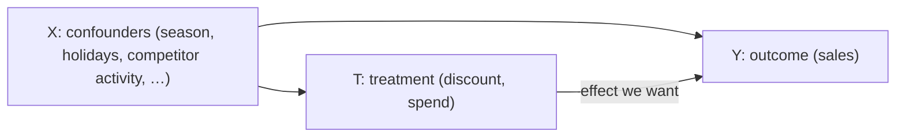

# Double Machine Learning in 10 minutes

A practitioner's introduction to the method behind `doubleml-pipeline`: what
problem it solves, how it solves it, what it assumes, and how the vocabulary
maps onto the pipeline's parameters. No formulas are required to follow it;
the few that appear are there for readers who want to connect the words to the
underlying model.

## 1. The question

You ran promotions, discounts or media campaigns and you have the historical
data: one row per week (or day) per region per product, with sales, the
treatment (discount rate, TV spend, …) and many other columns. The question is

> *How much of the outcome did the treatment **cause**, and what is the return
> on each unit of it?*

Not "how did sales and discounts move together", but "what would sales have
been without the discount" — a *counterfactual* that nobody observed.

## 2. Why a naive comparison fails

Comparing weeks with and without a discount credits the discount with
everything that happens at the same time. Discounts are scheduled around
holidays and seasonal peaks; TV budgets go up when a new product launches;
competitors react. Any variable that influences **both** the treatment decision
and the outcome is a *confounder*, and it biases the naive comparison.



An A/B test removes the problem by randomizing T. With observational data we
have to remove the influence of X statistically — and X can be high-dimensional
and act non-linearly, which is where machine learning comes in.

## 3. What Double Machine Learning does

DML (Chernozhukov et al., 2018) estimates the effect in three steps:

1.  **Predict the outcome from the confounders.** Fit a flexible ML model
    `Y ~ X` and keep what it *cannot* explain: the residual `Y - E[Y | X]`.
2.  **Predict the treatment from the confounders.** Fit a second model
    `T ~ X` and keep its residual `T - E[T | X]` — the part of the treatment
    that is *not* explained by seasonality, holidays and the rest.
3.  **Regress the first residual on the second.** The slope is the treatment
    effect with everything X can explain removed from both sides.

The two prediction models are called *nuisance models* — they are needed, but
they are not what we are after. In the partially linear model the pipeline
uses, this reads

```text
Y = theta * T + g(X) + e        (outcome equation)
T = m(X) + v                    (treatment equation)
```

and `theta` is the quantity reported as the treatment effect.

### Why machine learning, and why it is safe here

Flexible learners (gradient boosting, random forests) capture the non-linear
way confounders act, but they are also biased by regularization and prone to
overfitting. Two ingredients make them usable for causal estimation:

*   **Neyman orthogonality.** The residual-on-residual regression is built so
    that small errors in the nuisance predictions do not bias `theta` to first
    order. The ML models only need to be *reasonably* good, not perfect.
*   **Cross-fitting.** The data is split into `K` folds; the nuisance models
    that produce a row's residuals are trained on the *other* folds, so no row
    is predicted by a model that has seen it and overfitting cannot leak into
    the effect. This is the `n_folds_list` parameter.

`doubleml-pipeline` adds a layer of automation on top: FLAML searches the
hyperparameters of the nuisance learners you list (`ml_models_y`,
`ml_models_t`), every candidate combination is fitted and ranked by a combined
error of the two nuisance models, the best `top_n` candidates are re-estimated
`n_reps` times with different fold splits, and the effect is reported with the
empirical 2.5–97.5% range of those repetitions.

## 4. From one number to a function: ATE and CATE

The *average treatment effect* (ATE) answers "how much, on average". The
*conditional average treatment effect* (CATE) answers "how much *in this
season / this region / for this product*" — and marketing decisions are mostly
about the second question.

The pipeline fits the CATE as a smooth function of the covariates you list in
`covariates_for_cate_list`, using B-spline bases (Semenova & Chernozhukov,
2021). The default basis (`cate_structure_list`: `auto_additive`, `df=3`,
`degree=2`, no intercept) is deliberately simple — one interior knot per
covariate, additive terms — because a flexible CATE on aggregated marketing
data quickly becomes unstable. One to a handful of covariates that matter for
the decision is the usual sweet spot; see the User Guide for the rules of thumb.

## 5. From an effect to money: incremental KPI and ROI

For every row the pipeline multiplies the estimated effect by the treatment it
received, which gives the **incremental KPI** — the sales that would not have
happened without the treatment. Summed over a period, region or product it is
the number you see in the charts, with the repetition band around it.

**ROI** divides the incremental KPI by what the treatment cost. For a `spend`
treatment the cost is the treatment itself; for a `percentage`, `impressions`
or `price` treatment you name the monetary column (`treatment_spend_cols`) and
the sales column (`sales_col`). The pipeline compares the ROI with a threshold
(`opt_threshold_roi`, default `1.0`) and, if asked (`optimize=True`), proposes
a reallocation.

Media spend usually shows *diminishing returns*: the tenth unit buys less than
the first. The optional Phase 0 of the pipeline estimates that curve before the
DML steps — see [Saturation DML](saturation.md).

## 6. What DML assumes — and what it cannot do

| Assumption | Plain meaning | What the pipeline offers |
| :--- | :--- | :--- |
| **No unmeasured confounding** (ignorability) | every variable that drives both T and Y is in `x_cols_list` | the **sensitivity analysis** (`run_sensitivity=True`): the *robustness value* says how strong a missing confounder would have to be to explain the effect away, benchmarked against the covariates you did include |
| **Overlap** (positivity) | for every kind of row there are both treated and less-treated examples | very wide confidence bands in some periods or segments are the symptom; the User Guide shows how to spot it |
| **No interference / no carryover** | a row's outcome depends on its own treatment, not on its neighbours' or on last week's | lagged features (`create_lagged_features`) can be added as covariates; the saturation-aware optimizer additionally assumes no carryover and warns when a lag of the treatment is among the covariates |
| **Variation in the treatment** | the treatment differs across rows after conditioning on X | if the treatment residual is nearly constant, nothing can be learnt — a treatment that is always the same is not estimable |

Two things no method can do for you: it cannot adjust for a confounder you did
not measure (it can only tell you how fragile the result is to one), and it
cannot tell you which variables are confounders and which are *consequences* of
the treatment. Variables caused by the treatment (store traffic after a
promotion, search volume driven by a campaign) must **not** be in
`x_cols_list`: they absorb part of the effect. Drawing the causal graph of your
business before choosing variables is time well spent.

## 7. What you decide and what the pipeline automates

| You decide | The pipeline automates |
| :--- | :--- |
| outcome `y_col`, treatment `d_cols`, confounders `x_cols_list` | hyperparameter search for the nuisance learners (FLAML) |
| how each column is scaled (`CausalDataScaler`) | cross-fitting, repetitions and the empirical confidence band |
| covariates for heterogeneity (`covariates_for_cate_list`) | ranking and shortlisting of candidate models |
| which diagnostics to run (`run_sensitivity`, ground truth columns) | cluster-robust inference (2-way Cluster DML keys chosen automatically) |
| whether to model saturation (`saturation_config`) and optimize (`optimize`) | descaling back to business units, charts, CSVs, the HTML report and the AI agent |

## 8. Glossary

| Term | Symbol | In `doubleml-pipeline` |
| :--- | :--- | :--- |
| Outcome | Y | `y_col` |
| Treatment | T (also D) | `d_cols` (one treatment per run recommended; optimization requires exactly one) |
| Confounders / controls | X | `x_cols_list` (one list per treatment) |
| CATE covariates | X_c | `covariates_for_cate_list`, basis in `cate_structure_list` |
| Nuisance models | `E[Y \| X]`, `E[T \| X]` | learners from `ml_models_y` / `ml_models_t`, tuned by FLAML within `time_budget` |
| Cross-fitting folds | K | `n_folds_list` |
| Repetitions | — | `n_reps` (with `top_n` shortlisted candidates) |
| Incremental KPI | theta × T per row | `estimated_incremental_KPI_<treatment>` columns, `001_total` … `003_item` charts |
| ROI | incremental KPI ÷ cost | `roi_*` columns; threshold `opt_threshold_roi` |
| Robustness value | RV | `sensitivity_metrics.csv`, `006_sensitivity` charts |
| Saturation curve | `f(T; alpha)` | `saturation_config` (Phase 0) |

## Further reading

*   Chernozhukov, Chetverikov, Demirer, Duflo, Hansen, Newey, Robins —
    *Double/debiased machine learning for treatment and structural parameters*
    ([arXiv:1608.00060](https://arxiv.org/abs/1608.00060)).
*   Semenova, Chernozhukov — *Debiased machine learning of conditional average
    treatment effects and other causal functions*
    ([arXiv:1702.06240](https://arxiv.org/abs/1702.06240)).
*   Cinelli, Hazlett — *Making sense of sensitivity: extending omitted variable
    bias* (JRSS-B, 2020) — the robustness value used by the sensitivity analysis.
*   Chiang, Kato, Matsushita, Ishihara — *Multiway cluster robust
    double/debiased machine learning*
    ([arXiv:1909.03489](https://arxiv.org/abs/1909.03489)).
*   The [DoubleML documentation](https://docs.doubleml.org) for the underlying
    package, and the [User Guide](guide.md) of this repository for the
    step-by-step workflow.
