# doubleml-pipeline User Guide

This guide walks through a doubleml-pipeline project in the order you will
actually do the work: prepare the data, choose the variables, normalize,
decide how much heterogeneity to model, pick the ML settings, run, read the
outputs, validate them, and turn them into ROI and a budget recommendation.
Every chapter starts with the parameters it decides and ends with a rule of
thumb. The rules of thumb come from simulation studies on realistic marketing
panels (the datasets under [`examples/`](../examples/)); treat them as
defaults to start from, not as laws.

If you are new to causal inference, read
[Double Machine Learning in 10 minutes](concepts.md) first. For every
parameter, default and return value see the [API Reference](api_reference.md);
for the CSV outputs see the [Output CSV Schema](output_csv_schema.md). The
original slide deck this guide was written from is kept as
[docs/slides.md](slides.md).

## Contents

*   [0. Overview: what you decide and what is automated](#0-overview-what-you-decide-and-what-is-automated)
*   [1. Prepare your data](#1-prepare-your-data)
*   [2. Choose the variables](#2-choose-the-variables)
*   [3. Normalize](#3-normalize)
*   [4. Heterogeneous effects (CATE)](#4-heterogeneous-effects-cate)
*   [5. ML settings](#5-ml-settings)
*   [6. Run and monitor](#6-run-and-monitor)
*   [7. Read the outputs](#7-read-the-outputs)
*   [8. Validate the result](#8-validate-the-result)
*   [9. ROI and budget optimization](#9-roi-and-budget-optimization)
*   [10. Checklist](#10-checklist)

--------------------------------------------------------------------------------

## 0. Overview: what you decide and what is automated

The pipeline estimates the causal effect of one or more treatments `T` (a
discount rate, media spend, impressions, a price gap) on an outcome `Y`
(sales) with Double Machine Learning (DML), and reports it as an incremental
KPI, an ROI and — optionally — an optimized budget. It runs in phases:

| Phase | What happens | Automated? |
| :--- | :--- | :--- |
| Phase 0 *(optional)* | **Saturation**: estimate the diminishing-returns curve `f(T; alpha)` and hand the transformed treatment to the next phases. Enabled by `saturation_config`; see [Saturation DML](saturation.md). | yes |
| Phase 1 | **Grid search**: fit a Y-model and a T-model for every candidate `ml_models_y × ml_models_t × n_folds_list`, in parallel, with FLAML AutoML choosing the hyperparameters. | yes |
| Phase 2 | **Shortlist**: rank the candidates by *combined error* `norm_T_rmse × (norm_T_rmse + norm_Y_rmse)` (min–max normalized out-of-fold RMSEs) and keep the best `top_n`. | yes |
| Phase 3 | **Repetitions**: re-estimate every shortlisted candidate `n_reps` times with new sample splits; the model group with the lowest combined error of its *median* RMSEs wins, and its repetitions are pooled with the median method of Chernozhukov et al. (2018) into a point estimate and a 95% band per row. | yes |
| Phase 4 | **Consolidate & report**: CATE equation, incremental KPI, ROI, sensitivity analysis, budget optimization, charts, the HTML report and an ADK agent. | yes |

What is *not* automated is the causal design, and it is the subject of
Chapters 1–5:

| # | Your input | Parameters | Chapter |
| :--- | :--- | :--- | :--- |
| 1 | Data granularity | `date_col`, `geo_col`, `item_col`, `population_col` (scaler) | [1](#1-prepare-your-data) |
| 2 | Variable selection | `y_col`, `d_cols`, `x_cols_list` | [2](#2-choose-the-variables) |
| 3 | Normalization | `CausalDataScaler(...)` column lists | [3](#3-normalize) |
| 4 | Covariates for CATE | `covariates_for_cate_list` | [4](#4-heterogeneous-effects-cate) |
| 5 | CATE structure | `cate_structure_list` | [4](#4-heterogeneous-effects-cate) |
| 6 | ML settings | `ml_models_y`, `ml_models_t`, `n_folds_list`, `time_budget`, `n_jobs`, `hparam_policy`, `top_n`, `n_reps` | [5](#5-ml-settings) |
| 7 | Ground truth (simulations) | `ground_truth_existence`, `ground_truth_effect_column` | [7](#7-read-the-outputs) |
| 8 | Sensitivity analysis | `run_sensitivity`, `sensitivity_scope` | [8](#8-validate-the-result) |
| 9 | ROI | `treatment_types`, `treatment_spend_cols`, `sales_col` | [9](#9-roi-and-budget-optimization) |
| 10 | Optimization | `optimize`, `simple_optimization`, `opt_periods`, `opt_threshold_roi`, `opt_other_cost_variables`, `opt_geos`, `opt_items` | [9](#9-roi-and-budget-optimization) |

> [!NOTE]
> Throughout this guide the worked examples use the simulated Indian skincare
> panel of [`examples/IN_skincare/`](../examples/IN_skincare/): weekly data,
> one treatment (`discount`, a discount rate), outcome `Revenue_Sales`,
> six geos. The multi-treatment and lagged-treatment examples come from
> [`examples/JP_retailer/`](../examples/JP_retailer/). Both notebooks can be
> opened in Colab from the [README](../README.md#documentation).

--------------------------------------------------------------------------------

## 1. Prepare your data

| Parameter | Plain meaning | Typical value | Change when |
| :--- | :--- | :--- | :--- |
| `date_col` | the period of each row | `"date"` (weekly) | — always set it; lags, date blocks and every time-series chart need it |
| `geo_col` | the region of each row | `"geo"` | leave `None` only when the data is national |
| `item_col` | the product / category of each row | `"item"` | leave `None` when there is one product line |
| `population_col` (scaler) | population of the row's geo | `"population"` | required by the `population_*` normalizations of Chapter 3 |

### One row per date × geo × item

Keep the data at the finest level you have — typically one row per
`date × geo × item`. Aggregating to a national weekly series throws away
exactly what DML needs:

*   **Sample size.** 134 weeks is a small dataset for machine learning;
    134 weeks × 6 geos × 3 categories is not.
*   **Cluster-robust inference.** The cross-fitting folds and the standard
    errors use a 2-way Cluster DML whose keys are chosen automatically from
    `item_col`, `geo_col` and a contiguous date block derived from
    `date_col` — the two candidates with the most clusters are adopted (see
    [Cluster DML keys](advanced.md#cluster-dml-keys-chosen-automatically-every-run)).
    Rows of the same geo (or item, or month) are correlated; the cluster keys
    stop that correlation from making the confidence bands too narrow.
*   **Breakdowns.** Geo- and item-level ROI, CATE and the validation checks of
    Chapter 8 all need the dimension columns.

A minimal table looks like this (the names are yours; the pipeline only needs
to be told which column plays which role):

| date | geo | item | population | sales_revenue | discount_rate | discount_cost | seasonality | holiday | tv_grp |
| :--- | :--- | :--- | ---: | ---: | ---: | ---: | ---: | ---: | ---: |
| 2024-01-07 | tokyo | shampoo | 13,960,000 | 12,430 | 0.10 | 1,243 | 0.92 | 0 | 104 |
| 2024-01-07 | osaka | shampoo | 8,840,000 | 7,210 | 0.00 | 0 | 0.95 | 0 | 61 |
| 2024-01-14 | tokyo | shampoo | 13,960,000 | 14,980 | 0.15 | 2,247 | 1.08 | 1 | 98 |

Requirements that are checked (or silently matter):

*   The DataFrame **index must be unique** — `df = df.reset_index(drop=True)`
    after filtering; duplicated labels raise a `ValueError` before anything
    runs.
*   `date_col` must be sortable as a date (`YYYY-MM-DD` strings or datetimes).
*   No missing values in `Y`, `T` and `X`: the learners do not impute. The
    example notebooks check `isna()` and negative spend before running.
*   Treatments and outcomes are **continuous** columns. A `percentage`
    treatment must lie in `[0, 1]`.
*   `population_col` is the population of the geo, not a sales figure, and it
    must **not** be listed among the columns it normalizes (the scaler warns).

### Lagged treatments and lagged confounders

Media and promotions often act with a delay. `create_lagged_features` adds
`<col>_l1`, `<col>_l2`, … holding the value observed exactly 1, 2, … periods
earlier **within each unit**, matching on the date rather than on row order,
so gaps in the calendar do not misalign the lags:

```python
from doubleml_pipeline.preprocessing.features import create_lagged_features
import pandas as pd

df = pd.read_csv("marketing_data.csv")
df = create_lagged_features(
    df=df,
    columns=["flyer_spend"],
    periods=[1, 2, 3],
    unit_col="geo",
    date_col="date",
    na_fill=True,  # the first periods of each unit become 0 instead of NaN
)
```

Two ways to use the lagged columns:

*   **As additional treatments** — `d_cols=["flyer_spend", "flyer_spend_l1",
    "flyer_spend_l2"]` estimates the carry-over effect of each lag separately
    (the JP retailer notebook does this for `Spend_Flyer` with lags 1–3). Each
    treatment gets its own confounder list in `x_cols_list`; the *other* lags
    of the same spend are natural confounders of each one. In the Phase 4
    totals a lagged treatment contributes its incremental KPI but not its
    spend (so the money is not counted twice).
*   **As confounders** of a non-lagged treatment — last week's spend drives
    both this week's spend and this week's sales.

> [!NOTE]
> With the saturation-aware optimizer (Chapter 9) a lag of a treatment among
> that treatment's confounders triggers a warning at the start of Phase 4: the
> allocator assumes no carry-over.

--------------------------------------------------------------------------------

## 2. Choose the variables

| Parameter | Plain meaning | Typical value | Change when |
| :--- | :--- | :--- | :--- |
| `y_col` | the KPI you want to move | `"sales_revenue"` | — |
| `d_cols` | the lever(s) you control | `["discount_rate"]` | several treatments → one list entry each |
| `x_cols_list` | per treatment, the variables that drive *both* that treatment and the outcome | one inner list of 5 to 15 columns | one inner list per treatment, in the same order as `d_cols` |

This is the chapter that decides whether the number you get is causal. The
pipeline cannot check it for you; the diagnostics of Chapter 8 can only tell
you afterwards that something is wrong.

### Confounders, predictors, and what to leave out

Draw the causal graph of your business before touching the code. The roles:

| Role | Definition | Put it in `x_cols_list`? |
| :--- | :--- | :--- |
| **Confounder** | drives both the treatment decision and the outcome (seasonality, holidays, category demand, a competitor's activity) | **Yes — all of them.** Leaving one out biases the estimate (omitted-variable bias). |
| **Predictor** | drives the outcome but not the treatment (TV GRPs when the discount calendar is set independently) | Optional. A few strong predictors reduce noise; many weak ones destabilize the estimate (see the case study below). |
| **Mediator / post-treatment variable** | is *caused by* the treatment (store traffic after the promotion, search volume driven by the campaign, units shipped to meet the promoted demand) | **Never.** It absorbs part of the effect you are measuring. |
| **Instrument** | drives the treatment but not the outcome (a budget rule, a planning constraint) | No. It adds variance and no identification in a PLR. |

The graph below is the one behind the skincare example. The confounders `C`
(seasonality, category sales, holiday and peak flags) open *back-door paths*
`T ← C → R` from the discount to sales; conditioning on them closes those
paths. Media `M`, search `S` and distribution `O` are predictors of sales in
this design; an unobserved confounder `U` (red, dashed) is what the
sensitivity analysis of Chapter 8 is about.

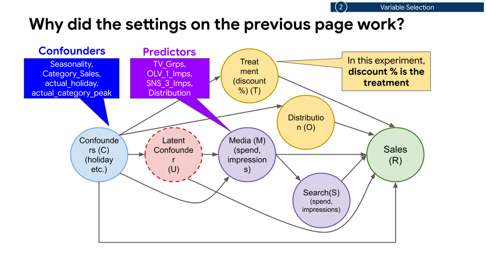

*Confounders in the example: `Seasonality`, `Category_Sales`,
`actual_holiday`, `actual_category_peak`. Predictors: `TV_Grps`, `OLV_1_Imps`,
`SNS_3_Imps`, `Distribution`.*

Back-door paths also run through time. When the treatment is this week's
online event and the outcome is this week's offline sales, seasonality in
*every* earlier week influences both — including them (or a seasonality
index that summarizes them) is what blocks the paths:

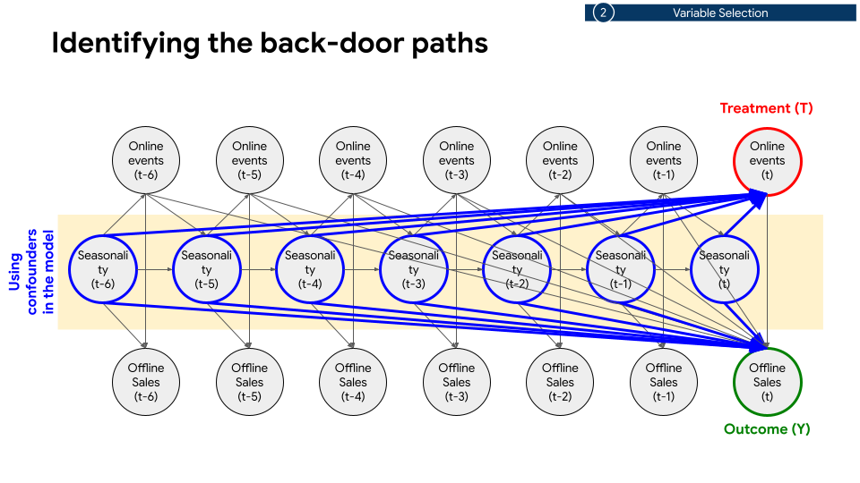

### Multicollinearity: check the VIF

Confounders that are near-linear combinations of each other make the T-model
unstable. Compute the variance inflation factor (VIF) of your candidate list
and drop (or merge) variables above **10** — keeping at least one variable
from each group of near-duplicates:

```python
import pandas as pd
from statsmodels.stats.outliers_influence import variance_inflation_factor

df = pd.read_csv("marketing_data.csv")
x_cols = ["seasonality", "category_sales", "distribution", "tv_grp"]
x = df[x_cols].dropna().to_numpy()
vif = pd.DataFrame({
    "Variable": x_cols,
    "VIF": [variance_inflation_factor(x, i) for i in range(len(x_cols))],
})
print(vif.sort_values("VIF", ascending=False))
```

(`statsmodels` is installed together with DoubleML.)

### Case study: from 28 variables to 8

The skincare panel (134 weeks, one geo, `d_cols=['discount']`,
`y_col='Revenue_Sales'`) started with every available column as a confounder
— 28 of them: baseline drivers (`Seasonality`, `Category_Sales`,
`Distribution`, competitor revenues, prices, `Covid_Var`, `GDP`,
`Gdp_Per_Capita`, `Population`, `CPI`), fourteen media and search columns
(`OLV_*_Imps`, `SNS_*_Imps`, `Retail_*_Display_Imps`, `PR_Imps`, `TV_Grps`,
`OS_*_GTs`, `PS_*_Imps`) and two dummies (`actual_holiday`,
`actual_category_peak`).

**Step 1 — everything in.** The VIF table showed `OS_Retail_GTs` 34.8,
`OS_Generic_GTs` 31.3, `GDP` 16.9 and `Distribution` 14.1. The estimate was
unusable: a single week in late November 2021 produced an incremental KPI
spike of about −1.6 × 10⁸ against a ground truth near zero (SMAPE 89%,
R² = −131).

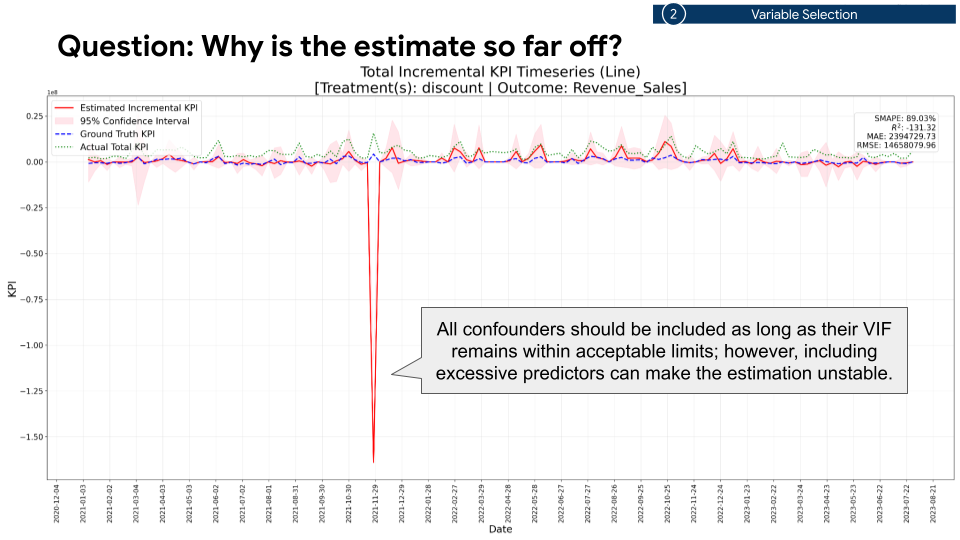

**Step 2 — drop VIF > 10.** Removing `GDP`, `Gdp_Per_Capita`, `Population`,
`CPI`, `OS_Generic_GTs` and `OS_Retail_GTs` brought every VIF below 5 (max
4.26 for `Category_Sales`) — and the estimate got *worse* (R² = −233, spike
≈ −2.2 × 10⁸). A clean VIF table is necessary, not sufficient: 22
predictors on 134 weeks still over-fit the nuisance models.

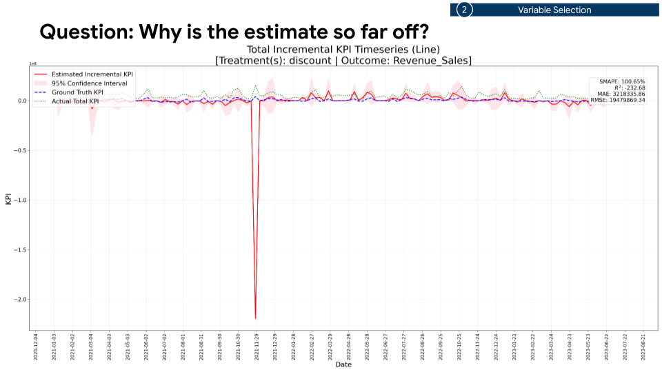

**Step 3 — keep the confounders, narrow the predictors.** The final list keeps
all four confounders of the graph, the three largest media channels and the
two dummies:

```python
x_cols_list = [[
    # Confounders: drive both the discount calendar and sales
    "Seasonality", "Category_Sales", "Distribution",
    # Predictors: the three largest media channels only
    "TV_Grps", "OLV_1_Imps", "SNS_3_Imps",
    # Structural dummies
    "actual_holiday", "actual_category_peak",
]]
d_cols = ["discount"]
y_col = "Revenue_Sales"
```

The estimate now tracks the ground truth (R² = 0.54, SMAPE 80% on a series
that is mostly zero, no spikes):

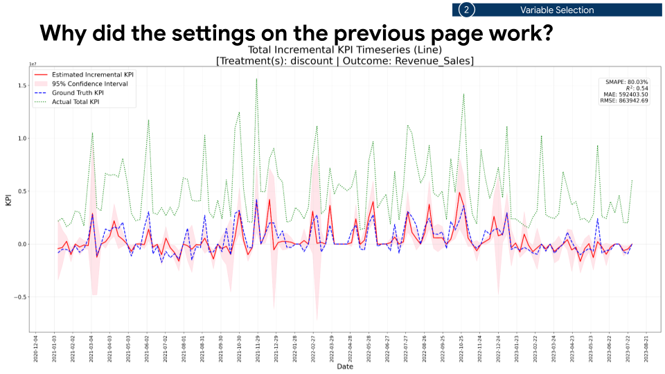

> [!TIP]
> **Rule of thumb.** Include every confounder whose VIF is acceptable; keep
> the predictors to the handful that matter most; never include mediators.
> If the series shows an isolated spike, suspect the variable list before the
> model.

### Several treatments

`x_cols_list` has one inner list per treatment, in the order of `d_cols`. The
lists may differ — each treatment needs *its own* back-door paths closed. In
the JP retailer example the flyer spend and its three lags are four treatments
and the other lags serve as confounders of each:

```python
d_cols = ["Spend_Flyer", "Spend_Flyer_l1", "Spend_Flyer_l2", "Spend_Flyer_l3"]
base = ["TotalDemand", "Holidays", "DemandShock"]
x_cols_list = [
    base + ["Spend_Flyer_l1", "Spend_Flyer_l2", "Spend_Flyer_l3"],
    base + ["Spend_Flyer", "Spend_Flyer_l2", "Spend_Flyer_l3"],
    base + ["Spend_Flyer", "Spend_Flyer_l1", "Spend_Flyer_l3"],
    base + ["Spend_Flyer", "Spend_Flyer_l1", "Spend_Flyer_l2"],
]
```

Each treatment is estimated in its own Phase 1–3 run; Phase 4 adds them up.
Budget optimization, however, is only available for a single treatment
(Chapter 9).

--------------------------------------------------------------------------------

## 3. Normalize

| Parameter (`CausalDataScaler`) | Plain meaning | Typical value |
| :--- | :--- | :--- |
| `population_median_normalize_cols` | per-capita, then divided by the median of the positive per-capita values | sales, spend, impressions, coupons |
| `population_standardize_cols` | per-capita, then centred and scaled to unit variance | per-capita variables used only inside the ML models (store counts) |
| `median_normalize_cols` | divided by the median of the non-zero values | GRPs, distribution rates, a saturated treatment |
| `standardize_cols` | centred and scaled to unit variance | temperature, precipitation, demand indices with a scale of their own |
| `min_max_cols` | scaled to `[0, 1]` on the fitting range | rarely — it breaks on out-of-range future values |
| `population_col` | the population column used by the two `population_*` options | `"population"` |

Different columns live on wildly different scales (revenue in the millions,
a discount rate in `[0, 1]`, GRPs in the hundreds). The scaler brings them to
comparable scales for the nuisance models and, crucially, **inverts the
transformation afterwards** so that every incremental KPI and ROI in the
outputs is in the original units. Columns you do not list are left untouched.

### Which option for which variable

| Option | Formula | Use it for |
| :--- | :--- | :--- |
| **A** `population_median_normalize_cols` | `(x / population) / median(positive per-capita values)` | variables **proportional to population** whose **sign must be preserved** — sales, impressions, number of coupons distributed, spend |
| **B** `population_standardize_cols` | `((x / population) − mean) / sd` | variables proportional to population where the sign does **not** matter because they are only used inside the T-/Y-models — number of stores per prefecture |
| **C** `median_normalize_cols` | `x / median(non-zero values)` | variables **not** proportional to population whose sign must be preserved — TV GRPs, a distribution rate, a treatment that will be saturated |
| **D** `standardize_cols` | `(x − mean) / sd` | everything that does not fall under A, B, C or E — temperature, precipitation |
| **E** *no normalization* | — | binary flags (holidays), `[0, 1]` rates (a discount rate), indices that are already comparable across regions |

"Sign must be preserved" means: zero stays zero and positive stays positive.
That matters for the outcome (incremental KPI is a difference of outcomes),
for spend (an ROI denominator) and for anything you later saturate.

Worked assignment for the skincare example:

| Column | What it is | Option |
| :--- | :--- | :--- |
| `Revenue_Sales` (Y) | total sales amount | **A** |
| `Category_Sales` | total category sales amount | **A** |
| `OLV_1_Imps`, `SNS_3_Imps` | impressions | **A** |
| `Distribution` | store-based distribution rate, 0–100 | **C** |
| `TV_Grps` | gross rating points | **C** |
| `Seasonality` | demand index in `[0, 1)` | **E** |
| `discount` (T) | discount rate in `[0, 1)` | **E** |
| `actual_holiday`, `actual_category_peak` | binary flags | **E** |

```python
from doubleml_pipeline.preprocessing.scalers import CausalDataScaler

scaler = CausalDataScaler(
    population_median_normalize_cols=[
        "Revenue_Sales", "Category_Sales", "OLV_1_Imps", "SNS_3_Imps",
    ],
    median_normalize_cols=["Distribution", "TV_Grps"],
    population_col="Population",
)
```

> [!IMPORTANT]
> **Saturation DML** (Phase 0) needs `f(0) = 0` and a non-negative treatment.
> A saturated treatment must therefore be left unscaled or use a *divisive*
> option — **A** or **C**. Listing it under `standardize_cols`,
> `population_standardize_cols` or `min_max_cols` raises a `ValueError` at the
> start of Phase 0. See [Saturation DML](saturation.md).

> [!TIP]
> **Rule of thumb.** Amounts that grow with the population → **A**; rates and
> GRPs → **C**; flags, shares and `[0, 1]` rates → nothing. Reach for **D**
> only for variables with a physical scale of their own, and avoid
> `min_max_cols` for anything that may exceed its historical range.

--------------------------------------------------------------------------------

## 4. Heterogeneous effects (CATE)

| Parameter | Plain meaning | Typical value | Change when |
| :--- | :--- | :--- | :--- |
| `covariates_for_cate_list` | per treatment, the variables the effect is allowed to vary with | 1–10 columns, e.g. `[["seasonality", "holiday"]]` | `[[]]` for a single average effect (ATE) |
| `cate_structure_list` | the functional form per treatment | `["auto_additive"]` (default) | a dict to change `df` / `degree`, or a patsy formula for interactions |

### Why model heterogeneity

The partially linear model behind DML is

```text
Y = T · θ(X) + g(X) + ζ,   E[ζ | T, X] = 0
T = m(X) + δ,              E[δ | X] = 0
```

With `covariates_for_cate_list=[[]]` the estimand `θ` is one number — the
average treatment effect. With covariates it becomes a *function* `θ(X)`:
the effect of a discount in a peak month, in a holiday week, at high category
demand. That function is what you need to decide *when* and *where* to spend,
and it is also the input of the budget optimizer.

### Which covariates

Select the variables that **influence your decision-making** — the factors
you would actually condition a budget on: seasonality, competition, major
sales events, a demand index. They do not have to coincide with the
confounders of Chapter 2 (the CATE covariates are usually a small subset of
them, sometimes plus a dimension dummy), and they must be columns of the
data at prediction time.

### How the function is built: B-splines

`θ(X)` is approximated by a finite basis, `θ(X) ≈ B(X)ᵀβ`, and only the
coefficients `β` are estimated. For a continuous covariate the basis is a
B-spline with a handful of bell-shaped pieces; for a binary covariate it is
the variable itself (a linear term). Three numbers describe a B-spline:

*   `df` — the number of basis functions (3 by default);
*   `degree` — the polynomial degree of each piece (2 = quadratic by default);
*   knots — where the pieces join; `knots = df − degree` (1 by default).

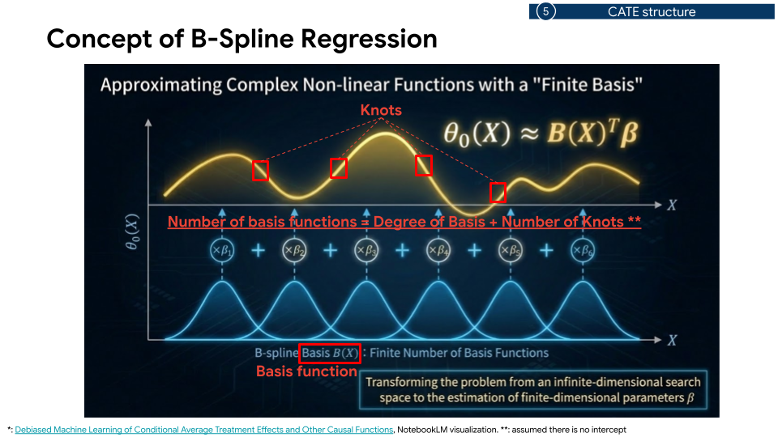

The default `auto_additive` structure is therefore
`bs(x, df=3, degree=2, include_intercept=False)` for every continuous
covariate, the raw column for every binary covariate, and the terms are
**added** (no interactions). The notes below explain why those defaults are
conservative on purpose.

### Four things that make a CATE unstable

**1. Too many covariates.** Each continuous covariate adds `df` parameters;
with a dozen covariates the design has sixty columns and the curse of
dimensionality takes over.

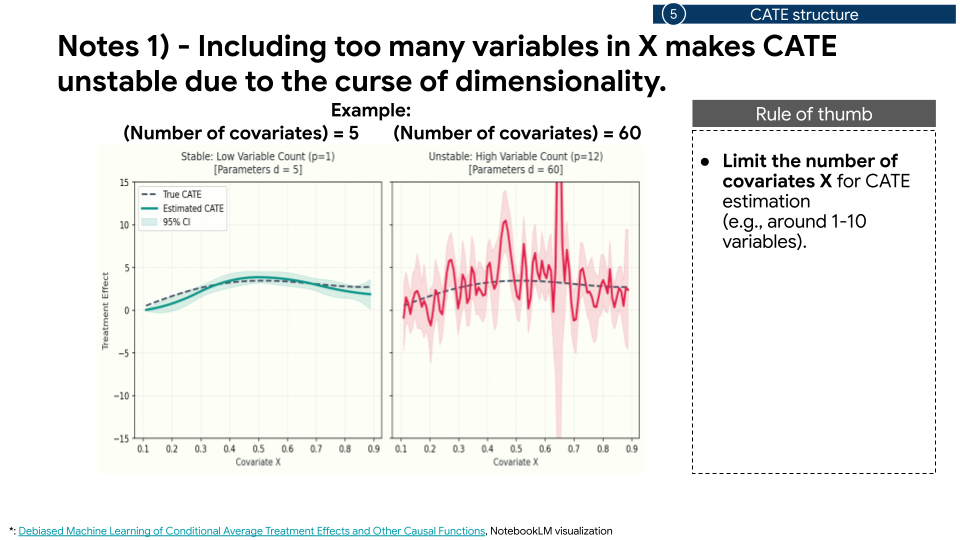

> **Rule of thumb:** limit the CATE covariates to about **1–10**, depending
> on the sample size.

**2. Too many knots.** More knots means more local flexibility and wider
bands.

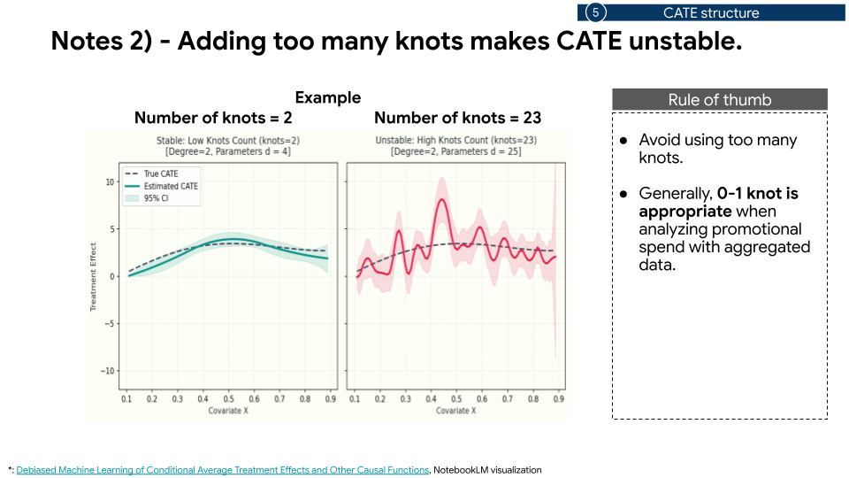

> **Rule of thumb:** **0–1 knot** is appropriate for promotional spend on
> aggregated data.

**3. A degree that is too high.** High-degree pieces oscillate, especially at
the edges of the covariate range.

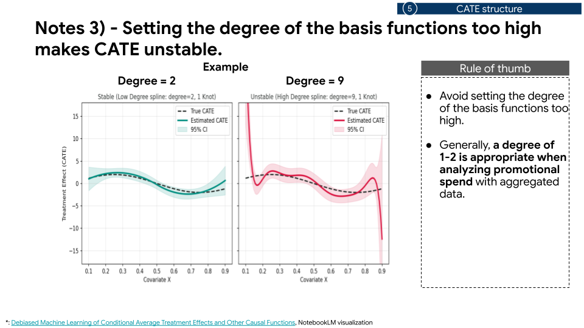

> **Rule of thumb:** a **degree of 1–2**.

**4. Multiplying splines.** A tensor product of splines (an interaction of
two continuous covariates) multiplies the parameter count and, in the
simulation, inflated the confidence band fifteen-fold.

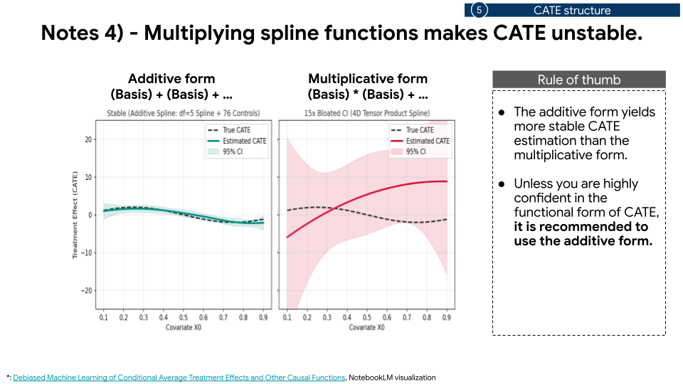

> **Rule of thumb:** use the **additive** form unless you are highly confident
> in the functional form; interact a spline with *binary* flags only.

### Setting the structure

The default needs no configuration:

```python
covariates_for_cate_list = [["Seasonality", "Category_Sales", "actual_holiday"]]
cate_structure_list = ["auto_additive"]
```

Phase 4 prints and stores the fitted equation (coefficients in
`step4_consolidated_results/graph/004_cate/cate_coef_dict_pooling.csv`). For
the skincare run it read, in short:

```text
[discount]
0.9148 -2.0069 * Spline_0(Seasonality) -0.9266 * Spline_1(Seasonality)
+14.4858 * Spline_2(Seasonality) -0.8617 * Spline_0(Category_Sales)
+8.2988 * Spline_1(Category_Sales) -13.0673 * Spline_2(Category_Sales)
+1.2296 * actual_holiday
```

— three spline terms per continuous covariate, a single linear term for the
binary `actual_holiday`. The coefficients are on the *normalized* covariates,
so read them directionally; the response curves in the `004_cate` tab of the
HTML report are the readable version.

To change `df` or `degree` for every covariate of a treatment, pass a dict;
to write the formula yourself (patsy syntax, columns of
`covariates_for_cate`), pass a string. The JP retailer notebook interacts one
linear spline of demand with two binary flags:

```python
cate_structure_list = [
    {"type": "auto_additive", "df": 2, "degree": 1, "include_intercept": False},
]

demand_spline = "bs(TotalDemand, df=1, degree=1, include_intercept=False)"
custom_formula = (
    f"{demand_spline}+"
    f"{demand_spline}:DemandShock+"
    f"{demand_spline}:Holidays+"
    f"{demand_spline}:Holidays:DemandShock"
)
cate_structure_list = [custom_formula]
```

Interactions appear in the printed equation as products
(`Spline_(TotalDemand) * Holidays`).

> [!NOTE]
> The sample-size guard of the runner warns when `n < 1000` and asks for a
> degree of 2 or less for continuous covariates — see the
> [FAQ](faq.md#sample-size-is-small-n--1000-set-degree-of-continuous-covariates-to-2-or-less).

--------------------------------------------------------------------------------

## 5. ML settings

| Parameter | Plain meaning | Typical value | Change when |
| :--- | :--- | :--- | :--- |
| `ml_models_y`, `ml_models_t` | candidate learners for the Y-model and the T-model (FLAML estimator names) | `["lgbm", "xgboost"]` | add `"rf"`, `"extra_tree"`, `"enet"`, … to widen the grid |
| `n_folds_list` | candidate numbers of cross-fitting folds | `[5]` or `[4, 6]` | 4–10; more folds = less bias, more compute |
| `time_budget` | seconds of FLAML hyperparameter search per (treatment, learner) | `15` (default) for exploration, `30`–`60` for a final run | the nuisance RMSEs in `1c_metrics_*.csv` are still falling when you double it |
| `n_jobs` | CPU cores to use | `-1` (all cores, default) | share the machine |
| `hparam_policy` | search hyperparameters once per (treatment, learner) (`"global"`, default) or inside every fold (`"per_fold"`) | `"global"` | only to reproduce the historical behaviour |
| `top_n` (`run_full_pipeline`) | candidates kept after Phase 2 | `3` | — |
| `n_reps` (`run_full_pipeline`) | repetitions per shortlisted candidate in Phase 3 | `5`–`10` for exploration, `20` (default) for a final run | the confidence bands keep moving between runs |

### Learners

The T-model learns `E[T | X]`, the Y-model learns `E[Y | X]`; both are
regressions and both are fitted by FLAML, so any FLAML regression estimator
name works:

| Family | Names |
| :--- | :--- |
| Tree-based | `lgbm`, `xgboost`, `rf`, `xgb_limitdepth`, `extra_tree`, `histgb` |
| Distance-based | `kneighbor` |
| Linear | `enet` |

Every combination `ml_models_y × ml_models_t × n_folds_list` is one Phase 1
candidate (`['lgbm', 'xgboost'] × ['lgbm', 'xgboost'] × [4, 6]` = 8
candidates), ranked by the combined error of Chapter 0, so a wider grid costs
time linearly but never hurts the result.

### Folds

Cross-fitting splits the rows into `n_folds` groups (by cluster, see
Chapter 1), fits the nuisance models on all but one group and predicts the
held-out group. Few folds → each model sees less data (more bias); many
folds → more models to fit (more compute) and more volatile out-of-fold
predictions. **4–10 folds** is the usual range; `[5]` is a good single value.

### Time budget and hyperparameter policy

With the default `hparam_policy="global"`, FLAML searches hyperparameters
**once per (treatment, learner)** at the start of Phase 1, for `time_budget`
seconds, and every fold of Phases 1 and 3 then fits the winner with those
fixed hyperparameters. The searches are saved to
`step1_exploration_<treatment>/hparams_<treatment>_<learner>.json`. The
default 15 s is enough to explore; give a final run 30–60 s. Details:
[Hyperparameter policy](advanced.md#hyperparameter-policy-hparam_policy-default-global).

### Cores

`n_jobs=-1` uses every CPU core: each parallel section runs
`W = min(tasks, cores)` worker processes with `cores // W` learner threads
each. The pipeline does **not** use a GPU for Phases 1–4 (tree learners on
tabular data gain little from one); a standard CPU Colab runtime is fine. See
also [Do I need a GPU?](faq.md#do-i-need-a-gpu).

> [!TIP]
> **Rule of thumb.** Start with `["lgbm", "xgboost"]` on both sides, `[5]`
> folds, `time_budget=15`, `top_n=3`, `n_reps=5` to check the design; for the
> run you will act on, raise `time_budget` to 30–60 and `n_reps` to 20.

--------------------------------------------------------------------------------

## 6. Run and monitor

Putting Chapters 1–5 together for the skincare example:

```python
from doubleml_pipeline.preprocessing.scalers import CausalDataScaler
from doubleml_pipeline.workflow import CausalWorkflowOrchestrator
import pandas as pd

df = pd.read_csv("IN_skincare.csv")
df = df[df["Category"] == "skincare"].reset_index(drop=True)

scaler = CausalDataScaler(
    population_median_normalize_cols=[
        "Revenue_Sales", "Category_Sales", "OLV_1_Imps", "SNS_3_Imps",
    ],
    median_normalize_cols=["Distribution", "TV_Grps"],
    population_col="Population",
)

orchestrator = CausalWorkflowOrchestrator(
    y_col="Revenue_Sales",
    d_cols=["discount"],
    x_cols_list=[[
        "Seasonality", "Category_Sales", "Distribution",
        "TV_Grps", "OLV_1_Imps", "SNS_3_Imps",
        "actual_holiday", "actual_category_peak",
    ]],
    ml_models_y=["lgbm", "xgboost"],
    ml_models_t=["lgbm", "xgboost"],
    n_folds_list=[6],
    output_dir="./results",
    time_budget=15,
    date_col="Date",
    geo_col="Geo",
    covariates_for_cate_list=[
        ["Seasonality", "Category_Sales", "actual_holiday"],
    ],
    cate_structure_list=["auto_additive"],
    run_sensitivity=True,
    sensitivity_scope=["total"],
    # A discount rate is a "percentage" treatment (Chapter 9).
    treatment_types={"discount": "percentage"},
    treatment_spend_cols={"discount": "discount_amount"},
    sales_col="Revenue_Sales",
    optimize=True,
    simple_optimization=True,
    opt_threshold_roi=1.0,
)

orchestrator.run_full_pipeline(df, scaler, top_n=3, n_reps=5)
```

Construction validates the combination of options (an optimizer that cannot
run, a sensitivity scope without its column, a negative ROI threshold, …) and
raises immediately; `run_full_pipeline` then checks the data before Phase 1
starts — every named column exists in `df`, the index is unique, the
treatment types are valid and a `percentage` treatment lies in `[0, 1]`.

### What the log tells you

*   A header per phase (`=== Phase 1: ... ===`). Before Phase 1 the chosen
    cluster keys are printed, e.g. `Cluster DML keys ...: 2-way:
    cluster_date_block (7 clusters), geo (6 clusters); not adopted: item
    (2 clusters)`. If the line says `none`, the data has no usable cluster
    dimension and inference is observation-level — reconsider Chapter 1.
*   The parallel plan of each section (`workers = W, threads/worker = h`).
*   Warnings worth reading: a treatment named like a rate but typed `spend`,
    `simple_optimization` forced to `True`, ROI output skipped for a treatment
    without a spend mapping. The [FAQ](faq.md#warnings) explains each.

### How long it takes

Run time is roughly proportional to
`(#candidates + top_n × n_reps) × n_folds × (fit time per learner)`, plus
`time_budget` per (treatment, learner) and the Phase 0 fits when saturation
is on. The exploration settings of Chapter 5 finish in minutes on a laptop
for a few thousand rows; see
[How long does a run take?](faq.md#how-long-does-a-run-take-and-how-do-i-make-a-first-run-fast)
for the levers.

--------------------------------------------------------------------------------

## 7. Read the outputs

| Parameter | Plain meaning | Typical value |
| :--- | :--- | :--- |
| `ground_truth_existence` | the data is simulated and the true effect is known | `False`; `True` for the bundled examples |
| `ground_truth_effect_column` | per treatment, the column holding the true incremental KPI | `["TrueContrib_Discount_Total"]` |
| `generate_html`, `generate_agent` | write the HTML report / the ADK agent | `True` (default) |

### Where things are

Everything goes under `output_dir`
([full tree](output_csv_schema.md#1-output-directory-architecture)):

| Path | Content |
| :--- | :--- |
| `<treatment>_<outcome>[_<family>].html` | the self-contained HTML report (e.g. `discount_Revenue_Sales.html`) |
| `metadata.json` | the run configuration, cluster keys, the optimizer in force |
| `step0_saturation/` | Phase 0 (only with `saturation_config`) |
| `step1_exploration_<treatment>/` | per candidate: metrics (`1c_metrics_*.csv`), geo/item slices, the FLAML searches (`hparams_*.json`) |
| `step2_shortlisted_<treatment>/` | the ranking (`2_shortlisted_models_metrics.csv`) |
| `step3_final_<treatment>/` | repetitions (`3a_*`, `3b_*`) and `best_model/` with the pooled row-level estimates |
| `step4_consolidated_results/` | `consolidated_1a_full_df.csv` (row level, all treatments), `consolidated_3b_summary*.csv` (totals, by geo, by item), `graph/001_total … 007_optimization`, `roi_output/<treatment>/` |
| `agents/causal_ml_insight_agent/` | a runnable ADK agent over these files |

### The HTML report, tab by tab

| Tab | What to look at |
| :--- | :--- |
| `000_saturation` *(saturation runs)* | the fitted curve, the 1-SE decision and the Phase 0 diagnostics |
| `001_total` | incremental KPI over time with its 95% band, the ROI bars, the totals table — start here |
| `002_geo`, `003_item` | the same per region / product; the comparison chart ranks the entities by ROI |
| `004_cate` | the fitted CATE equation, response curves per covariate and the scatter matrix |
| `005_prior` | ROI and contribution priors (Normal / LogNormal / Beta) fitted for MMM use |
| `006_sensitivity` | the Cinelli–Hazlett contour per scope and the robustness value (Chapter 8) |
| `007_optimization` *(with `optimize=True`)* | spend, incremental KPI and ROI before/after, and the yearly matrix (Chapter 9) |
| `roi_output_* (<treatment>)` *(non-`spend` treatments)* | amount-based ROI by month, by geo, by item and the updated priors |
| `✨ AI Assistant (Gemini)` | asks questions about a precomputed snapshot of the results; see the [`doubleml_pipeline.agent` reference](api_reference.md#module-doubleml_pipelineagent) |

### Three numbers first

1.  **Incremental KPI** (`total_estimated_incremental_KPI` in
    `consolidated_3b_summary.csv`, time series in `001_total`) — how much of
    the outcome the treatment caused, with the 2.5–97.5% band from the Phase
    3 repetitions.
2.  **ROI** (`total_estimated_roi`, and `roi_amount_based_<treatment>` per
    row for non-`spend` treatments) — incremental KPI divided by spend.
3.  **Robustness value** (`robustness_value` in
    `graph/006_sensitivity/sensitivity_metrics.csv`) — Chapter 8.

### Ground truth (simulated data)

When the true effect is known — simulated data, or a geo experiment you are
back-testing — set `ground_truth_existence=True` and name the column per
treatment in `ground_truth_effect_column`. The charts then overlay the truth
(blue dashed) and print SMAPE, R², MAE and RMSE of the estimate against it,
overall and per geo/item (`consolidated_3b_summary*.csv`):

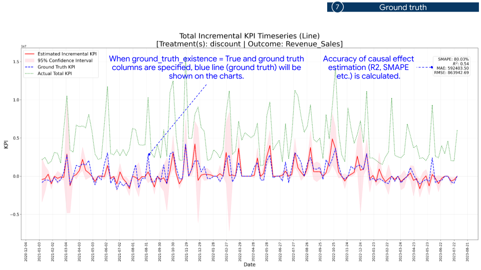

Use these runs to tune Chapters 2–5 *before* running on real data: a
variable list that cannot recover a simulated effect will not recover a real
one.

### ROI charts for non-spend treatments

For `percentage`, `impressions` and `price` treatments with a spend mapping,
`roi_output/<treatment>/` adds the amount-based views — spend as % of sales,
incremental sales as % of sales and ROI by month (peak months highlighted) and
by geo, plus the updated prior distributions:

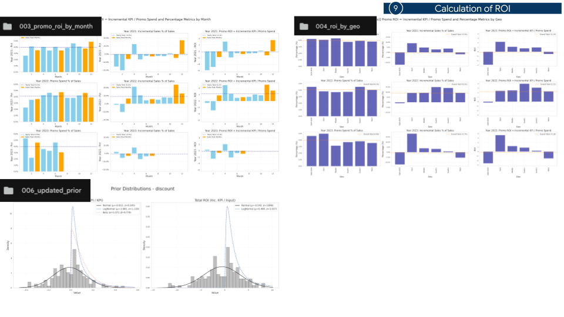

--------------------------------------------------------------------------------

## 8. Validate the result

| Parameter | Plain meaning | Typical value |
| :--- | :--- | :--- |
| `run_sensitivity` | run the omitted-variable-bias analysis on the best model | `True` |
| `sensitivity_scope` | `"total"`, plus `"geo"` and/or `"item"` for one row per entity | `["total"]`; `["total", "geo"]` when you act per region |

A DML estimate is only as good as three assumptions. Each has a symptom you
can look for in the outputs and a remedy:

| | Assumption | Symptom | Remedy |
| :--- | :--- | :--- | :--- |
| **A** | **Ignorability** — no unmeasured confounder | the robustness value is close to (or below) the benchmark covariate's strength | find and add the missing confounder; report the result as sensitive |
| **B** | **Homogeneity of the structure** — the relation between T, X and Y is similar across geos/items | an extreme incremental effect or ROI in one geo/item | split the data (one run per segment) or model the segment explicitly (dimension dummies in CATE) |
| **C** | **Positivity** — every context X has both treated and untreated rows | an exploding confidence band in rare contexts (an annual mega sale), a rare X | extend the period, add geo/item breakdowns, or exclude the context from the claims |

### A. Ignorability — the robustness value

With `run_sensitivity=True` the best model gets a Cinelli–Hazlett (2020)
analysis: `sensitivity_metrics.csv` reports, per scope, the **robustness
value** `RV` — the strength an unobserved confounder would need (partial R²
with both the treatment and the outcome) to bring the 95% lower bound of the
effect to zero — next to a **benchmark**: the partial R²s (`benchmark_cf_d`,
`benchmark_cf_y`) of the observed covariate most correlated with the
treatment. There is no absolute threshold; the comparison is the test:

*   `RV` well above the benchmark → an unobserved confounder would have to be
    much stronger than your strongest observed one; the conclusion is robust.
*   `RV` near or below the benchmark → a confounder as strong as one you
    already have could flip the sign. Look for it (Chapter 2) or qualify the
    result.

The `006_sensitivity` tab draws the contour plot; the formulas are in
[Sensitivity analysis details](advanced.md#sensitivity-analysis-details).

### B. Heterogeneity across geos and items

Plot the distribution of the row-level ROI (or incremental KPI) per geo from
`consolidated_1a_full_df.csv`:

```python
import matplotlib.pyplot as plt
import pandas as pd

df = pd.read_csv(
    "results/step4_consolidated_results/consolidated_1a_full_df.csv"
)
df.boxplot(column="roi_amount_based_discount", by="Geo", grid=False)
plt.axhline(0, color="red", linestyle="--", label="Break-even (ROI=0)")
plt.title("Heterogeneity of discount ROI by geography")
plt.suptitle("")
plt.legend()
plt.show()
```

In the skincare run one geo stood out: Delhi NCR's ROI was negative in every
week while the other five regions were near or above break-even.

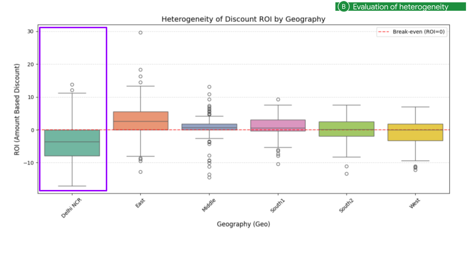

Such an outlier is a prompt, not a conclusion. Check whether the segment is
structurally different (different channel mix, different promotion
mechanics); if it is, estimate it separately or give the CATE a dimension
dummy. If a single geo also fails check C, the "heterogeneity" may just be a
positivity problem in disguise.

### C. Positivity — is the treatment spread across the covariates?

For each CATE covariate, look at the joint density of the treatment and the
covariate per geo. Dense regions are where the model has evidence; isolated
islands are contexts the data barely covers:

```python
import matplotlib.pyplot as plt
import pandas as pd

df = pd.read_csv("IN_skincare.csv")
geos = sorted(df["Geo"].unique())
fig, axes = plt.subplots(2, 3, figsize=(12, 7), sharex=True, sharey=True)
for ax, geo in zip(axes.ravel(), geos):
  part = df[df["Geo"] == geo]
  ax.hist2d(part["discount"], part["Seasonality"], bins=25, cmap="magma")
  ax.set_title(geo)
fig.suptitle("Density: Seasonality vs discount % by geo")
fig.supxlabel("Discount %")
fig.supylabel("Seasonality")
plt.show()
```

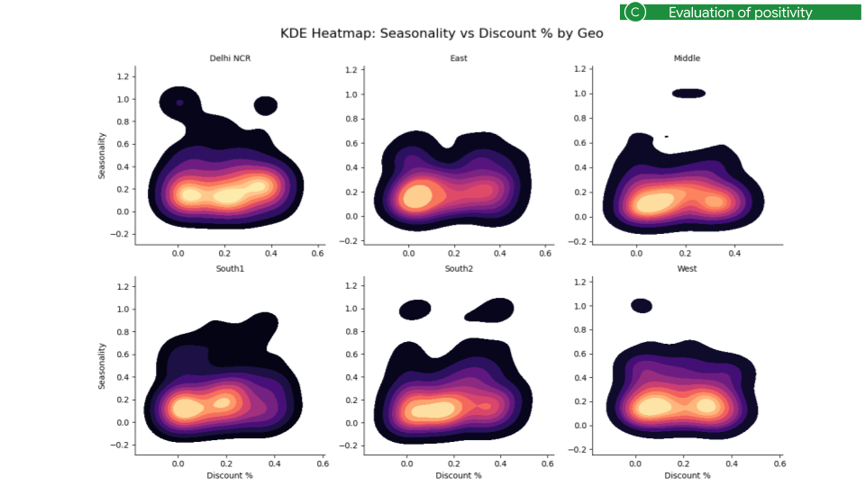

In the example the mass sits at `Seasonality ≤ 0.4`; the weeks near
`Seasonality ≈ 1.0` (the annual mega sales) are a handful of points per geo.
The consequence is visible in the per-geo time series: the confidence band
of Delhi NCR explodes in exactly those weeks (November/December 2021,
October/November 2022):

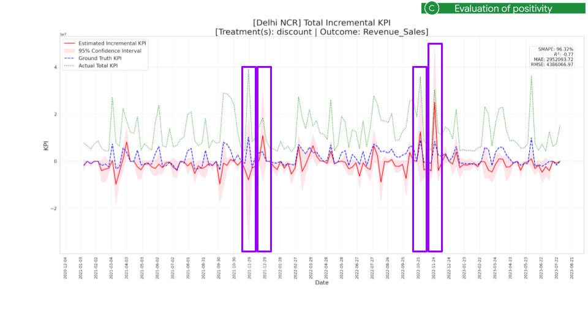

Remedies: more periods, more geos/items with the same context, a coarser CATE
(drop the covariate that singles out the rare context), or state explicitly
that the estimate does not cover those weeks.

> [!TIP]
> **Rule of thumb.** Before acting on a number: RV above the benchmark, no
> geo/item with an implausible effect, no context with a band ten times wider
> than the rest. One failed check is a reason to go back to Chapters 1–4,
> not to the slide deck.

--------------------------------------------------------------------------------

## 9. ROI and budget optimization

| Parameter | Plain meaning | Typical value | Change when |
| :--- | :--- | :--- | :--- |
| `treatment_types` | per treatment: `"spend"` (default), `"percentage"`, `"impressions"` or `"price"` | `{"discount_rate": "percentage"}` | always declare non-spend treatments |
| `treatment_spend_cols` | per non-spend treatment, the column with its monetary cost | `{"discount_rate": "discount_cost"}` | required for ROI and optimization of non-spend treatments |
| `sales_col` | the sales column used by the amount-based ROI | `"sales_revenue"` | usually `= y_col` |
| `optimize` | run the Phase 4 budget optimization | `False` | single treatment only |
| `simple_optimization` | `True`: cut spend where ROI is below the threshold; `False`: saturation-aware reallocation | `None` (derived: `False` when a saturation family is set) | see the table below |
| `opt_periods` | `(start, end)` window to optimize | `None` (whole range) | a planning horizon |
| `opt_threshold_roi` | minimum acceptable ROI `r` | `1.0` (default) | `0.0` for "cut only loss-making spend" |
| `opt_other_cost_variables` | other spend columns that receive the freed budget | `["tv_spend", "digital_spend"]` | — |
| `opt_geos`, `opt_items` | restrict the allocation units of the saturation-aware optimizer | `None` (all) | a regional plan |

### What "ROI" means for each treatment type

DML estimates `θ` = incremental KPI per unit of treatment. For spend that is
already money-on-money; for the other types it is not:

| `treatment_types` | `θ` means | With `treatment_spend_cols` + `sales_col` | ROI charts (`roi_output/`) |
| :--- | :--- | :--- | :--- |
| `"spend"` *(default)* | incremental sales per currency unit | not needed | not generated (the Phase 4 totals already are the ROI) |
| `"percentage"` | incremental sales per discount point | amount-based ROI = incremental sales ÷ discount cost | generated |
| `"impressions"` | incremental sales per impression | amount-based ROI = incremental sales ÷ media cost | generated |
| `"price"` | incremental sales per unit of price gap (`benchmark price − current price`) | amount-based ROI = incremental sales ÷ price investment | generated |

Non-spend treatments without the two mappings run, but skip the ROI output
and the optimization with a warning. A `percentage` treatment must hold values
in `[0, 1]`; `create_amount_from_pct` builds a cost column from a rate when
you do not have one. Details:
[Treatment types and ROI charts](advanced.md#treatment-types-and-roi-charts).

### The two optimizers

| `optimize` | `simple_optimization` | Saturation family | Behaviour |
| :--- | :--- | :--- | :--- |
| `True` | `True` | any | **Simple**: inside `opt_periods`, every row whose ROI is below `opt_threshold_roi` has its spend cut; the freed budget is reported as an increase of `opt_other_cost_variables`. |
| `True` | `False` *(derived when a family is set)* | required | **Saturation-aware**: reallocates the budget across rows along the fitted curves so that marginal ROIs equalize, subject to `ROI ≥ r` per unit ([details](saturation.md#saturation-aware-optimization)). |
| `True` | `False` (explicit) | none | `ValueError` at construction — a linear model has no interior optimum. |
| `True` | any | any, non-`spend` treatment | forced to the simple optimizer with a warning. |

Optimization is available for a **single treatment**; with several
treatments it is skipped with a warning (the ROI tables are still produced).
See [Optimization modes](advanced.md#optimization-modes).

The simple optimizer answers "which weeks and regions lose money at this
discount?" and is a deliberate business compromise, not an optimum:

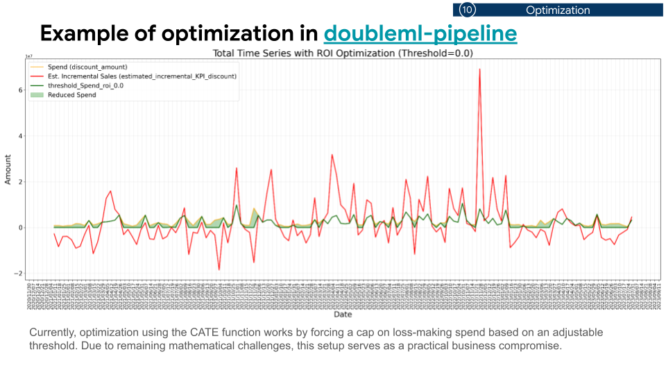

Its output, `graph/007_optimization/optimization_metrics.csv` (or
`roi_output/<treatment>/007_optimization/` for non-spend treatments), has one
row for all rows plus one per geo/item: the treatment cost in the window, the
optimized cost, the reduction, the total of the other cost variables and the
percentage by which they could grow — the last column is the hand-over to a
media mix model. `optimization_yearly_summary.csv` holds the yearly
before/after matrix shown in the HTML tab.

> [!TIP]
> **Rule of thumb.** Declare the treatment type honestly, keep
> `opt_threshold_roi` at the hurdle rate your finance team uses (the default
> `1.0` means "every unit of spend must at least pay for itself"), and read
> the optimizer's output as a reallocation *proposal* bounded by the data
> range it was fitted on.

--------------------------------------------------------------------------------

## 10. Checklist

Based on the simulation studies behind this guide. Items 1–6 are inputs;
A–C are checks on the outputs.

| # | Category | Checkpoint |
| :--- | :--- | :--- |
| 1 | Data granularity | Is the data kept at the geo and/or item level (sample size, cluster-robust inference, breakdowns)? Is the index unique and the date column clean? |
| 2 | Variable selection | Are exactly the variables that block the back-door paths included? Is every VIF ≤ 10? |
| 2 | Variable selection | Are mediators and post-treatment variables excluded? |
| 2 | Variable selection | Are the predictors narrowed down to the key ones? |
| 3 | Normalization | Does each column use the option that matches its nature (A–E)? Is a saturated treatment on a divisive option? |
| 4 | Covariates for CATE | Around 1–10 covariates, chosen because decisions depend on them? |
| 5 | CATE structure | Simple: degree 1–2, 0–1 knots, additive? |
| 6a | ML models | Several learners on both sides, compared by combined error? |
| 6b | Folds | `n_folds` around 4–10? |
| 6c | Time budget | At least 30 s per (treatment, learner) for the run you act on? |
| 6d | Cores | `n_jobs=-1` on a machine with several cores (no GPU needed)? |
| A | Ignorability | Is the robustness value comfortably above the benchmark? |
| B | Heterogeneity | Is the effect implausibly dispersed across geos or items? |
| C | Positivity | Is the treatment spread across the CATE covariates, with no exploding bands in rare contexts? |

--------------------------------------------------------------------------------

## Further reading

*   [Double Machine Learning in 10 minutes](concepts.md) — the ideas behind
    the parameters.
*   [Saturation DML](saturation.md) — Phase 0 and the saturation-aware
    optimizer.
*   [Advanced configuration & internals](advanced.md) — treatment types,
    optimization modes, cluster keys, hyperparameter policy, sensitivity
    formulas.
*   [API Reference](api_reference.md) and
    [Output CSV Schema](output_csv_schema.md).
*   [Slides](slides.md) — the original deck, one image per slide.
*   Chernozhukov, V. et al. (2018). *Double/debiased machine learning for
    treatment and structural parameters.* The Econometrics Journal.
*   Semenova, V. & Chernozhukov, V. (2021). *Debiased machine learning of
    conditional average treatment effects and other causal functions.* The
    Econometrics Journal.
*   Cinelli, C. & Hazlett, C. (2020). *Making sense of sensitivity: extending
    omitted variable bias.* JRSS-B.
